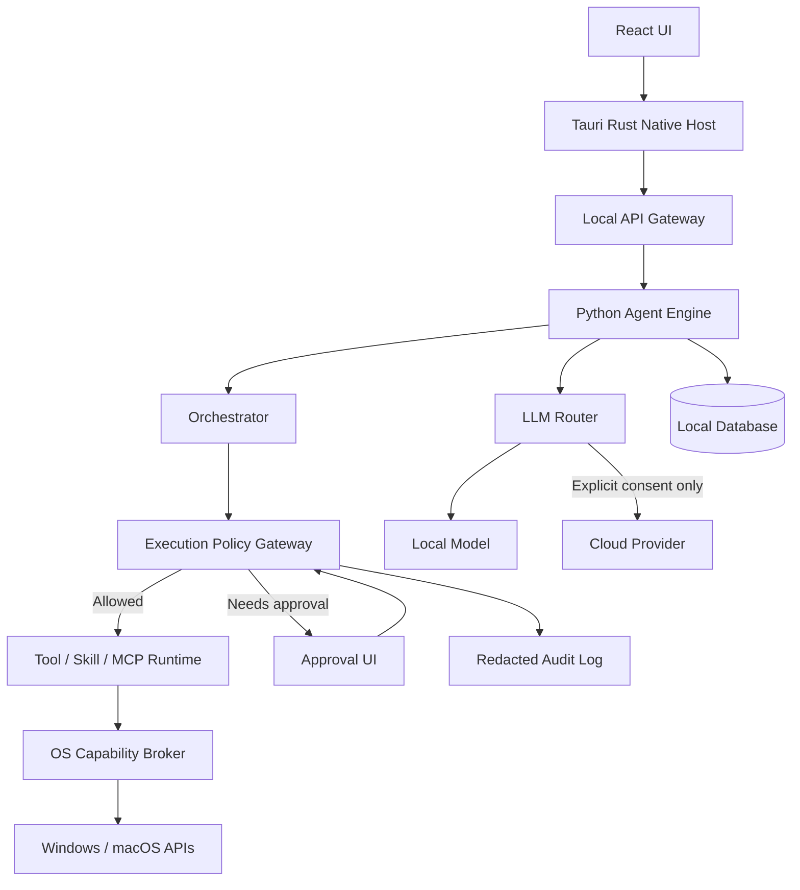

# AKSA — Enterprise Readiness Master Specification
## Master implementation plan, security baseline, OS integration, extensibility, QA, and release gates

| Metadata | Value |
|---|---|
| Product | AKSA Desktop AI Agent |
| Repository | `https://github.com/yogijowo/aksa` |
| Target platforms | Windows and macOS |
| Existing technology direction | Tauri v2 + Rust, React + TypeScript, Python FastAPI sidecar |
| Document type | Master technical specification and implementation backlog |
| Revision | 1.0 |
| Prepared | 17 November 2026 |
| Status | Implementation specification — not a certification or proof that the current build is release-ready |

> **Important:** Dokumen ini adalah spesifikasi kerja untuk membawa AKSA menuju standar aplikasi desktop enterprise. Dokumen ini tidak otomatis membuat aplikasi siap produksi. Status *Enterprise Ready* hanya boleh diberikan setelah seluruh release gate yang relevan di bagian akhir dipenuhi, pengujian dijalankan pada Windows dan macOS, temuan keamanan ditutup, dan artefak rilis diverifikasi.

---

# 1. Tujuan dan hasil akhir

AKSA harus menjadi desktop AI agent yang dapat membantu pengguna bekerja dengan aplikasi, file, dokumen, dan workflow lokal secara aman, dapat diaudit, dapat dikendalikan, serta dapat diperluas tanpa memberi akses sistem secara berlebihan.

Target akhirnya bukan sekadar aplikasi yang bisa menjalankan prompt. AKSA harus mempunyai:

1. **Security by default** — tidak ada akses file, aplikasi, kamera, mikrofon, layar, jaringan, atau eksekusi perintah yang diberikan secara diam-diam.
2. **Explicit user consent** — setiap kemampuan sensitif meminta persetujuan yang jelas, spesifik, dapat dicabut, dan sesuai mekanisme OS.
3. **Local-first dan privacy-preserving** — data tetap lokal kecuali pengguna memilih provider cloud dan menyetujui data yang akan dikirim.
4. **Reliable execution** — setiap tool memiliki validasi input, kebijakan risiko, timeout, pembatasan resource, hasil yang diverifikasi, dan audit event.
5. **Native OS integration** — deteksi aplikasi, pemilihan file/folder, screen capture, accessibility, dan pembukaan aplikasi menggunakan API yang sesuai dengan Windows atau macOS.
6. **Safe extensibility** — skill dan MCP server dari luar diperlakukan sebagai kode/instruksi yang tidak tepercaya sampai diverifikasi dan diberi izin.
7. **Maintainability** — arsitektur modular, migration database, automated tests, CI/CD, release signing, update verification, rollback, dokumentasi, dan support diagnostics.
8. **Enterprise operability** — konfigurasi terkelola, kebijakan keamanan, versi yang dapat dipantau, audit yang aman, paket instalasi bertanda tangan, dan proses penanganan insiden.

## 1.1 Prinsip yang tidak boleh dilanggar

- Deny by default; berikan izin minimum yang diperlukan.
- Tidak ada silent fallback dari model lokal ke model cloud.
- Tidak ada persetujuan global untuk tindakan yang berbeda-beda.
- Tidak ada eksekusi skill atau MCP hanya karena paket berhasil diunduh.
- Tidak ada pemilihan workspace otomatis yang memperluas izin.
- Tidak ada klaim aplikasi terpasang jika hanya berasal dari fallback atau contoh data.
- Tidak ada secret di source code, log, SQLite plaintext, crash report, atau telemetry.
- Tidak ada tombol UI yang menyatakan sukses sebelum backend memverifikasi hasil.
- Jangan menyamakan deteksi aplikasi, status permission OS, dan persetujuan AKSA.
- Jangan menganggap deskripsi tool, isi skill, halaman web, atau output model sebagai instruksi tepercaya.
- Setiap keputusan akses harus ditegakkan di backend/native layer, bukan hanya disembunyikan di UI.

---

# 2. Kondisi awal dan temuan audit yang menjadi dasar

Bagian ini merangkum temuan pada pemeriksaan statis repo publik `main` yang dilakukan pada 17 November 2026. Temuan harus diverifikasi kembali terhadap commit/branch yang benar sebelum perubahan dibuat.

| Prioritas | Area | Kondisi/risiko yang ditemukan | Hasil yang diwajibkan |
|---|---|---|---|
| P0 | Cloud fallback | Jalur provider dapat berpindah ke provider cloud ketika provider lokal tidak tersedia atau konfigurasi tidak lengkap. | Mode lokal tidak boleh mengirim data ke cloud dalam kondisi apa pun. |
| P0 | Attachment dokumen | Orchestrator dapat memilih PDF dari workspace secara otomatis dan mengirimkannya ke provider. | Tidak ada attachment otomatis; setiap pengiriman data sensitif harus disetujui. |
| P0 | Execution policy | Terdapat jalur override dan approval belum terikat kuat ke argumen/resource/sesi. | Satu policy gateway wajib menjadi gerbang seluruh tindakan. |
| P0 | Workspace | Ada fallback pemilihan workspace dan risiko izin baca/tulis dilonggarkan ketika workspace didaftarkan ulang. | Workspace harus dipilih eksplisit dan kebijakan tersimpan tidak boleh diperluas otomatis. |
| P0 | Secret storage | API key disimpan dalam JSON SQLite plaintext. | Secret disimpan pada OS credential vault; database hanya menyimpan reference. |
| P1 | Sidecar | Lifecycle sidecar, handshake, port, dan autentikasi perlu diverifikasi serta diperkuat. | Sidecar dikelola Tauri, loopback-only, port dinamis, authenticated handshake. |
| P1 | WebSocket | Validasi subscription perlu memastikan klien berhak atas session yang diminta. | Otorisasi per koneksi dan per session pada setiap subscribe/event. |
| P1 | App inventory | Fallback aplikasi contoh dapat membuat hasil deteksi palsu. | Hanya tampilkan hasil yang benar-benar ditemukan dan sertakan sumber/confidence. |
| P1 | Native permissions | Sebagian status permission belum berasal dari OS API/dialog yang sesungguhnya. | Permission broker memakai API native per platform. |
| P1 | Skills | Instalasi eksternal, validasi paket, izin, sandbox, dan integrasi runtime belum lengkap. | Secure skill supply chain dari karantina sampai eksekusi terisolasi. |
| P1 | MCP | Handshake/discovery/call belum memenuhi lifecycle protokol secara lengkap. | Implementasi MCP sesuai spesifikasi dan permission gateway. |
| P1 | Computer Use | Accessibility tree dan validasi hasil aksi belum memadai. | Native accessibility adapter dan post-action verification. |
| P1 | Tauri security | Capability, CSP, command exposure, dan shell scope perlu ditinjau menyeluruh. | Least-privilege capabilities dan command allowlist. |
| P2 | QA | Test suite yang diklaim belum membuktikan semua kontrol keamanan dan platform. | CI test matrix, security tests, E2E, dan release evidence. |
| P2 | Release | Signing, notarization, updater, SBOM, provenance, dan rollback perlu dipastikan. | Reproducible/repeatable release process dengan signed artifacts. |

## 2.1 Area kode yang perlu diperiksa terlebih dahulu

Nama/path berikut berasal dari audit sebelumnya. Konfirmasi kembali struktur repo sebelum mengedit karena file dapat berubah:

- `services/engine/app/core/orchestrator.py`
- `services/engine/app/core/llm_router.py`
- `services/engine/app/routes.py`
- `services/engine/app/core/tool_registry.py` atau modul registry terkait
- `services/engine/app/ws.py`
- `services/engine/app/core/config.py`
- `src-tauri/src/lib.rs`
- `src-tauri/src/sidecar.rs`
- `src-tauri/tauri.conf.json`
- `src-tauri/capabilities/`
- `package.json`
- `scripts/dev.py`
- modul app inventory, permission broker, skill manager, MCP client, dan Computer Use yang sudah ada.

**Instruksi:** jangan langsung menulis ulang modul besar. Petakan pemanggil, data model, API contract, tests, dan dependency terlebih dahulu. Buat perubahan kecil yang terukur dan backward-compatible jika memungkinkan.

---

# 3. Target architecture

## 3.1 Komponen dan tanggung jawab

| Komponen | Tanggung jawab | Batas keamanan |
|---|---|---|
| React UI | Chat, workspace picker, permission center, app inventory, skills catalog, approval dialog, settings, audit viewer. | UI tidak menjadi enforcement layer. |
| Tauri/Rust Native Host | Lifecycle aplikasi, sidecar process, native dialogs, OS permission adapters, app discovery, credential vault bridge, updater. | Hanya command yang secara eksplisit diizinkan; validasi setiap parameter. |
| Local API Gateway | Menghubungkan UI dan Python engine, autentikasi lokal, request limits, session binding. | Bind ke loopback saja; token per-run/per-install; tidak membuka LAN. |
| Python Agent Engine | Orchestration, LLM routing, RAG, tools, workflow, skill/MCP coordination. | Tidak boleh melewati Policy Gateway. |
| Execution Policy Gateway | Authorization, risk classification, approval, scope checks, audit, rate/timeout limits. | Semua tool/action wajib melewati gerbang ini. |
| OS Capability Broker | Mengakses file, aplikasi, screen, accessibility, automation sesuai permission OS. | Permission OS dan consent AKSA dicatat terpisah. |
| Workspace Service | Canonical path, access scopes, file metadata, read/write controls. | Tidak ada fallback workspace atau path traversal. |
| Skill Runtime | Memuat instruksi skill dan menjalankan script bila diizinkan. | Isolasi per skill; network/secrets disabled by default. |
| MCP Runtime | Lifecycle server, protocol handshake, discovery, tool invocation. | Server eksternal dianggap untrusted; izin per tool. |
| Persistence | SQLite/database lokal, migrations, audit metadata, user settings. | Secret tidak disimpan plaintext; backup sensitif dienkripsi. |
| Observability | Local logs, metrics, crash diagnostics, support bundle. | Redaction dan opt-in; tidak mengirim isi dokumen/prompt secara default. |

## 3.2 Diagram alur



## 3.3 Kontrak arsitektur

- Frontend tidak boleh memanggil tool execution secara langsung tanpa Policy Gateway.
- Rust Native Host adalah pemilik lifecycle sidecar dan OS integration.
- Python engine tidak boleh menganggap dirinya memiliki izin OS hanya karena API request diterima.
- Semua operasi yang mengubah state sistem harus memiliki `action_id` dan audit trail.
- Semua operasi cloud harus melewati `DataDisclosureGate`.
- Semua ekstensi harus melewati extension trust pipeline.
- Semua identifier session, workspace, approval, skill, MCP server, dan action harus divalidasi di server-side.
- Setiap service harus mempunyai timeout, cancellation, dan error contract yang jelas.

---

# 4. Enterprise security baseline

## 4.1 Threat model

Threat model minimum harus mencakup:

1. Prompt injection dari dokumen, PDF, web page, email, OCR, hasil pencarian, dan skill.
2. Malicious skill yang mencoba membaca file di luar workspace, mengambil secret, mengakses jaringan, atau menjalankan command.
3. MCP server berbahaya atau compromised.
4. Tool description yang menipu dan output tool yang memuat instruksi.
5. Local API diserang proses lain pada perangkat yang sama.
6. WebSocket session hijacking atau cross-session data leakage.
7. Path traversal, symlink/junction escape, ZIP Slip, archive bomb, dan file race/TOCTOU.
8. Command injection, argument injection, shell metacharacters, dan executable spoofing.
9. Data exfiltration melalui provider cloud, telemetry, logs, crash report, atau support bundle.
10. Credential theft, SQLite tampering, backup leakage, dan memory dump.
11. Update/package tampering dan dependency/supply-chain compromise.
12. Privilege escalation melalui UAC/sudo atau native command.
13. Screen capture atau accessibility automation tanpa consent.
14. Malicious content pada output model yang memicu aksi destruktif.

Buat dokumen `SECURITY.md` atau folder security docs yang memuat data-flow diagram, trust boundaries, threat scenarios, mitigations, residual risk, dan owner.

## 4.2 Risk classification untuk seluruh aksi

Gunakan kategori yang konsisten:

| Level | Contoh | Default policy |
|---|---|---|
| R0 — Read-only low | Menampilkan status AKSA, membaca metadata non-sensitif. | Boleh jika scope tersedia. |
| R1 — Read sensitive | Membaca dokumen pribadi, clipboard, email, data aplikasi. | Perlu scope eksplisit; disclosure sesuai klasifikasi data. |
| R2 — Reversible write | Membuat draft, file baru, mengubah workspace file dengan backup. | Preview/diff dan approval sesuai setting. |
| R3 — External side effect | Mengirim email, mengunggah file, mengirim pesan, membuat transaksi/booking. | Konfirmasi eksplisit per tindakan. |
| R4 — Destructive/privileged | Menghapus permanen, menjalankan executable, mengubah sistem, install software, elevasi admin. | Deny by default; konfirmasi kuat dan batasan khusus. |

Jangan hanya mengandalkan level dari model atau metadata skill. Server menghitung risiko dari jenis operasi, target, resource, scope, dan dampaknya.

## 4.3 Approval harus terikat pada tindakan yang tepat

Setiap approval minimal menyimpan:

- `approval_id`
- `action_id`
- `session_id`
- `user_id` atau local profile ID
- `tool_id`
- `tool_version`
- canonical JSON `arguments`
- `arguments_hash`
- `resource_ids` dan canonical resource paths
- `workspace_id`
- `risk_level`
- `data_classification`
- `requested_permissions`
- `created_at`, `expires_at`, `decided_at`
- `decision`: approved/denied/cancelled/expired
- `one_time`: true untuk tindakan sensitif
- `policy_version`
- `decision_reason`

Saat approval dipakai:

1. Hitung ulang hash argumen canonical.
2. Pastikan session dan workspace masih sama.
3. Pastikan target resource masih sama dan masih berada di scope.
4. Periksa permission OS terkini.
5. Periksa grant belum kedaluwarsa, dicabut, atau dipakai.
6. Pastikan tool/version tidak berubah.
7. Konsumsi approval secara atomik sebelum eksekusi.
8. Catat hasil dan verifikasi post-condition.

**Dilarang:** public request dapat mengirim `execution_policy_override`, `skip_approval`, `is_admin`, atau field lain untuk menurunkan risiko. Field semacam itu harus ditolak, bukan diabaikan diam-diam.

## 4.4 Workspace isolation

- Workspace hanya ditambahkan melalui native folder picker atau tindakan eksplisit pengguna.
- Default permission saat workspace baru dibuat: read-only atau no access sampai user memilih.
- Read, write, delete, execute, dan export adalah scope terpisah.
- Tidak ada `Path.cwd()` atau workspace pertama sebagai fallback.
- Canonicalize path sebelum setiap operasi.
- Cegah traversal (`..`), symlink/junction escape, alternate data streams, UNC/network paths jika tidak diizinkan, dan race condition.
- Validasi path kembali saat eksekusi, bukan hanya saat file dipilih.
- Jangan mengikuti symlink keluar dari root workspace kecuali pengguna memberi izin spesifik.
- File output harus dibuat dengan atomic write dan tidak menimpa file tanpa preview/approval.
- Hapus permission workspace saat user remove workspace.
- Sediakan tombol “Revoke all workspace access”.

## 4.5 Secret and credential management

**Wajib:**
- Windows: Windows Credential Manager / DPAPI melalui native secure storage.
- macOS: Keychain Services.
- SQLite hanya menyimpan `credential_ref`, provider, label, created/updated timestamp, dan metadata non-secret.
- Secret tidak pernah dikembalikan ke frontend setelah disimpan.
- Masking hanya untuk tampilan, bukan kontrol penyimpanan.
- Jangan menulis token/API key ke log, exception, telemetry, crash dump, command-line argument, atau environment yang dapat dibaca proses lain.
- Sediakan rotate, replace, test connection, revoke, dan delete.
- Migrasi secret plaintext harus satu kali, transactional, dan menghapus plaintext setelah vault berhasil diverifikasi.
- Jika migrasi gagal, jangan hapus data lama sebelum user diberi pesan aman; jangan log nilainya.
- Backup database tidak boleh menjadi salinan secret plaintext.

## 4.6 Local API, sidecar, dan WebSocket

- Bind hanya ke `127.0.0.1` atau `::1`; jangan bind ke `0.0.0.0`.
- Gunakan port ephemeral/dynamic; jangan mengandalkan port statis yang dapat dipakai proses lain.
- Tauri membuat secret handshake acak minimal 256-bit per app session dan mengirimkannya melalui channel aman ke sidecar.
- Sidecar memvalidasi token, origin/host, request size, rate, dan session binding.
- Token tidak boleh ditaruh di URL, log, atau browser localStorage.
- Tambahkan nonce/timestamp/replay protection untuk handshake bila desain protokol memerlukannya.
- WebSocket subscribe harus memeriksa hak akses terhadap session di server; jangan percaya `session_id` dari klien.
- Setiap event harus memiliki session owner dan audience yang tervalidasi.
- Koneksi tanpa subscription tidak boleh menerima event session.
- Terapkan message size limit, ping/pong timeout, connection cap, rate limit, dan cancellation.
- CORS allowlist hanya origin aplikasi yang benar-benar diperlukan. CORS bukan pengganti autentikasi.
- Production config harus eksplisit; jangan bergantung pada `dev_mode=True` sebagai default.

## 4.7 Tauri hardening

- Audit semua capability dan plugin permission.
- Pisahkan capability untuk main window, settings, permission dialog, dan privileged workflows bila perlu.
- Daftarkan hanya Tauri commands yang dibutuhkan oleh window terkait.
- Jangan mengaktifkan remote origin kecuali ada kebutuhan dan threat model.
- Shell plugin: command allowlist, argument validation, working-directory scope, environment allowlist, timeout, output cap.
- Hindari `sh -c`, `cmd /c`, PowerShell dynamic command, dan string command composition.
- CSP harus aktif dan sesempit mungkin; hindari `unsafe-eval` dan wildcard.
- Review navigation, deep links, external URLs, file protocol, and WebView exposure.
- Jangan mengekspos Rust command sensitif ke seluruh window secara default.
- Jangan menganggap Tauri capability menggantikan validasi di Rust/Python.

---

# 5. OS integration: application discovery and permission broker

## 5.1 Application inventory: model data

Setiap aplikasi yang terdeteksi minimal mempunyai:

```json
{
  "app_id": "stable-platform-specific-id",
  "display_name": "Application Name",
  "platform": "windows | macos",
  "bundle_id": null,
  "aumid": null,
  "executable_path": null,
  "bundle_path": null,
  "version": null,
  "publisher": null,
  "signature_status": "valid | invalid | unsigned | unknown",
  "install_source": "registry | start_menu | package_manager | launch_services | application_directory | user_import",
  "detection_status": "installed | running | portable | unavailable",
  "launch_status": "launchable | not_launchable | unknown",
  "automation_status": "supported | permission_required | unsupported | unknown",
  "last_seen_at": "ISO-8601",
  "confidence": 0.0
}
```

Field yang tidak tersedia harus `null`, bukan diisi tebakan. Jangan gunakan daftar aplikasi hardcoded sebagai hasil scan. Daftar rekomendasi boleh ada, tetapi harus dipisahkan dari “Installed applications”.

## 5.2 Windows discovery

Gunakan beberapa sumber yang sesuai:

- Registry uninstall keys pada HKLM/HKCU, termasuk registry view 32-bit dan 64-bit.
- Start Menu shortcuts dan AppUserModelID untuk aplikasi yang dapat diluncurkan.
- Packaged/MSIX apps melalui API Windows yang sesuai.
- Running processes sebagai informasi aplikasi yang sedang berjalan, bukan bukti instalasi permanen.
- Portable applications hanya jika pengguna memilih folder atau menambahkan aplikasi manual.

Ketentuan:
- Hindari `Win32_Product` karena dapat memicu consistency check MSI dan lambat.
- Jangan mengeksekusi aplikasi hanya untuk menguji keberadaannya.
- Validasi executable path, publisher/signature bila tersedia, dan file existence.
- `InstallLocation` kosong tidak boleh membuat launcher melaporkan sukses.
- Bedakan “detected”, “installed”, “running”, “launchable”, dan “automatable”.
- Jangan meminta UAC hanya untuk discovery atau membuka aplikasi biasa.
- Jangan menaikkan privilege secara otomatis.

## 5.3 macOS discovery

Gunakan:
- Launch Services / NSWorkspace untuk menemukan aplikasi dan aplikasi yang sedang berjalan.
- `/Applications`, `/System/Applications`, dan `~/Applications` sebagai sumber tambahan.
- Bundle identifier, bundle URL, version, signing identity, dan quarantine metadata jika tersedia.
- App yang berjalan tidak otomatis dianggap dapat diotomasi.

Ketentuan:
- Jangan memindai seluruh disk secara default.
- Jangan menghapus quarantine attribute atau melewati Gatekeeper.
- Jangan mengubah TCC database.
- Jangan meminta Full Disk Access hanya demi inventory aplikasi.
- Gunakan native APIs untuk membuka aplikasi, bukan shell command string.

## 5.4 Permission broker: dua lapisan persetujuan

Simpan status berikut secara terpisah:

**A. OS permission state**
- `NOT_REQUESTED`
- `CHECKING`
- `GRANTED`
- `DENIED`
- `RESTRICTED`
- `NEEDS_USER_ACTION`
- `UNSUPPORTED`
- `ERROR`

**B. AKSA consent state**
- `NOT_GRANTED`
- `GRANTED_SCOPED`
- `DENIED`
- `REVOKED`
- `EXPIRED`

Permission tidak boleh disimpulkan dari status lain. Contoh: user mengizinkan AKSA mengakses folder tidak berarti macOS Accessibility permission sudah granted.

## 5.5 Permission catalog minimum

| Capability | Windows | macOS | Default |
|---|---|---|---|
| Read selected file | Native file picker + ACL | NSOpenPanel + security-scoped bookmark | Per file/folder selection |
| Write selected folder | Folder picker + ACL | NSOpenPanel + security-scoped bookmark | Per folder |
| Screen capture | Windows.Graphics.Capture consent picker/API | Screen Recording/TCC status dan arahan System Settings sesuai API OS | Off |
| Accessibility/UI automation | UI Automation; akses sesuai user/session dan kebijakan OS | Accessibility trust/TCC; arahkan user ke pengaturan OS bila dibutuhkan | Off |
| Control target app | Per-app UIA capability/policy | Accessibility/Apple Events TCC per target app | Per application |
| Microphone | Windows privacy permission/API | AVFoundation authorization | Off |
| Camera | Windows privacy permission/API | AVFoundation authorization | Off |
| Notifications | Windows notification support | User notification authorization | Off |
| Launch application | ShellExecute/CreateProcess melalui allowlisted native API | NSWorkspace openApplication | User action/policy |
| Elevation | UAC hanya untuk operasi admin yang benar-benar diperlukan | Authorization Services/sudo flow yang sesuai; jangan simpan password | Per action, deny by default |

**Penting:** Windows UI Automation bukan permission dialog generik. UAC bukan dialog untuk semua permission. macOS Screen Recording tidak boleh dipalsukan dengan dialog buatan AKSA; gunakan status/API OS dan arahkan ke System Settings ketika OS mensyaratkannya. Gunakan native picker/API yang disediakan platform.

## 5.6 Permission UX

Sebelum meminta izin, tampilkan:

- Nama kemampuan.
- Tujuan spesifik.
- Aplikasi/folder/resource yang akan diakses.
- Jenis operasi: read/write/execute/capture/control.
- Apakah data akan dikirim ke cloud.
- Durasi dan ruang lingkup.
- Dampak jika ditolak.
- Tombol Allow once / Allow for this workspace / Deny.
- Link ke OS settings bila izin dikelola OS.

Sediakan **Permission Center** untuk:
- melihat status OS dan AKSA,
- melihat alasan izin diminta,
- mengubah/revoke izin,
- membuka pengaturan OS,
- melihat penggunaan terakhir,
- menampilkan permission yang tidak lagi digunakan.

Jangan membuat status `GRANTED` hanya karena UI dialog AKSA ditutup atau user pernah memberi izin lain.

---

# 6. LLM, data privacy, dan RAG

## 6.1 Mode provider

Sediakan mode yang eksplisit:

1. **Local-only** — hanya provider lokal yang diizinkan. Jika offline/model hilang, tampilkan error. Tidak boleh fallback ke cloud.
2. **Cloud by choice** — provider cloud dipilih pengguna dan data disclosure ditampilkan sebelum pengiriman sensitif.
3. **Hybrid with consent** — tiap request ditentukan berdasarkan kebijakan dan klasifikasi data. Tidak ada silent routing.
4. **Enterprise managed** — administrator dapat membatasi provider, model, region, dan data class yang boleh keluar.

Mode harus terlihat pada UI, settings, dan request context.

## 6.2 Data disclosure gate

Sebelum data dikirim ke provider eksternal, tampilkan ringkasan:

- Provider dan model.
- Jenis data: prompt, nama file, isi dokumen, gambar, OCR, metadata, hasil RAG.
- Dokumen/resource yang dilampirkan.
- Tujuan pengiriman.
- Informasi retensi/processing provider sesuai dokumentasi dan konfigurasi.
- Opsi redaksi.
- Tombol approve once / cancel.

Jangan otomatis melampirkan PDF atau seluruh dokumen workspace. User harus memilih file atau mengaktifkan kebijakan yang spesifik.

## 6.3 Data classification

Gunakan minimal:
- `PUBLIC`
- `INTERNAL`
- `CONFIDENTIAL`
- `RESTRICTED`

Aturan awal:
- `PUBLIC`: dapat diproses sesuai provider policy.
- `INTERNAL`: local-first; cloud hanya jika organisasi/user mengizinkan.
- `CONFIDENTIAL`: local-only secara default; cloud memerlukan konfirmasi tambahan.
- `RESTRICTED`: blokir cloud dan integrasi eksternal secara default.

Klasifikasi tidak boleh hanya bergantung pada LLM. Terapkan rules, file labels, user selection, workspace policy, dan metadata.

## 6.4 RAG controls

- Chunking dan retrieval harus menyimpan provenance: file ID, path scope, page, chunk ID, timestamp, hash.
- Retrieval hanya dari workspace yang diizinkan untuk session itu.
- Jangan memasukkan konten workspace lain ke prompt.
- File yang berubah harus di-reindex berdasarkan hash.
- Hapus index saat file/workspace dicabut sesuai retention policy.
- Prompt injection dalam dokumen harus diperlakukan sebagai konten, bukan instruksi.
- Batasi ukuran dokumen, jumlah chunk, token, dan waktu parsing.
- PDF parser, OCR, Office parser harus berjalan dengan batas resource dan tanpa macro execution.
- Audit log cukup menyimpan metadata, bukan isi dokumen.
- Sediakan “show sources” dan “why this source” pada jawaban RAG.

---

# 7. External Agent Skills: secure install and execution

## 7.1 Prinsip

Format `SKILL.md` dapat digunakan sebagai format interoperable, tetapi kompatibilitas format tidak sama dengan kepercayaan. Skill eksternal adalah instruksi tidak tepercaya; script, binary, dependency, dan referensinya dapat membawa risiko.

Sumber kandidat dapat mencakup:
- katalog internal AKSA yang dikurasi,
- repository resmi Agent Skills,
- repository publisher yang telah diverifikasi,
- Git repository publik,
- ZIP yang dipilih user,
- folder lokal yang dipilih user.

Tidak boleh ada source yang otomatis dipercaya hanya karena populer atau berada di GitHub.

## 7.2 Skill manifest

Gunakan manifest AKSA terpisah dari `SKILL.md`, misalnya:

```yaml
schema_version: 1
id: example.publisher.skill-name
name: Example Skill
version: 1.0.0
description: Short purpose statement
publisher:
  name: Example Publisher
  source_url: https://example.com/repository
  verified: false
entrypoint:
  instruction_file: SKILL.md
  scripts: []
capabilities:
  filesystem:
    read: []
    write: []
  network:
    enabled: false
    hosts: []
  applications: []
  shell:
    enabled: false
  secrets:
    access: false
resources:
  max_execution_seconds: 30
  max_memory_mb: 256
  max_output_bytes: 1048576
integrity:
  archive_sha256: ""
  source_commit: ""
  signature: null
```

Manifest adalah deklarasi permintaan izin, bukan bukti bahwa skill aman.

## 7.3 Secure installation pipeline

1. Download/copy ke quarantine directory.
2. Validasi source URL, redirect, HTTPS, ukuran, content type, dan archive type.
3. Hitung SHA-256; simpan immutable artifact.
4. Validasi ZIP/TAR path: cegah `../`, absolute path, symlink escape, duplicate paths, case collision, dan archive bomb.
5. Batasi jumlah file, total uncompressed bytes, compression ratio, nesting, dan file size.
6. Parse `SKILL.md` dengan parser yang aman; tolak format malformed.
7. Inspeksi scripts, binaries, dependency manifests, install hooks, network endpoints, obfuscated payloads, dan shell usage.
8. Jalankan static scanners; hasil scanner bukan jaminan aman.
9. Buat permission preview dari manifest dan hasil analisis.
10. Minta user approval untuk capability yang diminta.
11. Install ke direktori immutable per `skill_id/version/hash`.
12. Default status `DISABLED`; user harus mengaktifkan secara eksplisit.
13. Jalankan dalam sandbox dengan scope minimal.
14. Catat source, version, hash, approval, permissions, dan last-used.
15. Update harus menampilkan diff, perubahan permission, publisher, dan hash baru.
16. Uninstall mencabut seluruh grant skill dan membersihkan file runtime/cache sesuai kebijakan.

**Jangan pernah:** menjalankan script pada saat instalasi, menjalankan `postinstall` dari paket, memasang dependency tanpa approval, atau memberi skill akses semua folder dan semua secret.

## 7.4 Skill runtime isolation

- Skill instruction dibaca sebagai untrusted context.
- Script hanya berjalan melalui isolated runner.
- Tidak ada akses network secara default.
- Tidak ada secret access secara default.
- Filesystem read/write hanya ke resource yang diizinkan.
- Per-skill timeout, CPU, memory, output, process count, dan file size limit.
- Environment variables dibersihkan dan di-allowlist.
- Executable dan dependency harus pinned/versioned.
- Jangan menjalankan script dengan hak administrator.
- Jika OS tidak menyediakan sandbox yang memadai, tandai kemampuan script sebagai unsupported/unsafe dan jangan aktifkan secara default.
- Skill tidak dapat memberi izin kepada dirinya sendiri.
- Model tidak boleh menyetujui izin atas nama user.

## 7.5 Skill lifecycle/status

`DISCOVERED → QUARANTINED → SCANNING → REVIEW_REQUIRED → APPROVED → INSTALLED_DISABLED → ENABLED → DISABLED → REVOKED/UNINSTALLED`

Setiap transisi harus punya audit event dan alasan. Scanner error, timeout, atau hasil tidak pasti harus fail closed.

---

# 8. MCP runtime

MCP dan Agent Skills adalah dua jenis ekstensi berbeda. Jangan menggabungkan instalasi skill dengan instalasi server MCP.

## 8.1 MCP lifecycle minimum

1. User menambahkan server dari sumber yang jelas.
2. AKSA menampilkan publisher/source, transport, command/args atau URL, permissions, dan risk.
3. Validasi executable, signature, pinned version, environment, dan network destination.
4. Server berjalan dalam isolated process/container jika memungkinkan.
5. Lakukan `initialize` dan tunggu response yang valid.
6. Negosiasikan protocol version dan capabilities.
7. Proses `notifications/initialized` sesuai spesifikasi.
8. Lakukan `tools/list` dan validasi schema.
9. Tampilkan daftar tool dan permission per tool.
10. Sebelum `tools/call`, jalankan Policy Gateway.
11. Validasi result, size, timeout, content type, dan resource.
12. Handle cancellation, server exit, protocol error, reconnect, dan shutdown.
13. Catat audit metadata.

## 8.2 MCP security

- Semua server eksternal dianggap untrusted.
- Jangan aktifkan default servers secara otomatis.
- Hindari `npx -y`, `uvx`, atau dynamic package install tanpa pinned package/version dan review.
- Jangan mewariskan seluruh environment process.
- Jangan meneruskan API key AKSA ke MCP server.
- Network egress deny by default; allowlist host/port.
- Stdio server tetap dapat menjalankan arbitrary code; isolasi proses.
- Tool annotations/descriptions bukan policy.
- Tool output adalah untrusted data dan tidak boleh mengubah policy.
- User harus menyetujui akses data dan pemanggilan tool sesuai risk.
- Untuk remote MCP, gunakan HTTPS dan mekanisme authorization sesuai spesifikasi; simpan token di OS credential vault.
- Terapkan OAuth/PKCE jika diwajibkan oleh transport/server flow.
- Revoke server harus memutus process, token, permission grants, dan cache.

---

# 9. Computer Use and application automation

## 9.1 Adapter architecture

Jangan membuat satu implementasi automation generik yang menganggap semua OS sama. Buat interface adapter dan implementasi platform:

```text
ComputerUseAdapter
├── WindowsComputerUseAdapter
│   ├── UI Automation
│   ├── Windows Graphics Capture
│   ├── Native input APIs
│   └── App/window discovery
└── MacOSComputerUseAdapter
    ├── Accessibility API
    ├── ScreenCaptureKit / supported capture APIs
    ├── CoreGraphics / supported input APIs
    └── NSWorkspace / app discovery
```

Interface harus melaporkan kemampuan yang benar-benar tersedia, bukan menjanjikan fitur yang belum didukung.

## 9.2 Action contract

Setiap action minimal memiliki:

- action type enum yang eksplisit,
- target application/window identifier,
- target element identifier atau coordinate,
- arguments yang tervalidasi,
- precondition,
- expected postcondition,
- timeout,
- cancellation token,
- approval requirement,
- result status,
- evidence/verification metadata.

Action type harus allowlist, misalnya:
- `get_active_window`
- `capture_screen`
- `find_element`
- `click_element`
- `type_text`
- `press_key`
- `scroll`
- `launch_application`

Unknown action harus `REJECTED`, bukan sukses kosong.

## 9.3 Safety

- Tampilkan aplikasi/window target sebelum aksi sensitif.
- Jangan mengambil screenshot secara terus-menerus tanpa user consent.
- Redact password fields, secure desktop, sensitive windows bila memungkinkan.
- Jangan membaca password manager, credential dialog, atau secure fields.
- Untuk destructive action, tampilkan preview dan minta approval.
- Setelah klik/ketik, verifikasi postcondition; jangan hanya menganggap API input berhasil berarti tugas selesai.
- Sediakan emergency stop global.
- Jangan mengotomasi aplikasi yang tidak didukung tanpa menjelaskan keterbatasannya.
- Simpan bukti aksi hanya jika user mengaktifkan audit visual; default jangan menyimpan screenshot.

---

# 10. API contracts and data model

## 10.1 API design rules

- Semua endpoint mempunyai schema request/response versioned.
- Gunakan Pydantic validation dan strict types pada Python.
- Reject unknown privileged fields.
- Error response konsisten: `code`, `message`, `request_id`, `retryable`, `details_safe`.
- Jangan kembalikan stack trace atau secret ke UI.
- Terapkan request size limit, rate limit, timeout, pagination, dan idempotency untuk operasi yang dapat mengubah state.
- Semua mutation memiliki audit event.
- Semua API internal tetap membutuhkan autentikasi lokal.
- API sensitif harus memeriksa authorization di server-side.

## 10.2 Domain model minimum

Tabel/aggregate yang perlu dipastikan ada dan bermigrasi dengan migration system:

- `app_profiles`
- `detected_applications`
- `workspaces`
- `workspace_permissions`
- `os_permission_states`
- `consent_grants`
- `approval_requests`
- `execution_actions`
- `execution_audit_events`
- `credentials_metadata`
- `provider_configs`
- `skills`
- `skill_versions`
- `skill_permissions`
- `skill_install_scans`
- `mcp_servers`
- `mcp_server_versions`
- `mcp_tools`
- `mcp_permissions`
- `sessions`
- `session_subscriptions`
- `settings`
- `schema_migrations`

Nama final boleh mengikuti konvensi existing project. Hindari membuat tabel duplikat sebelum memeriksa schema sekarang.

## 10.3 Data integrity

- Foreign keys aktif.
- Unique constraints untuk stable IDs dan version/hash.
- Transaction untuk approval consume, migration, install state transition, dan permission revoke.
- WAL mode bila cocok dengan pola concurrency.
- Backup sebelum migration destructive.
- Migration memiliki `up` dan rollback/recovery plan bila memungkinkan.
- Jangan menyimpan file content di DB kecuali ada alasan kuat; simpan metadata, hash, dan scoped path.
- Jangan menganggap SQLite cocok untuk multi-user shared database. Jika kelak ada centralized enterprise service, desain service/database terpisah.

---

# 11. Reliability, performance, and resource management

Target angka berikut adalah **initial engineering targets**, bukan klaim hasil benchmark. Ukur pada reference hardware dan revisi berdasarkan data.

| Area | Target awal |
|---|---|
| UI launch | Main window usable dalam 3–5 detik pada reference device. |
| Sidecar readiness | Ready dalam 5–10 detik; tampilkan progress jika lebih lama. |
| API local | P95 di bawah 300 ms untuk operasi metadata lokal sederhana. |
| UI interaction | Tidak ada blocking main thread untuk operasi filesystem/LLM/automation. |
| Cancellation | User dapat membatalkan task yang sedang berjalan dan proses anak dihentikan. |
| Resource limits | Batas memory/CPU/file size/process count untuk parser dan extension runner. |
| Crash recovery | App dapat start kembali dan menandai task interrupted tanpa mengulang side effect secara otomatis. |
| Database | Transactional migration, backup/restore verification, corruption handling. |

## 11.1 Failure handling

- Retry hanya untuk operasi idempotent atau yang memiliki idempotency key.
- Jangan retry otomatis untuk send email, delete file, submit form, purchase, atau external side effect tanpa status reconciliation.
- Bedakan timeout, cancellation, permission denied, unsupported, provider unavailable, validation error, dan internal error.
- Setiap task mempunyai state: queued, running, waiting_approval, succeeded, failed, cancelled, interrupted.
- Saat aplikasi ditutup, lakukan graceful shutdown dan persist task state.
- Setelah restart, jangan otomatis mengulang aksi eksternal yang statusnya tidak diketahui.
- Sediakan health checks untuk engine, DB, local model, dan extension runtime.

---

# 12. Frontend product requirements

## 12.1 Navigation minimum

- Chat / Workspace
- Applications
- Permissions
- Skills
- MCP Integrations
- Activity / Audit
- Providers & Models
- Settings
- Diagnostics / About

## 12.2 Application Center

Setiap aplikasi yang terdeteksi menampilkan:
- nama, icon, version, publisher/signature bila tersedia,
- status installed/running/launchable/automation-supported,
- source deteksi dan waktu terakhir scan,
- tombol Open,
- tombol Configure automation bila didukung,
- status permission yang relevan.

Tidak boleh menampilkan “Installed” untuk data rekomendasi/fallback.

## 12.3 Approval dialog

Dialog harus menunjukkan:
- aksi yang akan dilakukan dalam bahasa manusia,
- target/resource,
- perubahan yang akan terjadi,
- data yang akan dibaca/dikirim,
- provider tujuan bila ada,
- risk level,
- permission yang diperlukan,
- apakah tindakan dapat dibatalkan,
- tombol Approve once / Deny / Cancel.

Jangan gunakan tombol ambigu seperti “Continue” untuk tindakan destruktif.

## 12.4 Activity center

Tampilkan:
- waktu,
- task/action,
- aplikasi/tool/skill/MCP server,
- resource yang diakses (path disamarkan sesuai kebijakan),
- keputusan approval,
- status,
- alasan gagal,
- tombol revoke/stop bila masih berjalan.

Audit viewer tidak boleh menampilkan API key, isi dokumen rahasia, password, atau raw prompt sensitif secara default.

## 12.5 Accessibility and usability

- Keyboard navigation.
- Focus management untuk modal/approval.
- Screen reader labels.
- Contrast dan scalable text.
- Clear permission denied states.
- Loading/progress/cancel state.
- Empty/error states yang informatif.
- Localization minimal Bahasa Indonesia dan English jika produk menargetkan pengguna internasional.
- Jangan menampilkan status “connected” sebelum handshake benar-benar selesai.

---

# 13. Observability, privacy, and diagnostics

## 13.1 Structured logging

Gunakan structured logs dengan:
- timestamp,
- level,
- component,
- request_id,
- session_id pseudonymous,
- action_id,
- error_code,
- duration_ms,
- platform/app version.

Redact:
- prompt dan document body,
- API keys/OAuth tokens,
- passwords,
- clipboard,
- file contents,
- screen images,
- personal identifiers yang tidak dibutuhkan.

Default logs disimpan lokal dan memiliki retention limit.

## 13.2 Audit log vs debug log

Pisahkan:
- **Audit log:** siapa/apa/kapan/ke resource mana/approval/result; append-only secara logis.
- **Debug log:** detail teknis yang dapat diaktifkan user, tetap melalui redaction.

Jangan menyimpan konten sensitif di audit log. Audit log bukan tempat menyimpan transcript chat.

## 13.3 Support bundle

Sediakan export diagnostics yang:
- default menghapus secret dan isi dokumen,
- menampilkan versi aplikasi, OS, component health, redacted logs, migration version,
- meminta user melihat isi bundle sebelum export,
- tidak mengirim bundle otomatis,
- memiliki ukuran dan retention limit.

## 13.4 Telemetry

- Telemetry opt-in dan dapat dimatikan.
- Tidak mengirim prompt, document content, filenames, screen capture, clipboard, credentials, atau raw tool output.
- Jelaskan event yang dikirim, tujuan, retention, dan endpoint.
- Jika telemetry tidak tersedia, jangan mengklaim “zero telemetry” secara absolut tanpa verifikasi seluruh dependency dan updater.

---

# 14. Testing and quality engineering

## 14.1 Test pyramid

### Unit tests
- Risk classification.
- Canonical argument hashing.
- Approval expiration/consumption/revocation.
- Workspace canonicalization/path escape.
- Credential migration.
- Provider routing.
- Data classification.
- Skill manifest parsing.
- Archive validation.
- MCP protocol state machine.
- Permission state transitions.
- Action result verification.

### Integration tests
- Tauri ↔ sidecar handshake.
- Python API auth.
- SQLite migrations.
- Windows Credential Manager / macOS Keychain adapters (mock + platform tests).
- OS app discovery adapters.
- File picker/bookmark/ACL flow.
- Workspace permission enforcement.
- WebSocket session isolation.
- LLM local-only mode with cloud network blocked.
- Skill quarantine → scan → approval → install → disable/revoke.
- MCP initialize → list → call → shutdown.

### E2E tests
- Fresh install.
- First launch and onboarding.
- Detect applications.
- Add workspace via native picker.
- Deny and grant permission.
- Run local model task.
- Attempt cloud task while local-only.
- Approve and deny tool action.
- Install safe sample skill.
- Reject malicious ZIP.
- Add disabled MCP server and inspect tools.
- Revoke permission and verify action fails.
- Upgrade from previous version.
- Uninstall and verify data handling.

### Security/adversarial tests
- Path traversal and symlink escape.
- ZIP Slip and zip bomb.
- Malicious `SKILL.md` prompt injection.
- Script trying to read secret files.
- Script trying network egress.
- MCP server returning malicious tool descriptions.
- Cross-session WebSocket subscription.
- Invalid/expired/replayed approval.
- Changed arguments after approval.
- Local API request without token.
- Host/Origin spoofing.
- Oversized request and decompression bomb.
- Command injection payloads.
- Provider fallback network interception.
- Log/diagnostic secret leakage.
- Updater invalid signature.
- Dependency tampering.

## 14.2 Platform test matrix

| Test target | Windows | macOS |
|---|---:|---:|
| Build release | Required | Required |
| Fresh install | Required | Required |
| Upgrade from previous supported release | Required | Required |
| App inventory | Required | Required |
| Native file/folder picker | Required | Required |
| Permission denied/granted/revoked | Required | Required |
| Credential vault | Required | Required |
| Screen capture consent | Required | Required |
| Accessibility automation | Required | Required |
| Sidecar lifecycle | Required | Required |
| App launch | Required | Required |
| Uninstall/data cleanup | Required | Required |
| Signed updater | Required | Required |

Uji setidaknya pada versi OS yang secara resmi didukung. Jangan menyatakan dukungan untuk versi OS yang belum diuji.

## 14.3 Coverage and quality gates

Coverage bukan satu-satunya indikator kualitas. Tetapkan baseline awal:
- Core policy, permission, workspace, credential, and provider routing: target line/branch coverage tinggi (misalnya 90% untuk modul policy kritis).
- Seluruh security regression tests harus lulus.
- Tidak ada test yang di-skip tanpa issue/owner/reason.
- Tidak ada flaky test kritis yang diketahui pada release branch.
- Semua bug P0/P1 harus ditutup atau memiliki risk acceptance tertulis dari pemilik produk dan security reviewer.
- Laporan test harus menyebut commit SHA, OS, runtime version, dan command yang dijalankan.

---

# 15. CI/CD and software supply-chain security

## 15.1 CI checks per pull request

1. Formatting:
   - Prettier/ESLint/TypeScript checks.
   - `cargo fmt --check`.
   - `cargo clippy` dengan warnings yang relevan.
   - Python formatter/linter/type checks sesuai konfigurasi project.
2. Tests:
   - frontend unit tests,
   - Rust unit tests,
   - Python unit/integration tests,
   - schema/migration tests,
   - security regression tests.
3. Dependency/security:
   - npm audit atau scanner yang setara,
   - `cargo audit`/dependency review,
   - `pip-audit` atau scanner setara,
   - secret scanning,
   - SAST,
   - license policy check.
4. Build:
   - Windows build,
   - macOS build.
5. Artifact:
   - SBOM,
   - build metadata,
   - checksums.

Versi tool dan dependency harus dipin/lock. Jangan memasang dependency terbaru secara dinamis pada release build.

## 15.2 Release pipeline

- Build hanya dari protected release tag/commit.
- Gunakan isolated CI runners.
- Lindungi signing secrets dengan CI secret store dan least privilege.
- Windows installer ditandatangani dengan code-signing certificate.
- macOS app ditandatangani dan dinotarized sesuai distribusi yang dipilih.
- Tauri updater harus memverifikasi signature dan manifest.
- Generate SBOM untuk setiap release.
- Simpan checksum dan provenance/build metadata.
- Upload artifact setelah verifikasi.
- Lakukan smoke test terhadap installer yang sudah ditandatangani, bukan hanya hasil build lokal.
- Jangan publish jika signature verification gagal.
- Siapkan rollback/disable update channel bila release bermasalah.

## 15.3 Dependency policy

- Lockfile wajib dan harus masuk version control.
- Pin action versions di CI.
- Review package yang menjalankan install scripts.
- Hindari dependency yang tidak terawat atau tidak jelas publisher-nya.
- Tetapkan proses vulnerability triage dan SLA patch.
- Simpan daftar third-party licenses.
- Jangan memasukkan binary tidak terverifikasi ke repo.
- Build harus dapat direproduksi sejauh toolchain memungkinkan; jika belum reproducible, dokumentasikan variasi yang tersisa.

---

# 16. Installer, updater, migration, and enterprise deployment

## 16.1 Installer

Installer harus:
- menampilkan publisher yang valid,
- memiliki signature valid,
- memasang file ke lokasi yang tepat,
- tidak meminta admin privilege tanpa alasan,
- tidak membuka port jaringan,
- tidak memasang service/background agent tersembunyi,
- memiliki uninstall path yang jelas,
- menjelaskan data yang dipertahankan/dihapus saat uninstall.

## 16.2 Updater

- Verifikasi signature sebelum install.
- HTTPS untuk metadata dan package.
- Reject downgrade kecuali recovery flow yang disetujui.
- Tampilkan release notes.
- Backup database sebelum migration.
- Jika migration gagal, pulihkan state yang konsisten.
- Update tidak boleh mengaktifkan permission baru tanpa consent.
- Update skill/MCP tidak boleh otomatis mengubah grant.
- Sediakan staged rollout/channel bila infrastruktur mendukung.
- Sediakan mekanisme disable channel/rollback.

## 16.3 Enterprise managed mode

Jika AKSA akan dikelola organisasi, sediakan desain untuk:
- signed policy file atau managed configuration,
- allowlist/denylist provider,
- local-only mode enforcement,
- approved skill/MCP catalog,
- workspace root restrictions,
- disable Computer Use/clipboard/screen capture sesuai kebijakan,
- update channel dan minimum version,
- log retention settings,
- export policy status untuk audit.

Policy organisasi tidak boleh bisa diturunkan oleh user biasa. Namun, jangan mengklaim SSO, MDM, centralized management, atau multi-user governance sudah tersedia sebelum implementasinya ada.

## 16.4 Support matrix

Dokumentasikan:
- OS version,
- CPU architecture,
- minimum RAM/storage,
- local model compatibility,
- supported application automation,
- unsupported permission/automation cases,
- network requirements untuk cloud mode,
- known limitations.

---

# 17. Data lifecycle, backup, and uninstall

- Data inventory harus mendokumentasikan semua lokasi penyimpanan: database, config, logs, cache, indexes, downloaded skills, MCP binaries, model cache, backups.
- Beri pengguna pilihan untuk export, backup, restore, dan delete data.
- Backup harus dienkripsi dan integrity-checked.
- Restore harus memverifikasi schema version dan data integrity.
- Uninstall harus menjelaskan apakah user data dipertahankan atau dihapus.
- Sediakan “Reset AKSA” dengan preview konsekuensi.
- Revoke credential sebelum menghapus credential reference.
- Hapus skill runtime dan grant saat uninstall skill.
- Hapus index/cache saat workspace dicabut sesuai kebijakan.
- Jangan menghapus dokumen asli pengguna kecuali user meminta dan menyetujui tindakan spesifik.
- Retention default untuk logs dan cache harus terbatas dan dapat dikonfigurasi.

---

# 18. Operational readiness and support

Dokumentasikan prosedur:
- aplikasi gagal start,
- sidecar tidak siap,
- provider lokal offline,
- provider cloud authentication error,
- permission denied,
- workspace tidak dapat diakses,
- database migration gagal,
- skill scan gagal,
- MCP server crash,
- updater signature invalid,
- app automation gagal,
- data restore,
- credential compromise,
- security incident.

Setiap error harus punya:
- error code,
- pesan aman untuk pengguna,
- langkah pemulihan,
- informasi diagnostik yang boleh dibagikan,
- escalation path.

Buat `SUPPORT.md`, `SECURITY.md`, `PRIVACY.md`, `CHANGELOG.md`, dan release notes.

---

# 19. Implementation roadmap — urutan wajib

Urutan ini sengaja menempatkan keamanan dan integritas data sebelum penambahan fitur baru.

## Phase 0 — Repository baseline and architecture freeze

**Deliverables**
- Audit ulang commit SHA yang menjadi baseline.
- Diagram dependency dan data flow.
- Daftar API/command/tool/permission.
- Threat model dan risk register.
- Daftar test existing dan test yang benar-benar berjalan.
- Baseline build pada Windows dan macOS.

**Acceptance**
- Tidak ada klaim test lulus tanpa log/CI evidence.
- Setiap temuan memiliki severity, owner, file/module, test reproduksi, dan acceptance criterion.
- Branch protection dan PR review aktif.

## Phase 1 — P0 security blockers

**Tasks**
- Hapus public policy override dan seluruh bypass.
- Ikat approval ke canonical arguments/resource/session/tool/version.
- Perbaiki workspace selection dan path scope.
- Hentikan local-to-cloud fallback.
- Hentikan auto-attachment PDF/dokumen.
- Migrasi API key ke OS credential vault.
- Perbaiki WebSocket session authorization.
- Tambahkan regression tests untuk semua temuan.

**Acceptance**
- Local-only test tetap aman ketika local provider dimatikan dan outbound internet tersedia: tidak ada request ke cloud.
- Tidak ada tool execution tanpa Policy Gateway.
- Approval tidak dapat dipakai ulang atau dimodifikasi argumennya.
- Workspace A tidak dapat membaca/menulis workspace B.
- WebSocket session A tidak menerima event session B.
- Secret plaintext tidak tersisa setelah migrasi terverifikasi.

**Release status:** tidak boleh merilis sebelum phase ini lulus.

## Phase 2 — Sidecar and native OS capability foundation

**Tasks**
- Lifecycle sidecar dikelola Tauri.
- Dynamic port dan authenticated handshake.
- Loopback-only, strict host/origin, request limits.
- Windows/macOS app discovery tanpa fake fallback.
- Native file/folder picker.
- Permission broker dengan status OS dan AKSA terpisah.
- Credential vault adapters.
- OS permission center dan revoke flow.
- Native app launcher dengan result verification.

**Acceptance**
- App inventory dapat menjelaskan sumber deteksi.
- Tidak ada aplikasi contoh yang ditampilkan sebagai installed.
- Permission state sesuai OS API.
- Revoke membuat operasi berikutnya gagal secara aman.
- Sidecar berhenti saat app exit dan tidak tertinggal orphan process.

## Phase 3 — Safe Computer Use

**Tasks**
- Windows UI Automation adapter.
- macOS Accessibility adapter.
- Screen capture consent.
- Strict action enum/schema.
- Precondition/postcondition.
- Emergency stop.
- Sensitive window/field handling.
- Risk-aware approval.

**Acceptance**
- Unsupported capability dinyatakan unsupported, bukan simulasi sukses.
- Unknown action selalu ditolak.
- Hasil aksi diverifikasi.
- Screen capture tidak berjalan sebelum consent.
- Destructive action memerlukan approval.

## Phase 4 — Skill ecosystem

**Tasks**
- Agent Skills parser/validator.
- ZIP/Git source acquisition ke quarantine.
- Hash, publisher/source metadata, archive security checks.
- Static inspection dan permission preview.
- Install immutable version.
- Skill enable/disable/revoke.
- Isolated runtime dan resource limits.
- Update diff/rollback.

**Acceptance**
- Skill tidak berjalan ketika di-install.
- Malicious archive ditolak.
- Skill tidak dapat membaca secret atau file di luar grant.
- Skill tidak dapat mengakses network tanpa grant.
- Uninstall mencabut seluruh grant.

## Phase 5 — MCP ecosystem

**Tasks**
- Real protocol client lifecycle.
- Initialize/negotiation/initialized.
- Tools discovery/schema validation.
- Per-tool permission.
- Process isolation, environment allowlist, network policy.
- OAuth/credential handling bila diperlukan.
- Server update/revoke/kill.
- MCP security regression suite.

**Acceptance**
- Server tidak aktif sebelum user enable.
- Tool tidak dapat dipanggil tanpa authorization.
- Invalid protocol response ditangani aman.
- Server revoke menghentikan proses dan menghapus grant/token terkait.

## Phase 6 — Enterprise quality and release engineering

**Tasks**
- Full CI matrix Windows/macOS.
- E2E/security tests.
- Signing/notarization.
- Updater signature verification.
- SBOM/provenance.
- Backup/migration/rollback.
- Privacy/security docs.
- Support bundle.
- Release candidate soak test.

**Acceptance**
- Release artifacts signed and verified.
- All mandatory CI gates pass.
- No open P0/P1 findings unless formally risk-accepted.
- Installer, upgrade, rollback, uninstall tested on clean machines.
- Security and privacy claims match implementation.

---

# 20. Definition of Done — Enterprise Ready

AKSA hanya boleh diberi status **Enterprise Ready** bila semua kriteria wajib berikut dipenuhi.

## 20.1 Security

- [ ] Semua tool/action melewati Policy Gateway.
- [ ] Tidak ada policy override publik.
- [ ] Approval bound ke action, args hash, session, workspace, resource, tool version, expiry.
- [ ] Workspace path traversal/symlink tests lulus.
- [ ] WebSocket cross-session tests lulus.
- [ ] Local API authentication dan loopback binding diverifikasi.
- [ ] Tauri capability/command/shell/CSP audit selesai.
- [ ] Secret tidak disimpan plaintext.
- [ ] Logs/support bundle tidak membocorkan secret atau dokumen.
- [ ] Threat model ditinjau.
- [ ] Tidak ada temuan P0/P1 terbuka tanpa risk acceptance formal.

## 20.2 Privacy

- [ ] Local-only benar-benar tidak mengirim data ke cloud.
- [ ] Tidak ada automatic document attachment.
- [ ] Data disclosure muncul sebelum external processing.
- [ ] Data classification diterapkan.
- [ ] Telemetry opt-in dan terdokumentasi jika tersedia.
- [ ] Data retention/export/delete dijelaskan.

## 20.3 OS integration

- [ ] Windows app discovery diuji.
- [ ] macOS app discovery diuji.
- [ ] Native file/folder picker diuji.
- [ ] OS permission state berasal dari API OS.
- [ ] AKSA consent dan OS permission terpisah.
- [ ] Permission revoke diuji.
- [ ] Sidecar lifecycle diuji.
- [ ] App launcher memverifikasi hasil.

## 20.4 Extensibility

- [ ] Skill quarantine/install/scan/permission flow diuji.
- [ ] Skill execution sandbox diuji.
- [ ] Skill update diff dan rollback tersedia.
- [ ] MCP protocol lifecycle sesuai spesifikasi.
- [ ] MCP tool permission dan revoke diuji.
- [ ] Tidak ada extension yang otomatis dipercaya.

## 20.5 Reliability and UX

- [ ] Cancellation dan timeout bekerja.
- [ ] Crash recovery tidak mengulang side effect secara otomatis.
- [ ] Error states konsisten.
- [ ] UI permission/approval dapat diakses keyboard dan screen reader.
- [ ] Performance benchmark dicatat.
- [ ] Backup/restore diuji.
- [ ] Database migration diuji dari versi yang didukung.

## 20.6 Release

- [ ] Windows release build lulus.
- [ ] macOS release build lulus.
- [ ] Installer ditandatangani.
- [ ] macOS notarization selesai jika distribusi membutuhkan.
- [ ] Updater signature verification lulus.
- [ ] SBOM tersedia.
- [ ] Dependency/license scan lulus.
- [ ] Release notes dan support docs tersedia.
- [ ] Fresh install, upgrade, rollback, uninstall diuji.
- [ ] Semua hasil terhubung ke commit SHA dan build artifact.

---

# 21. Suggested repository documentation

Pastikan dokumen berikut tersedia dan selalu diperbarui:

```text
/
├── README.md
├── README.en.md
├── SECURITY.md
├── PRIVACY.md
├── SUPPORT.md
├── CHANGELOG.md
├── CONTRIBUTING.md
├── CODE_OF_CONDUCT.md
├── docs/
│   ├── architecture/
│   │   ├── overview.md
│   │   ├── data-flow.md
│   │   ├── trust-boundaries.md
│   │   └── decisions/
│   ├── security/
│   │   ├── threat-model.md
│   │   ├── permission-model.md
│   │   ├── execution-policy.md
│   │   ├── skill-security.md
│   │   └── mcp-security.md
│   ├── platform/
│   │   ├── windows.md
│   │   └── macos.md
│   ├── operations/
│   │   ├── release-process.md
│   │   ├── backup-restore.md
│   │   └── incident-response.md
│   └── testing/
│       ├── test-matrix.md
│       └── release-checklist.md
└── .github/
    └── workflows/
        ├── ci.yml
        ├── security.yml
        └── release.yml
```

Folder/file yang sudah ada harus dipakai kembali bila fungsinya sama; jangan membuat duplikasi dokumentasi.

---

# 22. Instructions for AI coding agents

## 22.1 Global instruction

Sebelum coding:
1. Baca `AGENTS.md`, `README.md`, `PROGRESS.md`, dan dokumentasi arsitektur yang ada.
2. Periksa branch dan commit SHA.
3. Petakan implementasi saat ini, jangan berasumsi dokumen status selalu benar.
4. Jalankan tests yang ada dan catat baseline.
5. Temukan seluruh caller, route, schema, database migration, dan UI yang terdampak.
6. Buat implementation plan per modul.
7. Jangan mengubah banyak domain sekaligus.
8. Jangan menandai pekerjaan selesai sebelum test baru lulus.
9. Jangan menyembunyikan test yang gagal dengan skip/xfail.
10. Laporkan file yang diubah, alasan, test command, hasil, risiko tersisa.

## 22.2 Prompt A — P0 security remediation

```text
You are the senior security engineer for AKSA, a Tauri v2 + Rust + React + Python desktop AI agent.

Read AGENTS.md, README.md, PROGRESS.md, and the Enterprise Readiness Master Specification.
Inspect the current implementation before editing.

Scope ONLY:
- execution policy bypasses,
- approval binding,
- workspace permission escalation/fallback,
- local-to-cloud fallback,
- automatic document attachment,
- WebSocket session authorization,
- plaintext API key migration.

Requirements:
- Fail closed.
- Every tool/action must pass through one policy gateway.
- Bind approval to canonical arguments hash, action, session, workspace, resource, tool version, expiry, and one-time consumption.
- Do not trust client-provided risk or override fields.
- Local-only mode must never call cloud providers.
- Never attach workspace documents automatically.
- No secret may be persisted in plaintext after verified migration.
- Add regression tests for each vulnerability.

Do not implement new features outside this scope.
Do not claim enterprise-ready.
Run all relevant tests and report exact commands/results.
```

## 22.3 Prompt B — Sidecar lifecycle and local API

```text
Implement the production lifecycle for the Python engine under the Tauri Rust host.
Inspect existing sidecar code and packaging first.

Requirements:
- Rust owns spawn, health/readiness, shutdown, and child-process cleanup.
- Bind API only to loopback.
- Use dynamic port allocation.
- Establish an authenticated per-launch handshake without putting tokens in URLs or logs.
- Validate Host/Origin, request size, rate, and session authorization.
- Production config must not default to dev mode.
- CORS must be restricted.
- Add Windows and macOS integration tests, failure recovery, and orphan-process tests.

Do not expose arbitrary shell execution.
Do not use a static shared token.
Do not claim completion without release-build verification on both platforms.
```

## 22.4 Prompt C — OS application discovery and permissions

```text
Implement native application discovery and permission broker for Windows and macOS.

Requirements:
- Separate installed, running, portable, launchable, and automatable states.
- Remove fake/hardcoded installed-app fallbacks.
- Windows: registry views, Start Menu/AUMID, packaged apps, signature metadata where available.
- macOS: Launch Services/NSWorkspace and standard application directories.
- Use native file/folder picker.
- Keep OS permission state separate from AKSA consent.
- Never fabricate an OS permission dialog or status.
- Do not request Full Disk Access or administrator privilege by default.
- Add source/confidence metadata and platform tests.

Document unsupported APIs and platform limitations honestly.
```

## 22.5 Prompt D — Secure skill supply chain

```text
Implement secure external Agent Skills installation.

Requirements:
- Support a documented SKILL.md format and a separate AKSA capability manifest.
- Quarantine all downloads before inspection.
- Validate source, redirects, size, archive paths, symlinks, duplicate paths, archive bombs, hashes, and file types.
- Inspect scripts/dependencies/network/shell behavior.
- Never execute scripts during installation.
- Present a permission preview and require explicit approval.
- Install immutable versions, disabled by default.
- Run scripts only in an isolated runner with no network/secrets by default and strict resource limits.
- Support disable, revoke, update diff, rollback, and uninstall.
- Fail closed on scanner errors or unknown formats.
- Add adversarial tests.

Do not treat GitHub popularity or a valid SKILL.md as proof of trust.
```

## 22.6 Prompt E — MCP protocol and security

```text
Implement a standards-compliant MCP client lifecycle.

Requirements:
- Inspect and pin the protocol version supported by this project.
- Implement initialize, version/capability negotiation, initialized notification, tools/list, tools/call, cancellation, errors, and shutdown.
- Validate JSON schemas and bound all inputs/outputs.
- Treat server descriptions and outputs as untrusted.
- Keep servers disabled until explicit user approval.
- Use isolated process execution, environment allowlists, network restrictions, and per-tool permissions.
- Store tokens only in OS secure storage.
- Add protocol conformance and malicious-server tests.

Do not mark a tool successful merely because a request was sent.
```

## 22.7 Prompt F — Computer Use

```text
Harden Computer Use with separate Windows and macOS adapters.

Requirements:
- Windows UI Automation and supported capture APIs.
- macOS Accessibility and supported screen capture APIs.
- Explicit action enums and strict schemas.
- Unknown action must be rejected.
- Check OS permissions and AKSA consent at execution time.
- Require approval for destructive/external side effects.
- Implement precondition and postcondition verification.
- Add emergency stop, cancellation, timeout, sensitive-field protections, and tests.
- Never report success unless the postcondition is verified.
```

## 22.8 Prompt G — CI/CD and release

```text
Build an enterprise-grade CI and release pipeline for AKSA.

Requirements:
- Windows and macOS build/test matrix.
- Frontend, Rust, Python lint/type/test gates.
- Security regression tests.
- Dependency, license, secret, and SAST scans.
- Generate SBOM.
- Sign Windows and macOS artifacts using protected CI secrets.
- Notarize macOS distribution where required.
- Verify Tauri updater signatures.
- Publish checksums and build provenance metadata.
- Test fresh install, upgrade, rollback, and uninstall.
- Do not publish artifacts if any mandatory check fails.

Do not invent signing credentials or claim a signature is valid without verification.
```

## 22.9 Prompt H — Final release audit

```text
Act as an independent release auditor, not as the implementation author.

Verify AKSA against every checkbox in the Enterprise Readiness Master Specification.
Inspect code, CI logs, test reports, installer signatures, updater metadata, and platform test evidence.
Reproduce critical security tests.
Classify findings as P0/P1/P2/P3 with exact file/module and reproduction steps.
Distinguish:
- implemented,
- tested,
- verified on Windows,
- verified on macOS,
- not implemented,
- not verifiable.

Do not accept PROGRESS.md or README claims as evidence without implementation/test proof.
Do not mark Enterprise Ready if any mandatory gate is missing.
Produce a signed-off release audit report with residual risks.
```

---

# 23. Engineering workflow and change management

Setiap phase dikerjakan dengan workflow:

1. Create issue dengan scope yang sempit.
2. Tambahkan reproduction test atau acceptance test terlebih dahulu.
3. Implementasikan satu domain.
4. Review security impact dan migration.
5. Jalankan test lokal.
6. Jalankan CI.
7. Lakukan code review.
8. Update docs dan `PROGRESS.md`.
9. Merge setelah required checks lulus.
10. Simpan evidence untuk release audit.

## 23.1 Pull request template minimum

```markdown
## Summary
What changed and why?

## Scope
Which modules/features are affected?

## Security impact
- [ ] No security impact
- [ ] Security review required
- [ ] Permission/policy/data-flow changed

## Data migration
- [ ] No migration
- [ ] Migration included and tested
- [ ] Backup/recovery documented

## Tests
Commands:
Results:

## Platform verification
- [ ] Windows
- [ ] macOS
- [ ] Not applicable (explain)

## Documentation
- [ ] README/PROGRESS updated
- [ ] Security/privacy docs updated
- [ ] User-facing behavior documented

## Risks and limitations
List remaining risks honestly.
```

## 23.2 PROGRESS.md rules

- Jangan memakai persentase 100% untuk fitur yang baru memiliki UI/mock/stub.
- Status harus salah satu: `NOT_STARTED`, `IN_PROGRESS`, `IMPLEMENTED`, `TESTED`, `VERIFIED_WINDOWS`, `VERIFIED_MACOS`, `RELEASED`.
- `IMPLEMENTED` tidak sama dengan `TESTED`.
- `TESTED` harus memiliki command dan evidence.
- `VERIFIED_WINDOWS/MACOS` hanya setelah pengujian pada OS nyata.
- Catat known limitations.
- Setiap klaim privasi/security harus menunjuk ke implementasi dan test.

---

# 24. Definition of release status

Gunakan istilah secara disiplin:

| Status | Makna |
|---|---|
| Prototype | Alur dasar berjalan, belum memenuhi baseline keamanan/reliability. |
| Internal Alpha | Digunakan tim internal dengan data non-sensitif dan risiko yang diketahui. |
| Private Beta | Fitur utama dan kontrol keamanan diuji terbatas; masih ada batasan yang didokumentasikan. |
| Release Candidate | Semua release gates wajib lulus, installer dan updater diuji. |
| Production Ready | Rilis disetujui berdasarkan evidence, monitoring/support siap, rollback tersedia. |
| Enterprise Ready | Production Ready ditambah managed policy, governance, auditability, support, supply-chain controls, dan dokumentasi enterprise yang benar-benar tersedia. |

**Catatan:** enterprise readiness tidak otomatis berarti sertifikasi ISO 27001, SOC 2, GDPR, HIPAA, atau kepatuhan hukum lain. Klaim tersebut memerlukan ruang lingkup, proses organisasi, audit independen, dan bukti tersendiri.

---

# 25. External standards and official references

Gunakan dokumen resmi berikut sebagai referensi desain dan verifikasi. Periksa kembali versi terbaru saat implementasi.

## Application security and secure development
- OWASP Application Security Verification Standard (ASVS) 5.0: https://asvs.owasp.org/
- OWASP ASVS downloads: https://asvs.owasp.org/downloads/
- NIST Secure Software Development Framework (SSDF), SP 800-218: https://csrc.nist.gov/pubs/sp/800/218/final

## Tauri
- Tauri v2 Capabilities and security boundaries: https://v2.tauri.app/security/capabilities/
- Tauri v2 Updater: https://v2.tauri.app/plugin/updater/

## MCP
- Model Context Protocol specification: https://modelcontextprotocol.io/specification/
- MCP security and trust principles: https://modelcontextprotocol.io/specification/

## Agent Skills
- Agent Skills specification and ecosystem: https://agentskills.io/
- Agent Skills GitHub: https://github.com/agentskills/agentskills
- Anthropic Skills examples: https://github.com/anthropics/skills

## Platform APIs
- Microsoft Windows UI Automation: https://learn.microsoft.com/en-us/dotnet/framework/ui-automation/
- Microsoft Windows.Graphics.Capture: https://learn.microsoft.com/en-us/uwp/api/windows.graphics.capture
- Apple Accessibility: https://developer.apple.com/documentation/applicationservices/axuielement
- Apple Security-Scoped Bookmarks: https://developer.apple.com/documentation/security/app_sandbox/accessing_files_from_the_macos_app_sandbox

---

# 26. Final directive to the implementation team

Jadikan dokumen ini sebagai **single source of truth untuk target enterprise readiness AKSA**. Jangan mengerjakan semua fitur sekaligus. Tutup seluruh P0 terlebih dahulu, buktikan melalui automated regression tests, lalu bangun OS integration, Computer Use, Skills, MCP, dan release pipeline.

Prioritas produk:
1. Aman terhadap data pengguna.
2. Tidak melakukan tindakan tanpa izin.
3. Benar-benar bekerja pada Windows dan macOS.
4. Dapat dipulihkan ketika terjadi error.
5. Dapat diaudit dan dikendalikan.
6. Baru kemudian memperluas jumlah skill, MCP server, dan kemampuan agent.

**Tidak boleh ada klaim “Enterprise Ready”, “100% secure”, “fully private”, “offline”, atau “production ready” tanpa evidence yang dapat diperiksa.**

Dokumen ini harus diperbarui setiap kali arsitektur, permission model, provider routing, extension runtime, atau release process berubah.
