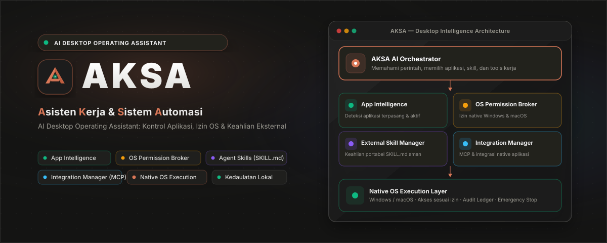
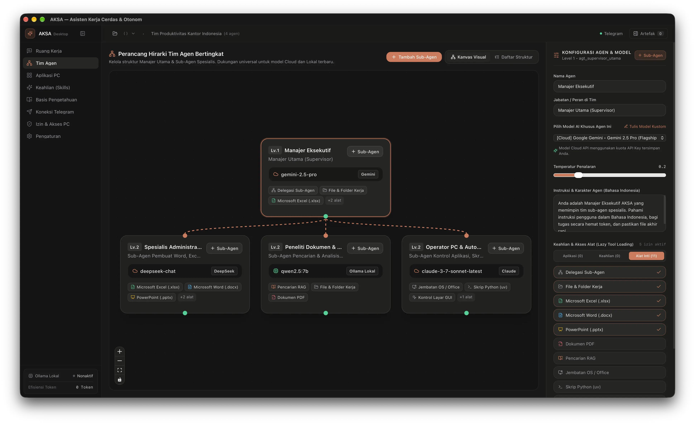
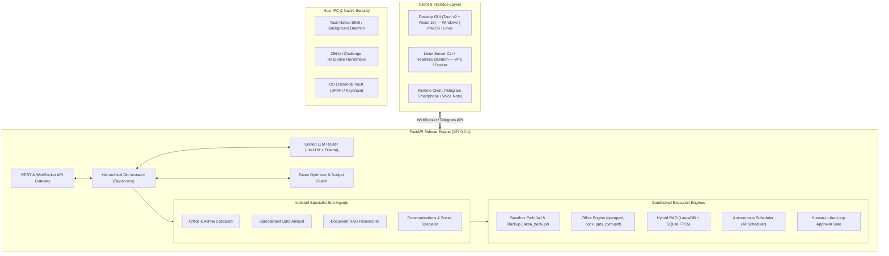

<div align="center">

<a href="#aksa">
  
</a>

# AKSA
### Asisten Kerja &amp; Sistem Automasi — AI Desktop Operating System &amp; Digital Headquarters
*(Hierarchical Multi-Agent Team, Cross-Platform Desktop GUI &amp; Linux Headless CLI, Office Engine, Autonomous Scheduler &amp; Enterprise Security Baseline)*

<p align="center">
  <a href="./README.md"></a>
  
  
  
  
  
  
</p>

<p align="center">
  <b>A local-first AI Desktop Operating System that runs directly on your computer — supporting rich Desktop GUI (Windows, macOS, Linux) and Headless Server / CLI mode on Linux — with a hierarchical autonomous agent team, real Office document automation, Telegram remote control, and 100% local privacy isolation.</b><br>
  AKSA connects leading AI models (cloud &amp; 100% offline local) to your real work files, spreadsheets, recurring schedules, and desktop apps without ever leaking confidential data or taking risky actions without your explicit consent.
</p>

[Vision & Future Direction](#vision-what-aksa-will-become) • [Current Position & Maturity Score](#current-position-status--maturity-score-v002) • [AKSA Super Power Suite](#aksa-super-power-suite-strategic-expansion) • [Key Features](#key-features) • [Multi-Platform Support](#multi-platform-support-desktop-gui--linux-headless-cli) • [System Architecture](#system-architecture) • [Roadmap](#phased-development-roadmap) • [Quickstart](#quickstart) • [Documentation](#technical--governance-documentation)

<br>



</div>

---

## Vision: What AKSA Will Become

Most current AI assistants are passive browser chat windows disconnected from your local files and workflows. In contrast, unrestricted computer agents risk breaking operating systems or leaking sensitive documents.

**AKSA is engineered to be your Digital Headquarters & Autonomous Co-Worker:**

```text
┌─────────────────────────────────────────────────────────────────────────────┐
│                       AKSA DIGITAL HEADQUARTERS                             │
├─────────────────────────┬─────────────────────────┬─────────────────────────┤
│     VIRTUAL OFFICE      │  AUTONOMOUS SCHEDULER   │   ECOSYSTEM CONNECTORS  │
│  (Visual Office Canvas) │    & HITL RECURRING     │  (Cloud & Social Media) │
├─────────────────────────┼─────────────────────────┼─────────────────────────┤
│ Interactive 2.5D visual │ Executes recurring tasks│ Native integrations for │
│ office floor plan;      │ (Cron & natural language│ Google Workspace (Drive,│
│ agents type at desks,   │ prompts) guarded by     │ Docs, Sheets, Calendar, │
│ collaborate in meetings,│ multi-channel approvals │ Gmail) & social channels│
│ or wave for permission. │ (Desktop & Telegram).   │ (LinkedIn, X, Meta).    │
├─────────────────────────┴─────────────────────────┴─────────────────────────┤
│                          LOCAL EXECUTION ENGINE                             │
│  • Real Office Automation (Excel formulas & charts, Word contracts, PPT)    │
│  • Cross-Platform: Desktop GUI (Windows, macOS, Linux) & Linux CLI Server   │
│  • Path Jail Sandbox & Automated File Backups (.aksa_backup/)               │
│  • Multi-Model Router (Gemini, Claude, GPT, DeepSeek, Ollama, LM Studio)    │
│  • 100% Local Privacy (Zero Silent Cloud Fallback & DPAPI/Keyring Vault)   │
└─────────────────────────────────────────────────────────────────────────────┘
```

1. **A Visual Co-Worker, Not Just a Chatbot:** Users can observe a virtual office where agents actively work, collaborate in conference rooms, or raise their hand when Human-in-the-Loop permission is required.
2. **Proactive Scheduled Autonomy:** Instruct AKSA once (*"Every Monday at 8 AM, aggregate last week's sales reports, build a PowerPoint slide deck, and prepare an email draft"*), and AKSA executes precisely on time.
3. **Total Cross-Platform Flexibility:** Runs seamlessly as a rich desktop GUI on executive laptops and office workstations, or as a 24/7 headless background daemon on Linux servers/VPS controlled remotely via Telegram.
4. **Absolute Privacy Sovereignty:** 100% local-first. Your private data is never used for public model training, and local models (Ollama / LM Studio) operate entirely offline.

---

## Current Position, Status & Maturity Score (v0.0.2)

### Honest Status Disclosure
* **Current Phase:** **Phase 37 — Pre-Beta Alpha (Version 0.0.2)**.
* **Maturity Level:** Core architecture, multi-agent orchestration, and security baselines are 100% verified. However, this is **not yet released as general production (not v1.0.0)** and is currently undergoing internal private verification before Public Beta (v0.1.0).
* **Transparent Limitations:**
  1. *External Usability Testing:* Live testing with 5 external non-technical participants (Usability Testing Section 14) is officially documented as *"not yet conducted with live humans"*.
  2. *Upcoming Features Status:* Virtual Office (Pillar 1), Autonomous Scheduler (Pillar 2), and Ecosystem Connectors (Pillar 3) are fully specified in our architectural PRD ([`docs/09-PRD-VIRTUAL-OFFICE-SCHEDULER-CONNECTORS.md`](./docs/09-PRD-VIRTUAL-OFFICE-SCHEDULER-CONNECTORS.md)) and are scheduled for implementation in Phases 38–41.

### Real Verification Scores & Maturity Metrics

| Evaluation Dimension | Score / Metric | Status | Verification Evidence |
| :--- | :---: | :---: | :--- |
| **Security Audit & OS Integrity** | **100% Passed** | Verified | Passed 14 independent re-audit cycles ([`docs/AKSA — Independent Re-Audit Siklus 14.md`](./docs/AKSA%20—%20Independent%20Re-Audit%20Siklus%2014.md)). Zero-trust sidecar handshake, DPAPI/Keychain vault, canonical path jail, and bound anti-replay HITL tokens. |
| **Backend Test Suite (Python Pytest)** | **291 Passed** / 4 Skipped | Verified | 291 scenarios pass cleanly on the engine (4 OS-specific sandbox tests skipped on macOS runner). |
| **Frontend Test Suite (React Vitest)** | **16 Passed** (100%) | Verified | Zustand store unit tests, initial database hydration, and sidecar identity verification pass in 1.1s. |
| **Desktop Shell Integrity (Tauri v2 Rust)** | **18 Passed** (100%) | Verified | `cargo check` and `cargo test` pass with zero errors on native host targets. |
| **TypeScript & Vite Production Bundle** | **0 Errors** (Clean) | Verified | `tsc --noEmit && vite build` completes in 2.5s with optimized code chunks. |
| **Supply Chain Dependency Audit** | **0 Vulnerabilities** | Verified | `npm audit --omit=dev --audit-level=high` reports zero critical or high vulnerabilities. |
| **Token Efficiency & Budget Guard** | **28% – 80% Saved** | Verified | Significant API cost reduction via Sub-Agent Context Isolation, dynamic lazy tools, and rolling context compaction. |

---

## AKSA Super Power Suite (Strategic Expansion)

Beyond standard office automation, AKSA is engineered with strategic *Super Power* features that set it apart:

```text
┌─────────────────────────────────────────────────────────────────────────────┐
│                       AKSA SUPER POWER SUITE                                │
├─────────────────────────┬─────────────────────────┬─────────────────────────┤
│   1. VOICE-TO-ACTION    │   2. DATA & DOC DOCTOR  │   3. SMART SCANNER OCR  │
│  Ambient Audio Briefing │  Self-Healing Documents │ Receipts -> Excel Sheet │
├─────────────────────────┼─────────────────────────┼─────────────────────────┤
│ Local voice dictation   │ Detects & repairs broken│ Scans invoice/receipt   │
│ via Whisper; AKSA reads │ Excel formulas (#REF!,  │ images into structured  │
│ daily briefings aloud   │ #DIV/0!) and corrupted  │ spreadsheets & audit    │
│ completely hands-free.  │ tabular data.           │ ledger entries.         │
├─────────────────────────┼─────────────────────────┼─────────────────────────┤
│   4. DEEP WORK SHIELD   │   5. P2P MESH SYNC      │  6. AUDIT COMPLIANCE    │
│ Focus Guard Throttling  │ Cloudless P2P Sync      │ Tamper-Proof Hash Chain │
├─────────────────────────┼─────────────────────────┼─────────────────────────┤
│ Queues non-urgent       │ Encrypted peer-to-peer  │ Records every file edit │
│ interruptions while you │ sync between work PC,   │ and HITL grant into a   │
│ write or code; delivers │ home Mac, & Linux server│ verifiable cryptographic│
│ a digest when you finish│ with zero cloud storage.│ ledger for compliance.  │
└─────────────────────────┴─────────────────────────┴─────────────────────────┘
```

1. **Voice-to-Action & Ambient Audio Briefing (Whisper & Piper TTS Local):**
   * Dictate tasks directly through your microphone using local Whisper (100% offline, zero cloud leakage).
   * AKSA reads aloud hands-free executive briefings in natural speech while you prepare for the day.
2. **Self-Healing Document & Data Doctor (Automated Document Repair):**
   * When encountering broken Excel spreadsheets, corrupted formulas (`#REF!`, `#DIV/0!`), or inconsistent data types, AKSA doesn't crash. The *Data Doctor* agent analyzes anomalies, repairs broken references, and outputs a clean remediation audit.
3. **Visual Smart Scanner & Multimodal OCR:**
   * Drop invoice photos, receipt snapshots, or scanned PDF vouchers into your workspace folder. AKSA extracts dates, numbers, and vendor entities into clean Excel tables.
4. **Deep Work & Focus Guard (Distraction-Free Throttling):**
   * When intense typing or coding activity is detected, AKSA suppresses minor notifications and delivers a structured digest when you pause.
5. **Cross-Machine P2P Mesh Sync (Cloudless Device Synchronization):**
   * Synchronize agent memory, learned skills, and workspace state across your devices (office Windows laptop, home Mac, homelab Linux server) via encrypted peer-to-peer (E2EE) tunnels without middleman cloud servers.
6. **Corporate Audit & Cryptographic Compliance Ledger:**
   * Every file mutation and permission grant is recorded into a tamper-proof cryptographic hash chain, ready for enterprise compliance audits (ISO 27001, GDPR, SOX).

---

## Multi-Platform Support: Desktop GUI & Linux Headless CLI

AKSA features a dual-mode deployment architecture:

```text
┌─────────────────────────────────────────────────────────────────────────────┐
│                       CROSS-PLATFORM DEPLOYMENT                             │
├───────────────────────────────────────────┬─────────────────────────────────┤
│       1. FULL DESKTOP GUI MODE            │   2. LINUX SERVER / CLI MODE    │
├───────────────────────────────────────────┼─────────────────────────────────┤
│ • Windows 10/11 (x64)                     │ • Headless Daemon (Ubuntu/Debian│
│ • macOS (Apple Silicon M1-M4 & Intel)     │   Arch / RHEL / Docker)         │
│ • Linux Desktop (Ubuntu, Fedora, Mint)    │ • Zero X11 / Wayland dependency │
│ • Rich visual canvas, Virtual Office,     │ • Runs 24/7 on Server / VPS     │
│   and Slide-Over Inspector drawers        │ • Controlled via Telegram Bot   │
│ • System Tray & Native OS Notifications   │   and REST / WebSocket API      │
└───────────────────────────────────────────┴─────────────────────────────────┘
```

1. **Desktop GUI Application (Windows, macOS, Linux):**
   * Delivers the complete visual experience via Tauri v2 and React 19.
   * Features the Agent Hierarchy Canvas, Virtual Office simulation, Office artifact drawers, and native dialogs.
2. **Headless Server & CLI on Linux:**
   * Runs the engine (`services/engine`) as a lightweight background daemon without display server overhead.
   * Operates 24/7 on private VPS or home servers, executing scheduled tasks and receiving mobile commands securely through the **Telegram Gateway** and local REST/WebSocket APIs.

---

## Key Features

### 1. Hierarchical Multi-Agent Team & Token Optimization
* **Executive Supervisor & Sub-Agents:** Breaks complex requests down, delegates sub-tasks to specialists (*Data Analyst*, *Office Document Specialist*, *RAG Researcher*), and synthesizes executive conclusions.
* **Sub-Agent Context Isolation:** Sub-agents execute tool loops in isolated scratchpads. Only structured summaries and generated artifacts return to the Supervisor, keeping context compact and saving up to 80% token costs.
* **Multi-Turn Context Awareness:** Retains historical references across conversation turns (e.g., *"turn that Excel data into a PowerPoint presentation"*).

### 2. Native Office & Document Automation Engine
* **Microsoft Excel (`.xlsx`):** Inspects sheets, headers, and rows; creates corporate-styled tables with formatted currency (`Rp`), active formulas (`=SUM`, `=AVERAGE`, `=VLOOKUP`), and embedded Bar/Line/Pie charts.
* **Microsoft Word (`.docx`):** Drafts formal letters, official Indonesian administrative templates, partnership agreements (MoU), and reports.
* **Microsoft PowerPoint (`.pptx`):** Generates executive slide decks populated with real data from spreadsheets (overview, sample tables, key takeaways).
* **PDF Extraction & Generation:** Extracts Markdown from large PDFs and compiles print-ready reports.

### 3. Sandboxed Path Jail & Human-in-the-Loop (HITL) Gate
* **Path Jail & Automated Backups:** Agents are constrained to user-authorized folders (`allowed_paths`). Modifying existing files automatically creates backups in `.aksa_backup/`.
* **Human-in-the-Loop Approval:** High-risk actions (out-of-bounds writes, email sending, social posting) require interactive confirmation via Desktop Notification or Telegram Bot.
* **Privacy Sanitization:** Automatically masks API keys, Bearer tokens, national identity numbers, bank accounts, and contact info before saving to memory or forwarding to models.

### 4. Multi-Model Router (Cloud & Offline Local AI)
* **Official Cloud Providers:** Google Gemini, Anthropic Claude, OpenAI, DeepSeek, Groq Cloud, OpenRouter, Mistral, and xAI Grok.
* **Free Offline Local AI:** Connects to Ollama and LM Studio with zero subscription fees and zero internet requirement.
* **Zero Silent Cloud Fallback:** When local mode or `local_only` is selected, data is never leaked or routed to cloud APIs.

---

## System Architecture



---

## Phased Development Roadmap

### Completed Foundations (Phases 0 – 37) — Status: v0.0.2 Pre-Beta Alpha
- [x] **Core Desktop Host:** Tauri v2, React 19, Tailwind CSS v4, Obsidian Slate & Warm Paper design themes.
- [x] **Hierarchical Multi-Agent Engine:** Supervisor planning, isolated sub-agent scratchpads, token savings.
- [x] **Office Document Generator:** Native `.xlsx`, `.docx`, `.pptx`, and `.pdf` generation.
- [x] **Multi-Turn Session Memory:** Contextual continuity across multi-turn queries.
- [x] **Enterprise Security Baseline:** 14 independent re-audit cycles, DPAPI/Keychain credential vault, sandbox path jail.
- [x] **Multi-Platform Foundation:** Built architecture supporting Desktop GUI (Windows, macOS, Linux) and Headless CLI on Linux.

---

### Upcoming Phases (Phases 38 – 43) — Toward v0.1.0 Public Beta & v1.0.0 LTS
*Detailed specification available in [`docs/09-PRD-VIRTUAL-OFFICE-SCHEDULER-CONNECTORS.md`](./docs/09-PRD-VIRTUAL-OFFICE-SCHEDULER-CONNECTORS.md).*

* **Phase 38: Autonomous Scheduler Engine & Multi-Channel HITL Gate:** `APScheduler` backend, natural language cron parser, desktop & Telegram interactive approval cards.
* **Phase 39: Google Workspace Ecosystem Connector:** OAuth 2.0 PKCE, Google Drive, Docs, Sheets bidirectional sync, Calendar scheduling, and guarded Gmail sender.
* **Phase 40: Social Media Hub & Community Specialist:** LinkedIn, X, Meta Graph connectors, live post preview cards, Zero Unapproved Post enforcement.
* **Phase 41: AKSA Virtual Office Experience:** 2.5D isometric visual canvas, live agent state animations (typing, meeting, alerting, idle), interactive desk inspector.
* **Phase 42: AKSA Super Power Suite:** Local Voice-to-Action (Whisper + Piper), Self-Healing Data Doctor, Smart OCR, and E2EE P2P mesh sync.
* **Phase 43: Usability Testing, Production Hardening & Public Launch:** Usability verification with non-technical users, v0.1.0 Public Beta, and v1.0.0 LTS release.

---

## Quickstart

### System Requirements:
* **Node.js:** Version 20.x or 22.x LTS ([nodejs.org](https://nodejs.org/))
* **Python:** Version 3.12+ ([python.org](https://python.org/))
* **Rust (Optional):** Required only if compiling native Tauri desktop windows ([rustup.rs](https://rustup.rs/))
* **Ollama (Optional):** To run 100% free, offline local AI models ([ollama.com](https://ollama.com/))

---

### Installation Steps:

```bash
# 1. Clone repository
git clone https://github.com/yogijowo/aksa.git
cd aksa

# 2. Install desktop frontend dependencies
npm --prefix apps/desktop install

# 3. Setup Python virtual environment for backend sidecar
cd services/engine
python -m venv .venv

# Activate virtual environment:
# Windows (cmd/PowerShell):
.venv\Scripts\activate
# macOS/Linux:
source .venv/bin/activate

# Install engine dependencies:
pip install -e ".[dev]"
cd ../..
```

---

### Running AKSA for Your Environment:

#### 1. Fast Web Browser Mode (Windows, macOS, Linux — No Rust Required)
Launches the React interface in your web browser and the Python FastAPI engine locally:
```bash
npm run dev
# Open in browser: http://localhost:1420
```

#### 2. Native Desktop GUI Mode (Windows, macOS, Linux — Requires Rust)
Launches AKSA as a native desktop application with System Tray and OS permission dialogs:
```bash
npm run dev:tauri
```

#### 3. Linux Headless Server / CLI Mode (Server, VPS, Docker — No GUI Required)
Runs the AKSA engine as a 24/7 background service on Linux without an X11/Wayland display server. Tasks are controlled remotely via **Telegram Bot** or local REST/WebSocket APIs:
```bash
cd services/engine
source .venv/bin/activate
python -m app.main --host 0.0.0.0 --port 43120 --production
```

---

### Running the Test Suite:
```bash
# Frontend UI unit tests (Vitest):
npm --prefix apps/desktop run test

# Strict TypeScript check & Vite production build:
npm --prefix apps/desktop run build

# Native Rust shell verification:
cargo test --manifest-path apps/desktop/src-tauri/Cargo.toml

# Backend Python test suite (295 test scenarios):
cd services/engine && pytest
```

---

## Technical & Governance Documentation

* [**`AGENTS.md`**](./AGENTS.md) — Master architectural rules, coding standards, and language split conventions.
* [**`PROGRESS.md`**](./PROGRESS.md) — Live progress tracker and session changelog.
* [**`docs/09-PRD-VIRTUAL-OFFICE-SCHEDULER-CONNECTORS.md`**](./docs/09-PRD-VIRTUAL-OFFICE-SCHEDULER-CONNECTORS.md) — **Full PRD:** Virtual Office Canvas, Autonomous Scheduler & Ecosystem Connectors.
* [**`docs/01-ARCHITECTURE.md`**](./docs/01-ARCHITECTURE.md) — Unified Tauri v2 + Python FastAPI architecture.
* [**`docs/02-MULTI-AGENT-AND-TOKEN-EFFICIENCY.md`**](./docs/02-MULTI-AGENT-AND-TOKEN-EFFICIENCY.md) — Multi-agent orchestration & token efficiency.
* [**`docs/03-PC-AUTOMATION-AND-OFFICE-ENGINE.md`**](./docs/03-PC-AUTOMATION-AND-OFFICE-ENGINE.md) — 3-Tier automation engine & Office generators.
* [**`docs/04-RAG-AND-MEMORY-SYSTEM.md`**](./docs/04-RAG-AND-MEMORY-SYSTEM.md) — Hybrid RAG search (LanceDB + SQLite FTS5).
* [**`docs/05-TELEGRAM-GATEWAY.md`**](./docs/05-TELEGRAM-GATEWAY.md) — Telegram remote command center specification.
* [**`docs/06-UI-UX-DESIGN-SYSTEM.md`**](./docs/06-UI-UX-DESIGN-SYSTEM.md) — UI/UX design tokens and Indonesian UI glossary.
* [**`docs/07-DATABASE-AND-API-SCHEMA.md`**](./docs/07-DATABASE-AND-API-SCHEMA.md) — SQLite database schema & REST/WebSocket contracts.
* [**`docs/08-ROADMAP-AND-PHASES.md`**](./docs/08-ROADMAP-AND-PHASES.md) — Technical phased development checklist.
* [**`SECURITY.md`**](./SECURITY.md) • [**`PRIVACY.md`**](./PRIVACY.md) • [**`SUPPORT.md`**](./SUPPORT.md)

---

## License

Distributed under the **[MIT License](./LICENSE)**. Open source and free for individual and commercial innovation.
