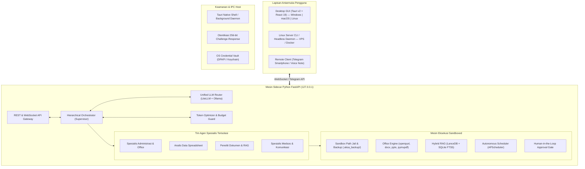

<div align="center">

<a href="#aksa">
  
</a>

# AKSA
### Asisten Kerja &amp; Sistem Automasi — AI Desktop Operating System &amp; Digital Headquarters
*(Hierarchical Multi-Agent Team, Cross-Platform Desktop GUI &amp; Linux Headless CLI, Office Engine, Autonomous Scheduler &amp; Enterprise Security Baseline)*

<p align="center">
  <a href="./README.en.md"></a>
  
  
  
  
  
  
</p>

<p align="center">
  <b>Sistem operasi kerja AI lokal yang beroperasi langsung di komputer Anda — mendukung antarmuka Desktop GUI (Windows, macOS, Linux) dan mode Headless Server / CLI di Linux — dengan tim agen otonom bertingkat, otomatisasi dokumen Office nyata, kendali jarak jauh Telegram, dan isolasi privasi lokal 100%.</b><br>
  AKSA menghubungkan model AI tercanggih (cloud maupun 100% offline lokal) dengan file kerja, spreadsheet, jadwal rutin, dan aplikasi harian Anda tanpa pernah membocorkan data pribadi atau melakukan tindakan berisiko tanpa izin eksplisit Anda.
</p>

[Visi & Arah Masa Depan](#-visi-aksa-akan-menjadi-apa-ke-depan) • [Posisi & Skor Kematangan Saat Ini](#-posisi-status--skor-kematangan-saat-ini-v002) • [Fitur Super Power Masa Depan](#-fitur-super-power-aksa-ekspansi-strategis) • [Fitur Utama](#-fitur-utama) • [Dukungan Multi-Platform](#-dukungan-multi-platform-gui--linux-headless-cli) • [Arsitektur Sistem](#-arsitektur-sistem-aksa) • [Peta Jalan Pengembangan](#-peta-jalan-pengembangan-roadmap) • [Panduan Memulai](#-panduan-memulai-cepat-quickstart) • [Dokumentasi Lengkap](#-dokumentasi-lengkap--spesifikasi-domain)

<br>


</div>

---

## Visi: AKSA Akan Menjadi Apa ke Depan?

Mayoritas asisten AI saat ini hanya berbentuk jendela *chat* pasif di browser web yang terpisah dari struktur berkas di komputer Anda dan melupakan konteks pekerjaan segera setelah jendela ditutup. Sebaliknya, agen otomasi yang diberi kebebasan tanpa pagar pembatas berisiko merusak sistem operasi atau membocorkan dokumen rahasia.

**AKSA dirancang untuk menjadi Digital Headquarters & Autonomous Co-Worker Anda:**

```text
┌─────────────────────────────────────────────────────────────────────────────┐
│                       AKSA DIGITAL HEADQUARTERS                             │
├─────────────────────────┬─────────────────────────┬─────────────────────────┤
│    KANTOR VIRTUAL       │   PENJADWALAN OTONOM    │   KONEKTOR EKOSISTEM    │
│  (Visual Office Canvas) │   (Autonomous Scheduler)│ (Cloud & Social Media)  │
├─────────────────────────┼─────────────────────────┼─────────────────────────┤
│ Denah kantor 2.5D visual│ Menjalankan tugas rutin │ Terhubung langsung ke   │
│ interaktif; agen tampak │ berkala (Cron & bahasa  │ Google Workspace (Drive,│
│ bekerja di meja, rapat, │ alami) dengan konfirmasi│ Sheets, Docs, Calendar, │
│ santai, atau butuh izin │ multi-channel (Desktop  │ Gmail) & publikasi medsos│
│ pengguna secara nyata.  │ & Telegram).            │ (LinkedIn, X, Meta).    │
├─────────────────────────┴─────────────────────────┴─────────────────────────┤
│                          MESIN EKSEKUSI LOKAL                               │
│  • Automasi Office Nyata (Excel rumus & grafik, Word naskah dinas, PPT, PDF)│
│  • Beroperasi Lintas Platform: GUI (Windows, macOS, Linux) & CLI Linux      │
│  • Perlindungan Sandbox Path Jail & Pencadangan Otomatis (.aksa_backup/)    │
│  • Multi-Model Router (Gemini, Claude, GPT, DeepSeek, Ollama, LM Studio)    │
│  • Kerahasiaan 100% Lokal (Zero Silent Cloud Fallback & Enkripsi DPAPI/Keyring)│
└─────────────────────────────────────────────────────────────────────────────┘
```

1. **Rekan Kerja Visual, Bukan Sekadar Chatbot:** Pengguna dapat melihat representasi visual interaktif tempat agen-agen AI bekerja, mengetahui secara instan siapa yang sedang menganalisis data, siapa yang menyusun laporan, dan siapa yang membutuhkan persetujuan Anda.
2. **Bekerja Proaktif Secara Mandiri:** Berikan tugas rutin satu kali (*"Setiap hari Senin jam 08:00, rekap data penjualan mingguan dari folder laporan, buatkan presentasi PPT, dan siapkan draf emailnya"*), dan AKSA akan mengeksekusinya tepat waktu.
3. **Fleksibilitas Tanpa Batas: GUI Desktop & Linux Server CLI:** Dapat dijalankan sebagai aplikasi desktop visual yang elegan di laptop/PC kerja Anda, maupun sebagai *daemon headless* di server Linux / VPS yang beroperasi 24/7 dan dikendalikan sepenuhnya melalui Telegram.
4. **Kedaulatan Privasi 100%:** Beroperasi lokal (*local-first*). Data Anda tidak pernah dikirim diam-diam ke cloud, dan penggunaan model AI lokal (Ollama / LM Studio) menjamin pemrosesan 100% tanpa internet.

---

## Posisi, Status & Skor Kematangan Saat Ini (v0.0.2)

### Laporan Status Jujur & Transparan (Honest Status Disclosure)
* **Fase Saat Ini:** **Fase 37 — Pre-Beta Alpha (Versi 0.0.2)**.
* **Status Kematangan:** Fondasi sistem inti, pengujian otomatis, dan audit keamanan telah selesai 100%. Namun, aplikasi ini **belum dirilis sebagai versi produksi umum (belum v1.0.0)** karena masih dalam tahap pengujian privat internal sebelum memasuki *Public Beta (v0.1.0)*.
* **Keterbatasan Saat Ini yang Perlu Diketahui:**
  1. *Pengujian Kegunaan Eksternal:* Pengujian langsung dengan 5 partisipan non-teknis (Usability Testing Section 14) masih berstatus *"belum diuji secara langsung dengan manusia"*.
  2. *Status Fitur Baru:* Fitur Kantor Virtual (Pilar 1), Scheduler (Pilar 2), dan Konektor Ekosistem (Pilar 3) saat ini telah selesai pada tahap spesifikasi arsitektur teknis lengkap ([`docs/09-PRD-VIRTUAL-OFFICE-SCHEDULER-CONNECTORS.md`](./docs/09-PRD-VIRTUAL-OFFICE-SCHEDULER-CONNECTORS.md)) dan sedang dijadwalkan untuk implementasi kode bertahap di Fase 38–41.

### Tabel Skor & Metrik Verifikasi Nyata

| Dimensi Evaluasi | Skor / Metrik Riil | Status | Bukti Verifikasi |
| :--- | :---: | :---: | :--- |
| **Audit Keamanan & Integritas OS** | **100% Lulus** | Terverifikasi | Lolos 14 siklus re-audit independen ([`docs/AKSA — Independent Re-Audit Siklus 14.md`](./docs/AKSA%20—%20Independent%20Re-Audit%20Siklus%2014.md)). Zero-trust sidecar handshake, DPAPI/Keychain vault, path traversal jail, dan anti-replay HITL tokens. |
| **Suite Pengujian Backend (Python Pytest)** | **291 Passed** / 4 Skipped | Terverifikasi | 291 skenario lulus sempurna di mesin Python engine (4 skenario khusus kernel sandbox Windows/Linux dilewati pada macOS runner). |
| **Suite Pengujian Frontend (React Vitest)** | **16 Passed** (100%) | Terverifikasi | Pengujian unit Zustand store, hidrasi database awal, dan validasi identitas engine sidecar lulus dalam 1.1 detik. |
| **Integritas Shell Desktop (Tauri v2 Rust)** | **18 Passed** (100%) | Terverifikasi | `cargo check` dan `cargo test` selesai tanpa galat (*zero errors*) pada target native. |
| **Kompilasi TypeScript & Bundle Vite** | **0 Errors** (Bersih) | Terverifikasi | `tsc --noEmit && vite build` selesai dalam 2.5 detik; pemisahan chunk produksi optimal. |
| **Audit Pasokan Dependensi (Supply Chain)** | **0 Vulnerabilities** | Terverifikasi | `npm audit --omit=dev --audit-level=high` bersih tanpa celah keamanan kritis. |
| **Efisiensi Penggunaan Token** | **Hemat 28% – 80%** | Terverifikasi | Penghematan biaya API nyata melalui isolasi konteks sub-agen, pemanggilan alat dinamis (*lazy tools*), dan pemadatan konteks bergulir (*rolling compaction*). |

---

## Fitur Super Power AKSA (Ekspansi Strategis)

Selain fitur dasar otomasi kantor, AKSA dirancang dengan serangkaian kapabilitas *Super Power* yang menjadikannya sistem operasi kerja mandiri paling komprehensif:

```text
┌─────────────────────────────────────────────────────────────────────────────┐
│                       AKSA SUPER POWER SUITE                                │
├─────────────────────────┬─────────────────────────┬─────────────────────────┤
│   1. VOICE-TO-ACTION    │   2. DATA & DOC DOCTOR  │   3. SMART SCANNER OCR  │
│  Ambient Audio Briefing │  Self-Healing Documents │ Scan Kwitansi -> Excel  │
├─────────────────────────┼─────────────────────────┼─────────────────────────┤
│ Dikte suara lokal via   │ Mendeteksi & memperbaiki│ Membaca foto struk/nota/│
│ Whisper; AKSA membacakan│ otomatis formula Excel  │ PDF scan fisik, otomatis│
│ ringkasan kerja harian  │ error (#REF!, #DIV/0!)  │ diubah menjadi tabel data│
│ secara hands-free.      │ dan tabel korup.        │ dan draf pembukuan rapi.│
├─────────────────────────┼─────────────────────────┼─────────────────────────┤
│   4. DEEP WORK SHIELD   │   5. P2P MESH SYNC      │  6. AUDIT COMPLIANCE    │
│ Focus Guard Throttling  │ Sinkronisasi Tanpa Cloud│ Tamper-Proof Hash Chain │
├─────────────────────────┼─────────────────────────┼─────────────────────────┤
│ Menahan interupsi saat  │ Sinkronisasi memori tim │ Mencatat seluruh mutasi │
│ pengguna sedang fokus,  │ antar-laptop kantor,    │ berkas & persetujuan izin│
│ menyajikan ringkasan    │ Mac rumah, & Linux server│ ke ledger kriptografis  │
│ berkala saat senggang.  │ via P2P lokal terenkripsi│ untuk audit kepatuhan.  │
└─────────────────────────┴─────────────────────────┴─────────────────────────┘
```

1. **Voice-to-Action & Ambient Audio Briefing (Whisper & Piper TTS Lokal):**
   * Perintahkan agen cukup dengan berbicara langsung melalui mikrofon komputer menggunakan model Whisper lokal (100% offline tanpa cloud).
   * Agen dapat membacakan ringkasan eksekutif pagi hari (*audio executive briefing*) secara *hands-free* saat Anda sedang mempersiapkan pekerjaan.
2. **Self-Healing Document & Data Doctor (Pemulihan Berkas Otomatis):**
   * Saat membaca file Excel atau data tabel yang berantakan, formula rusak (`#REF!`, `#VALUE!`), atau sel kosong yang tidak konsisten, AKSA tidak berhenti bekerja. Agen *Data Doctor* secara cerdas mendeteksi anomali, membersihkan data kotor, menyambung kembali rumus yang putus, dan menyajikan audit perbaikan untuk disetujui.
3. **Visual Smart Scanner & OCR Multimodal:**
   * Cukup letakkan berkas foto struk belanja, invoice faktur pajak, atau pindaian dokumen fisik PDF di folder kerja. AKSA otomatis mengekstraksi data angka, tanggal, dan nama entitas menjadi rekap tabel Excel terstruktur dan siap dilaporkan.
4. **Deep Work & Focus Guard (Perlindungan Konsentrasi Kerja):**
   * Ketika mendeteksi pengguna sedang fokus mengetik atau memprogram, AKSA menahan notifikasi interupsi non-kritis di latar belakang dan merangkumnya menjadi laporan ringkas saat pengguna selesai.
5. **Cross-Machine P2P Mesh Sync (Sinkronisasi Antar-Perangkat Tanpa Cloud):**
   * Sinkronisasi memori kerja agen dan profil tim antar-komputer pengguna (misal: laptop Windows di kantor, MacBook di rumah, dan homelab Linux server) secara terenkripsi *peer-to-peer* (E2EE) tanpa server perantara pihak ketiga.
6. **Corporate Audit & Cryptographic Compliance Ledger:**
   * Setiap mutasi berkas, pembacaan data, dan persetujuan izin dicatat dalam rantai hash kriptografis yang tahan manipulasi (*tamper-proof*), siap diekspor sewaktu-waktu untuk kepatuhan audit perusahaan (ISO 27001, UU PDP Indonesia, SOX).

---

## Dukungan Multi-Platform: GUI & Linux Headless CLI

AKSA dibangun dengan arsitektur modular yang dapat berjalan di berbagai lingkungan kerja:

```text
┌─────────────────────────────────────────────────────────────────────────────┐
│                     FLEKSIBILITAS LINTAS PLATFORM                           │
├───────────────────────────────────────────┬─────────────────────────────────┤
│      1. MODE DESKTOP GUI LENGKAP          │   2. MODE LINUX SERVER / CLI    │
├───────────────────────────────────────────┼─────────────────────────────────┤
│ • Windows 10/11 (x64)                     │ • Headless Daemon (Ubuntu/Debian│
│ • macOS (Apple Silicon M1/M2/M3 & Intel)  │   Arch / RHEL / Docker)         │
│ • Linux Desktop (Ubuntu, Fedora, Mint)    │ • Tanpa X11 / Wayland / Layar   │
│ • Antarmuka grafis kaya, Kanvas Kantor    │ • Berjalan 24/7 di Server / VPS │
│   Virtual, & Slider Drawer Inspector      │ • Dikendalikan via Telegram Bot │
│ • System Tray & Notifikasi Native OS      │   dan REST / WebSocket API      │
└───────────────────────────────────────────┴─────────────────────────────────┘
```

1. **Aplikasi Desktop GUI (Windows, macOS, Linux):**
   * Memberikan pengalaman visual terlengkap menggunakan Tauri v2 dan React 19.
   * Dilengkapi Kanvas Hirarki Agen, simulasi Kantor Virtual, laci inspektur dokumen Office, dan dialog persetujuan native.
2. **Mode Headless Server & CLI di Linux:**
   * Menjalankan mesin engine AKSA (`services/engine`) sebagai *daemon background process* di server Linux lokal, VPS, atau container Docker tanpa memerlukan server tampilan grafis (X11/Wayland).
   * Tim agen tetap dapat bekerja 24 jam penuh mengeksekusi tugas rutin terjadwal dan menerima perintah dari ponsel pengguna secara aman melalui **Pusat Kendali Telegram** dan Web API lokal.

---

## Fitur Utama Saat Ini

### 1. Orkestrasi Tim Multi-Agen Bertingkat & Efisiensi Token
* **Hirarki Supervisor & Sub-Agen:** Manajer Eksekutif mengurai instruksi rumit, mendelegasikan tugas ke sub-agen spesialis (Analis Data, Penyusun Dokumen, Peneliti Berkas), dan mengonsolidasikan hasil akhir.
* **Isolasi Konteks Sub-Agen:** Sub-agen menjalankan perputaran alat (*tool-loop*) di ruang kerja terisolasi. Hanya ringkasan terstruktur dan berkas hasil yang diserahkan kembali ke Supervisor, menjaga jendela konteks tetap bersih dan hemat token hingga 80%.
* **Deteksi Konteks Percakapan Multi-Turn:** Mampu memahami instruksi rujukan lanjutan (misal: *"dari data Excel tadi, tolong ubah jadi presentasi PPT"* tanpa kehilangan konteks file sumber).

### 2. Mesin Otomasi Dokumen Nyata (Office & PC Engine)
* **Microsoft Excel (`.xlsx`):** Menganalisis isi sheet, header, dan ribuan baris data, menyusun tabel bergaya korporat, memformat angka Rupiah (`Rp`), menulis formula aktif (`=SUM`, `=AVERAGE`, `=VLOOKUP`), dan menyematkan grafik Bar/Line/Pie.
* **Microsoft Word (`.docx`):** Menghasilkan surat resmi, naskah dinas, draf kontrak perjanjian kerjasama (MoU), laporan berkala dengan penataan gaya teks formal dan tabel rapi.
* **Microsoft PowerPoint (`.pptx`):** Menyusun presentasi eksekutif berbasis data riil dari berkas spreadsheet, mencakup slide judul, ringkasan tinjauan data, tabel sampel terformat, dan kesimpulan strategis.
* **Format PDF & Ekstraksi Teks:** Mengekstraksi teks dokumen PDF tebal ke format Markdown, menghasilkan laporan PDF berstandar cetak, serta menggabungkan atau memecah berkas.

### 3. Keamanan Sandboxing & Persetujuan Berjenjang (HITL Gate)
* **Path Jail & Pencadangan Otomatis:** Agen hanya diizinkan membaca dan menulis di dalam folder kerja yang telah dipilih pengguna (`allowed_paths`). Sebelum berkas kerja yang sudah ada diubah, sistem otomatis membuat salinan cadangan di `.aksa_backup/`.
* **Human-in-the-Loop (HITL) Approval:** Tindakan berisiko tinggi otomatis memunculkan dialog persetujuan (*approval card*) di desktop atau Telegram. Tanpa persetujuan eksplisit, tindakan akan dibatalkan (*fail-closed*).
* **Penyaring Privasi Otomatis:** Menyensor informasi sensitif (kunci API, Bearer token, NIK 16 digit, NPWP, nomor rekening, nomor telepon) sebelum data disimpan ke memori lokal atau dikirim ke LLM.

### 4. Router Multi-Model Fleksibel (Cloud & 100% Offline Lokal)
* **Penyedia Cloud Resmi:** Mendukung Google Gemini, Anthropic Claude, OpenAI, DeepSeek, Groq Cloud, OpenRouter, Mistral, dan xAI Grok.
* **Model AI Lokal Gratis (Ollama & LM Studio):** Jalankan model canggih seperti `qwen2.5:7b`, `deepseek-r1:8b`, atau `llama3.1:8b` langsung di komputer Anda tanpa biaya langganan API dan 100% beroperasi tanpa internet.
* **Zero Silent Cloud Fallback:** Saat memilih model lokal atau mengaktifkan mode `local_only`, sistem menjamin data Anda tidak akan dialihkan ke cloud dalam kondisi apa pun.

### 5. Basis Pengetahuan RAG Hibrida & Remote Telegram
* **Pencarian Semantik Hibrida (LanceDB + SQLite FTS5):** Menemukan informasi di ribuan berkas kerja lokal dengan memadukan pencarian vektor semantik dan pencarian kata kunci eksak (BM25) dengan pemantau perubahan folder *real-time*.
* **Pusat Kendali Jarak Jauh via Telegram:** Perintahkan tim agen dari ponsel cerdas Anda melalui pesan teks, pengiriman file, atau rekaman suara (*Voice Note*) Bahasa Indonesia yang dilindungi kode pairing 6-digit dan whitelist akun.

---

## Arsitektur Sistem AKSA



---

## Peta Jalan Pengembangan (Roadmap)

### Fase yang Telah Selesai (Fase 0 – 37) — Status: v0.0.2 Pre-Beta Alpha
- [x] **Fondasi & Desain Antarmuka:** Tauri v2, React 19, Tailwind CSS v4, tema Obsidian Slate & Warm Paper, dan glosarium Bahasa Indonesia terstandarisasi.
- [x] **Mesin Orkestrasi Hierarkis:** Pemisahan Supervisor dan Sub-Agen, isolasi scratchpad sub-agen, dan penghematan token hingga 80%.
- [x] **Pembuatan Dokumen Office Nyata:** Pembuatan dan modifikasi berkas `.xlsx`, `.docx`, `.pptx`, dan `.pdf` dengan data riil dari workspace.
- [x] **Memori Percakapan Multi-Turn:** Kemampuan merujuk data dari turn sebelumnya tanpa kehilangan konteks file sumber.
- [x] **Sistem Keamanan & Kepatuhan:** Path traversal jail, pencadangan otomatis, sandbox verifier worker, DPAPI/Keychain vault, dan 14 siklus re-audit independen.
- [x] **Dukungan Multi-Platform:** Menyiapkan landasan GUI (Windows, macOS, Linux) dan headless CLI di Linux.

---

### Fase Mendatang (Fase 38 – 43) — Menuju v0.1.0 Public Beta & v1.0.0 Production LTS
*Rincian spesifikasi lengkap tersedia di [`docs/09-PRD-VIRTUAL-OFFICE-SCHEDULER-CONNECTORS.md`](./docs/09-PRD-VIRTUAL-OFFICE-SCHEDULER-CONNECTORS.md).*

```text
Fase 38: Autonomous Scheduler Engine & Multi-Channel HITL Gate
├── Integrasi mesin scheduler asinkron (APScheduler) di sidecar engine
├── Skema database scheduled_jobs & scheduled_job_logs
├── Parser jadwal berbasis bahasa alami ("Setiap Senin jam 8 pagi...") & ekspresi Cron
├── Kartu persetujuan interaktif multi-channel (Desktop Notification & Telegram)
└── Antarmuka manajemen jadwal rutin di menu Ruang Kerja

Fase 39: Google Workspace Ecosystem Connector
├── Alur autentikasi aman Google OAuth 2.0 PKCE desktop loopback
├── Integrasi Google Drive & Docs (pencarian, unduh berkas, ekspor Word/PDF ke Drive)
├── Sinkronisasi dua arah Google Sheets (baca sel tabel & tambah baris rekap)
├── Integrasi Google Calendar (baca jadwal agenda & buat jadwal kegiatan baru)
└── Pembuat draf Gmail & pengiriman email terkontrol dengan gerbang HITL

Fase 40: Hub Media Sosial & Spesialis Komunikasi
├── Manajemen kredensial multi-platform (LinkedIn API, X API v2, Meta Graph API)
├── Template agen baru: "Spesialis Komunikasi & Media Sosial"
├── Kartu Pratinjau Postingan Interaktif di desktop (Live Preview Text, Media & Hashtag)
├── Aturan Zero Unapproved Post: wajib persetujuan pengguna sebelum publikasi
└── Pemantauan sebutan (mentions) & rekomendasi draf balasan komentar

Fase 41: AKSA Virtual Office Experience (Visual Agent Canvas)
├── Denah kantor 2.5D isometrik minimalis (Vector SVG + Canvas + Framer Motion)
├── Animasi status agen dinamis: Idle (santai/kopi), Bekerja (mengetik/lampu meja),
│   Rapat Kolaborasi (meja diskusi), dan Butuh Izin (melambaikan tangan)
├── Sinkronisasi status agen secara real-time melalui WebSocket engine
├── Kustomisasi tata letak meja kerja dan slide-over inspector agen interaktif
└── Tombol pengalih tampilan mulus: [ Kantor Virtual ] | [ Diagram Hirarki ] | [ Daftar Tim ]

Fase 42: AKSA Super Power Suite (Voice, Data Doctor, OCR & P2P Mesh)
├── Voice-to-Action & Ambient Audio Briefing (Whisper & Piper TTS lokal)
├── Self-Healing Document & Data Doctor (Auto-repair formula Excel rusak)
├── Smart OCR Scanner (Ekstraksi struk/kwitansi fisik menjadi tabel Excel)
└── Sinkronisasi P2P Mesh antar-perangkat lokal terenkripsi end-to-end

Fase 43: Usability Testing, Sertifikasi Keamanan & Rilis Publik
├── Pengujian kelayakan pengguna (Usability Testing) dengan 5 partisipan non-teknis
├── Peningkatan versi ke v0.1.0 Public Beta dan pengemasan installer multi-OS resmi
└── Rilis Produksi v1.0.0 Long-Term Support (LTS)
```

---

## Panduan Memulai Cepat (Quickstart)

### Prasyarat Sistem:
* **Node.js:** Versi 20.x atau 22.x LTS ([nodejs.org](https://nodejs.org/))
* **Python:** Versi 3.12+ ([python.org](https://python.org/))
* **Rust (Opsional):** Diperlukan jika ingin mengompilasi jendela desktop native via Tauri ([rustup.rs](https://rustup.rs/))
* **Ollama (Opsional):** Untuk menjalankan model AI lokal 100% gratis & offline ([ollama.com](https://ollama.com/))

---

### Langkah Instalasi Mandiri:

```bash
# 1. Klon repositori
git clone https://github.com/yogijowo/aksa.git
cd aksa

# 2. Pasang dependensi frontend desktop
npm --prefix apps/desktop install

# 3. Siapkan environment Python untuk backend sidecar
cd services/engine
python -m venv .venv

# Aktifkan virtual environment:
# Windows (cmd/PowerShell):
.venv\Scripts\activate
# macOS/Linux:
source .venv/bin/activate

# Pasang dependensi engine:
pip install -e ".[dev]"
cd ../..
```

---

### Menjalankan AKSA Sesuai Kebutuhan Lingkungan:

#### 1. Mode Cepat Web Browser (Windows, macOS, Linux — Tanpa Butuh Rust)
Menjalankan antarmuka React di browser web dan backend Python FastAPI secara lokal:
```bash
npm run dev
# Buka di browser: http://localhost:1420
```

#### 2. Mode Desktop GUI Native (Windows, macOS, Linux — Membutuhkan Rust)
Menjalankan aplikasi sebagai jendela desktop native dengan integrasi System Tray dan dialog izin OS:
```bash
npm run dev:tauri
```

#### 3. Mode Headless Server / CLI di Linux (Server, VPS, Docker — Tanpa Display/GUI)
Menjalankan mesin engine AKSA sebagai layanan latar belakang di Linux server tanpa antarmuka grafis. Seluruh tugas dapat dikendalikan dari jarak jauh melalui **Telegram Bot** atau REST/WebSocket API:
```bash
cd services/engine
source .venv/bin/activate
python -m app.main --host 0.0.0.0 --port 43120 --production
```

---

### Menjalankan Suite Pengujian & Verifikasi:
```bash
# Uji unit antarmuka frontend (Vitest):
npm --prefix apps/desktop run test

# Verifikasi kompilasi TypeScript ketat & bundle produksi Vite:
npm --prefix apps/desktop run build

# Uji biner Rust native Tauri:
cargo test --manifest-path apps/desktop/src-tauri/Cargo.toml

# Uji backend Python engine (295 skenario pengujian):
cd services/engine && pytest
```

---

## Dokumentasi Lengkap & Spesifikasi Domain

Seluruh rincian teknis, standar kode, dan arsitektur terdokumentasi rapi di dalam direktori [`docs/`](./docs/):

* [**`AGENTS.md`**](./AGENTS.md) — Pedoman utama arsitektur, konvensi kode (Code in English, UI in Bahasa Indonesia), dan aturan kerja AI.
* [**`PROGRESS.md`**](./PROGRESS.md) — Pelacak progres pengembangan live, riwayat sesi, dan status tugas terkini.
* [**`docs/09-PRD-VIRTUAL-OFFICE-SCHEDULER-CONNECTORS.md`**](./docs/09-PRD-VIRTUAL-OFFICE-SCHEDULER-CONNECTORS.md) — **PRD Lengkap:** Virtual Office Canvas, Autonomous Scheduler & Konektor Google/Medsos.
* [**`docs/01-ARCHITECTURE.md`**](./docs/01-ARCHITECTURE.md) — Arsitektur terpadu Tauri v2 (Rust) + Python FastAPI Sidecar.
* [**`docs/02-MULTI-AGENT-AND-TOKEN-EFFICIENCY.md`**](./docs/02-MULTI-AGENT-AND-TOKEN-EFFICIENCY.md) — Orkestrasi agen bertingkat & optimasi token.
* [**`docs/03-PC-AUTOMATION-AND-OFFICE-ENGINE.md`**](./docs/03-PC-AUTOMATION-AND-OFFICE-ENGINE.md) — Mesin dokumen Office (Word, Excel, PPT, PDF) & Sandbox.
* [**`docs/04-RAG-AND-MEMORY-SYSTEM.md`**](./docs/04-RAG-AND-MEMORY-SYSTEM.md) — Mesin pencarian hibrida lokal (LanceDB + SQLite FTS5).
* [**`docs/05-TELEGRAM-GATEWAY.md`**](./docs/05-TELEGRAM-GATEWAY.md) — Arsitektur pusat kendali jarak jauh melalui bot Telegram.
* [**`docs/06-UI-UX-DESIGN-SYSTEM.md`**](./docs/06-UI-UX-DESIGN-SYSTEM.md) — Sistem desain Warm Obsidian / Paper Light & glosarium UI Indonesia.
* [**`docs/07-DATABASE-AND-API-SCHEMA.md`**](./docs/07-DATABASE-AND-API-SCHEMA.md) — Skema database SQLite & kontrak REST/WebSocket API.
* [**`docs/08-ROADMAP-AND-PHASES.md`**](./docs/08-ROADMAP-AND-PHASES.md) — Rencana peta jalan teknis dari awal hingga rilis v1.0.
* [**`SECURITY.md`**](./SECURITY.md) — Kebijakan keamanan enterprise, pelaporan kerentanan, dan mitigasi risiko.
* [**`PRIVACY.md`**](./PRIVACY.md) — Kedaulatan data lokal, klasifikasi data, dan aturan zero-cloud fallback.

---

## Lisensi

Didistribusikan di bawah lisensi resmi **[MIT License](./LICENSE)**. Seluruh kode sumber terbuka untuk dipelajari, dikembangkan, dan dimanfaatkan secara bebas.
