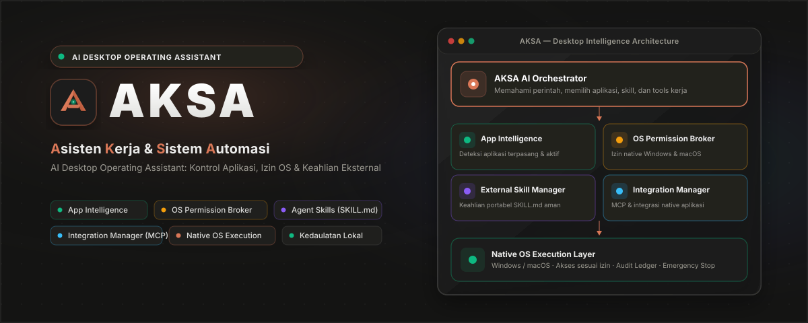
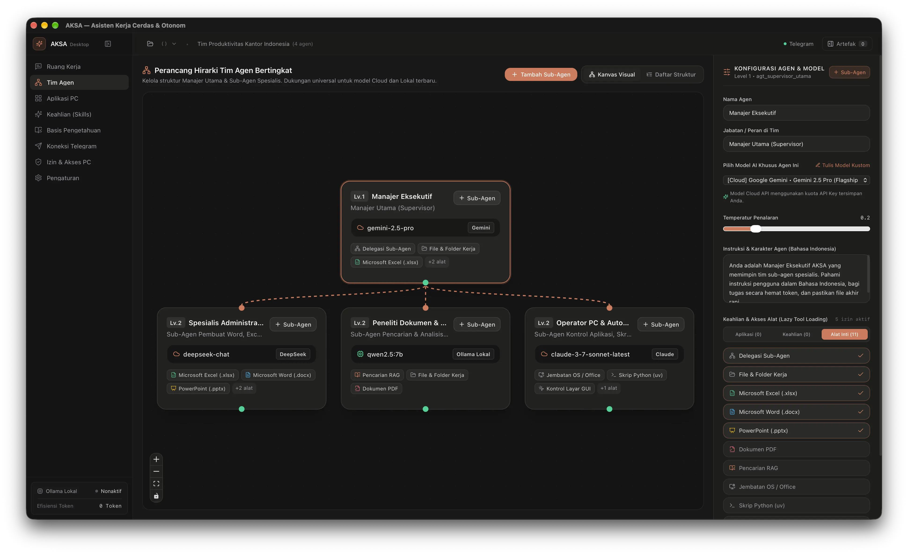
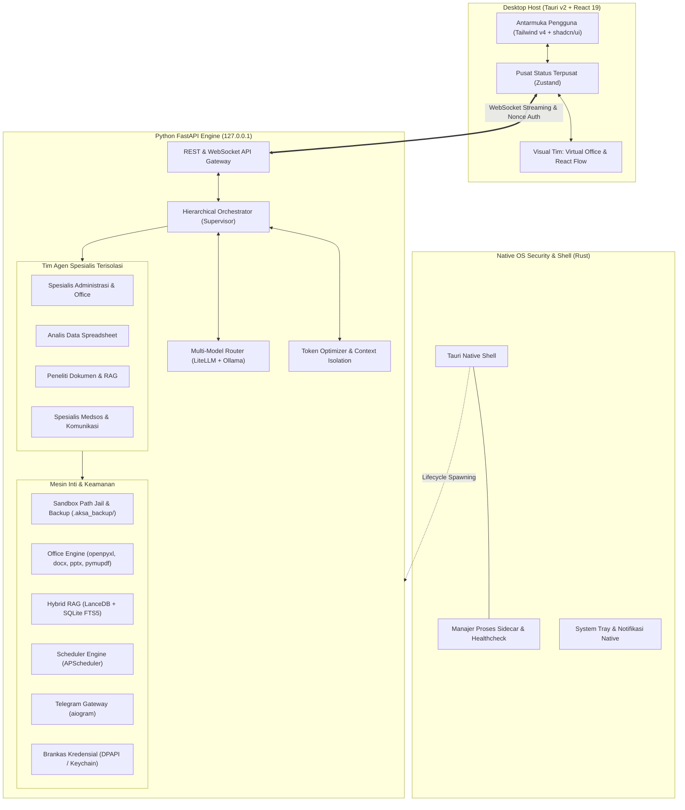

<div align="center">

<a href="#aksa">
  
</a>

# AKSA
### Asisten Kerja &amp; Sistem Automasi — AI Desktop Operating System &amp; Digital Headquarters
*(Hierarchical Multi-Agent Team, Virtual Office Experience, Autonomous Scheduler, Ecosystem Connectors &amp; Enterprise Security Baseline)*

<p align="center">
  <a href="./README.en.md"></a>
  
  
  
  
  
  
</p>

<p align="center">
  <b>Sistem operasi kerja AI desktop lokal yang beroperasi langsung di komputer Anda dengan tim agen otonom bertingkat, perlindungan data lokal 100%, otomatisasi dokumen Office nyata, dan integrasi ekosistem cloud &amp; sosial.</b><br>
  AKSA menghubungkan model AI tercanggih (cloud maupun 100% offline lokal) dengan file kerja, spreadsheet, jadwal rutin, dan aplikasi harian Anda tanpa pernah membocorkan data pribadi atau melakukan tindakan berisiko tanpa izin eksplisit Anda.
</p>

[Visi & Arah Masa Depan](#-visi-aksa-akan-menjadi-apa-ke-depan) • [Posisi & Skor Saat Ini](#-posisi-status--skor-kematangan-saat-ini-v002) • [Fitur Utama](#-fitur-utama) • [Arsitektur Sistem](#-arsitektur-sistem-aksa) • [Peta Jalan Pengembangan](#-peta-jalan-pengembangan-roadmap) • [Panduan Memulai](#-panduan-memulai-cepat-quickstart) • [Dokumentasi Lengkap](#-dokumentasi-lengkap--spesifikasi-domain)

<br>



</div>

---

## Visi: AKSA Akan Menjadi Apa ke Depan?

Kebanyakan asisten AI saat ini hanya berbentuk jendela *chat* di browser web yang pasif, terisolasi dari file komputer pengguna, dan melupakan konteks kerja segera setelah percakapan ditutup. Sebaliknya, agen otomasi yang diberi kebebasan penuh tanpa pagar pembatas berisiko merusak sistem atau membocorkan rahasia perusahaan.

**AKSA dirancang untuk menjadi Digital Headquarters & Autonomous Co-Worker Anda:**

```text
┌─────────────────────────────────────────────────────────────────────────────┐
│                       AKSA DIGITAL HEADQUARTERS                             │
├─────────────────────────┬─────────────────────────┬─────────────────────────┤
│    KANTOR VIRTUAL       │   PENJADWALAN OTONOM    │   KONEKTOR EKOSISTEM    │
│  (Visual Office Canvas) │   (Autonomous Scheduler)│ (Cloud & Social Media)  │
├─────────────────────────┼─────────────────────────┼─────────────────────────┤
│ Denah kantor 2.5D visual│ Menjalankan tugas rutin │ Terhubung langsung ke   │
│ interaktif; agen tampak │ berkala (Cron & bahasa  │ Google Workspace (Drive,│
│ bekerja di meja, rapat, │ alami) dengan konfirmasi│ Sheets, Docs, Calendar, │
│ santai, atau butuh izin │ multi-channel (Desktop  │ Gmail) & publikasi medsos│
│ pengguna secara nyata.  │ & Telegram).            │ (LinkedIn, X, Meta).    │
├─────────────────────────┴─────────────────────────┴─────────────────────────┤
│                          MESIN EKSEKUSI LOKAL                               │
│  • Automasi Office Nyata (Excel rumus & grafik, Word naskah dinas, PPT, PDF)│
│  • Perlindungan Sandbox Path Jail & Pencadangan Otomatis (.aksa_backup/)    │
│  • Multi-Model Router (Gemini, Claude, GPT, DeepSeek, Ollama, LM Studio)    │
│  • Kerahasiaan 100% Lokal (Zero Silent Cloud Fallback & Enkripsi DPAPI/Keyring)│
└─────────────────────────────────────────────────────────────────────────────┘
```

1. **Bukan Sekadar Chatbot, Melainkan Rekan Kerja Visual:** Pengguna dapat melihat kantor virtual tempat agen-agen AI bekerja, mengetahui siapa yang sedang menganalisis data, siapa yang menyusun laporan, dan siapa yang sedang menunggu persetujuan Anda.
2. **Bekerja Proaktif Secara Terjadwal:** Anda dapat memberi instruksi rutin satu kali (*"Setiap Senin jam 8 pagi, rangkum penjualan minggu lalu dari folder laporan, buatkan presentasi PPT, dan siapkan draf emailnya"*), dan AKSA akan menjalankannya tepat waktu.
3. **Penyambung Dunia Lokal dan Cloud:** AKSA menjembatani file di hard drive lokal Anda dengan ekosistem cloud (Google Workspace) dan corong publikasi digital (Media Sosial) dengan aturan baku: **tidak ada publikasi atau pengiriman data keluar tanpa persetujuan eksplisit Anda (Human-in-the-Loop)**.
4. **Kedaulatan Privasi Penuh:** Beroperasi secara lokal (*local-first*). Data Anda tidak dijadikan bahan pelatihan model publik, dan penggunaan model AI lokal (Ollama / LM Studio) dijamin berjalan 100% *offline*.

---

## Posisi, Status & Skor Kematangan Saat Ini (v0.0.2)

AKSA saat ini berada pada tahap **Pre-Beta Alpha (v0.0.2)**. Fondasi arsitektur inti telah rampung 100%, diaudit secara independen melalui 14 siklus re-audit ketat, dan siap diuji coba secara privat sebelum peluncuran Public Beta (v0.1.0) dan Rilis Produksi (v1.0.0).

### Tabel Skor & Metrik Verifikasi Sistem

| Dimensi Evaluasi | Skor / Metrik | Status | Bukti Verifikasi |
| :--- | :---: | :---: | :--- |
| **Audit Keamanan & Integritas OS** | **100% Lulus** | Terverifikasi | Lolos 14 siklus re-audit independen ([`docs/AKSA — Independent Re-Audit Siklus 14.md`](./docs/AKSA%20—%20Independent%20Re-Audit%20Siklus%2014.md)). Zero-trust sidecar handshake, DPAPI/Keychain vault, path traversal jail, dan anti-replay HITL tokens. |
| **Suite Pengujian Backend (Python Pytest)** | **291 Passed** / 4 Skipped | Terverifikasi | 291 skenario lulus sempurna pada mesin engine (4 skenario khusus kernel sandbox Windows/Linux dilewati pada macOS runner). |
| **Suite Pengujian Frontend (React Vitest)** | **16 Passed** (100%) | Terverifikasi | Pengujian unit Zustand store, hidrasi database awal, dan validasi identitas engine sidecar lulus dalam 1.1 detik. |
| **Integritas Shell Desktop (Tauri v2 Rust)** | **18 Passed** (100%) | Terverifikasi | `cargo check` dan `cargo test` selesai tanpa galat (zero errors) pada target native. |
| **Kompilasi TypeScript & Bundle Vite** | **0 Errors** (Bersih) | Terverifikasi | `tsc --noEmit && vite build` selesai dalam 2.5 detik; pemisahan chunk produksi optimal. |
| **Audit Pasokan Dependensi (Supply Chain)** | **0 Vulnerabilities** | Terverifikasi | `npm audit --omit=dev --audit-level=high` bersih tanpa celah keamanan kritis. |
| **Efisiensi Penggunaan Token** | **Hemat 28% – 80%** | Terverifikasi | Penghematan biaya API nyata melalui isolasi konteks sub-agen, pemanggilan alat dinamis (*lazy tools*), dan pemadatan konteks bergulir (*rolling compaction*). |
| **Kompilasi Biner Windows (.exe)** | **100% Berhasil** | Terverifikasi | CI privat GitHub Actions berhasil membekukan sidecar engine (115 MB) dan mengemas installer NSIS Windows: `AKSA_0.0.2_x64-setup.exe` (114,5 MB). |

---

## Fitur Utama

### 1. Orkestrasi Tim Multi-Agen Bertingkat & Efisiensi Token
* **Hirarki Supervisor & Sub-Agen:** Manajer Eksekutif mengurai instruksi rumit, mendelegasikan tugas ke sub-agen spesialis (Analis Data, Penyusun Dokumen, Peneliti Berkas), dan mengonsolidasikan hasil akhir.
* **Isolasi Konteks Sub-Agen:** Sub-agen menjalankan perputaran alat (*tool-loop*) di ruang kerja terisolasi. Hanya ringkasan terstruktur dan berkas hasil yang diserahkan kembali ke Supervisor, menjaga jendela konteks tetap bersih dan hemat token hingga 80%.
* **Deteksi Konteks Percakapan Multi-Turn:** Mampu memahami instruksi rujukan lanjutan (misal: *"dari data Excel tadi, tolong ubah jadi presentasi PPT"* tanpa kehilangan konteks file sumber).

### 2. Mesin Otomasi Dokumen Nyata (Office & PC Engine)
* **Microsoft Excel (`.xlsx`):** Menganalisis isi sheet, header, dan ribuan baris data, menyusun tabel bergaya korporat, memformat angka Rupiah (`Rp`), menulis formula aktif (`=SUM`, `=AVERAGE`, `=VLOOKUP`), dan menyematkan grafik Bar/Line/Pie.
* **Microsoft Word (`.docx`):** Menghasilkan surat resmi, naskah dinas, draf kontrak perjanjian kerjasama (MoU), laporan berkala dengan penataan gaya teks formal dan tabel rapi.
* **Microsoft PowerPoint (`.pptx`):** Menyusun presentasi eksekutif berbasis data riil dari berkas spreadsheet, mencakup slide judul, ringkasan tinjauan data, tabel sampel terformat, dan kesimpulan strategis.
* **Format PDF & Ekstraksi Teks:** Mengekstraksi teks dokumen PDF tebal ke format Markdown, menghasilkan laporan PDF berstandar cetak, serta menggabungkan atau memecah berkas.

### 3. Keamanan Sandboxing & Persetujuan Berjenjang (HITL Gate)
* **Path Jail & Pencadangan Otomatis:** Agen hanya diizinkan membaca dan menulis di dalam folder kerja yang telah dipilih pengguna (`allowed_paths`). Sebelum berkas kerja yang sudah ada diubah, sistem otomatis membuat salinan cadangan di `.aksa_backup/`.
* **Human-in-the-Loop (HITL) Approval:** Tindakan berisiko tinggi (menulis di luar folder kerja, menghapus berkas, mengirim email, atau memublikasikan postingan sosial) otomatis memunculkan dialog persetujuan (*approval card*) di desktop atau Telegram. Tanpa persetujuan eksplisit, tindakan akan dibatalkan (*fail-closed*).
* **Penyaring Privasi Otomatis:** Menyensor informasi sensitif (kunci API, Bearer token, NIK 16 digit, NPWP, nomor rekening, nomor telepon) sebelum data disimpan ke memori lokal atau dikirim ke LLM.

### 4. Router Multi-Model Fleksibel (Cloud & 100% Offline Lokal)
* **Penyedia Cloud Resmi:** Mendukung Google Gemini (Gemini 2.5 Flash, Gemini 1.5 Pro), Anthropic Claude (Claude 3.5 Sonnet, Claude 3.5 Haiku), OpenAI (GPT-4o, GPT-4o-mini), DeepSeek (V3, R1), Groq Cloud, OpenRouter, Mistral, dan xAI Grok.
* **Model AI Lokal Gratis (Ollama & LM Studio):** Jalankan model canggih seperti `qwen2.5:7b`, `deepseek-r1:8b`, atau `llama3.1:8b` langsung di perangkat Anda tanpa biaya langganan API dan 100% beroperasi tanpa internet.
* **Zero Silent Cloud Fallback:** Saat memilih model lokal atau mengaktifkan mode `local_only`, sistem menjamin data Anda tidak akan dialihkan ke cloud dalam kondisi apa pun.

### 5. Basis Pengetahuan RAG Hibrida & Remote Telegram
* **Pencarian Semantik Hibrida (LanceDB + SQLite FTS5):** Menemukan informasi di ribuan berkas kerja lokal dengan memadukan pencarian vektor semantik dan pencarian kata kunci eksak (BM25) dengan pemantau perubahan folder *real-time*.
* **Pusat Kendali Jarak Jauh via Telegram:** Perintahkan tim agen dari ponsel cerdas Anda melalui pesan teks, pengiriman file, atau rekaman suara (*Voice Note*) Bahasa Indonesia yang dilindungi kode pairing 6-digit dan whitelist akun.

---

## Arsitektur Sistem AKSA



---

## Peta Jalan Pengembangan (Roadmap)

### Fase yang Telah Rampung (Fase 0 – 37) — Status: v0.0.2 Pre-Beta Alpha
- [x] **Fondasi & Desain Antarmuka:** Tauri v2, React 19, Tailwind CSS v4, tema Obsidian Slate & Warm Paper, dan glosarium Bahasa Indonesia terstandarisasi.
- [x] **Mesin Orkestrasi Hierarkis:** Pemisahan Supervisor dan Sub-Agen, isolasi scratchpad sub-agen, dan penghematan token hingga 80%.
- [x] **Pembuatan Dokumen Office Tingkat Lanjut:** Pembuatan dan modifikasi berkas `.xlsx`, `.docx`, `.pptx`, dan `.pdf` dengan data riil dari workspace.
- [x] **Memori Percakapan Multi-Turn:** Kemampuan merujuk data dari turn sebelumnya tanpa kehilangan konteks file sumber.
- [x] **Sistem Keamanan & Kepatuhan:** Path traversal jail, pencadangan otomatis, sandbox verifier worker, DPAPI/Keychain vault, dan 14 siklus re-audit independen.
- [x] **Pipeline Kompilasi Installer Windows:** Otomasi build NSIS setup `.exe` mandiri tanpa menyertakan biner di repository git.

---

### Fase Mendatang (Fase 38 – 42) — Menuju v0.1.0 Public Beta & v1.0.0 Production LTS
*Rincian spesifikasi lengkap tersedia di [`docs/09-PRD-VIRTUAL-OFFICE-SCHEDULER-CONNECTORS.md`](./docs/09-PRD-VIRTUAL-OFFICE-SCHEDULER-CONNECTORS.md).*

```text
Fase 38: Autonomous Scheduler Engine & Multi-Channel HITL Gate
├── Integrasi mesin scheduler asinkron (APScheduler) di sidecar engine
├── Skema database scheduled_jobs & scheduled_job_logs
├── Parser jadwal berbasis bahasa alami ("Setiap Senin jam 8 pagi...") & ekspresi Cron
├── Kartu persetujuan interaktif multi-channel (Desktop Notification & Telegram)
└── Antarmuka manajemen jadwal rutin di menu Ruang Kerja

Fase 39: Google Workspace Ecosystem Connector
├── Alur autentikasi aman Google OAuth 2.0 PKCE desktop loopback
├── Integrasi Google Drive & Docs (pencarian, unduh berkas, ekspor Word/PDF ke Drive)
├── Sinkronisasi dua arah Google Sheets (baca sel tabel & tambah baris rekap)
├── Integrasi Google Calendar (baca jadwal agenda & buat jadwal kegiatan baru)
└── Pembuat draf Gmail & pengiriman email terkontrol dengan gerbang HITL

Fase 40: Hub Media Sosial & Spesialis Komunikasi
├── Manajemen kredensial multi-platform (LinkedIn API, X API v2, Meta Graph API)
├── Template agen baru: "Spesialis Komunikasi & Media Sosial"
├── Kartu Pratinjau Postingan Interaktif di desktop (Live Preview Text, Media & Hashtag)
├── Aturan Zero Unapproved Post: wajib persetujuan pengguna sebelum publikasi
└── Pemantauan sebutan (mentions) & rekomendasi draf balasan komentar

Fase 41: AKSA Virtual Office Experience (Visual Agent Canvas)
├── Denah kantor 2.5D isometrik minimalis (Vector SVG + Canvas + Framer Motion)
├── Animasi status agen dinamis: Idle (santai/kopi), Bekerja (mengetik/lampu meja),
│   Rapat Kolaborasi (meja diskusi), dan Butuh Izin (melambaikan tangan)
├── Sinkronisasi status agen secara real-time melalui WebSocket engine
├── Kustomisasi tata letak meja kerja dan slide-over inspector agen interaktif
└── Tombol pengalih tampilan mulus: [ Kantor Virtual ] | [ Diagram Hirarki ] | [ Daftar Tim ]

Fase 42: Pengujian Kelayakan Pengguna, Sertifikasi Keamanan & Rilis Publik
├── Pengujian kelayakan pengguna (Usability Testing) dengan pengguna non-teknis
├── Peningkatan versi ke v0.1.0 Public Beta dan pengemasan installer multi-OS
└── Rilis Produksi v1.0.0 Long-Term Support (LTS)
```

---

## Panduan Memulai Cepat (Quickstart)

### 1. Menjalankan Langsung via Installer Windows (.exe)
Jika Anda menggunakan Windows dan ingin mencoba langsung tanpa perlu menginstal Node.js atau Rust:
1. Buka tab **Actions** pada repositori GitHub Anda.
2. Pilih alur kerja **Build Windows Setup Executable (.exe)**.
3. Di bagian **Artifacts** di bawah ringkasan, unduh file zip **`AKSA-Windows-x64-Setup`**.
4. Ekstrak dan jalankan `AKSA_0.0.2_x64-setup.exe` untuk memasang aplikasi di PC Anda.

---

### 2. Menjalankan dari Kode Sumber (Development Mode)

#### Prasyarat Sistem:
* **Node.js:** Versi 20.x atau 22.x LTS ([nodejs.org](https://nodejs.org/))
* **Python:** Versi 3.12+ ([python.org](https://python.org/))
* **Rust:** Diperlukan jika ingin mem-build jendela desktop native via Tauri ([rustup.rs](https://rustup.rs/))
* **Ollama (Opsional):** Untuk menjalankan model AI lokal 100% gratis & offline ([ollama.com](https://ollama.com/))

#### Langkah Instalasi:
```bash
# 1. Klon repositori
git clone https://github.com/yogijowo/aksa.git
cd aksa

# 2. Pasang dependensi frontend
npm --prefix apps/desktop install

# 3. Siapkan environment Python untuk backend sidecar
cd services/engine
python -m venv .venv

# Aktifkan virtual environment:
# Windows (cmd/PowerShell):
.venv\Scripts\activate
# macOS/Linux:
source .venv/bin/activate

# Pasang dependensi engine:
pip install -e ".[dev]"
cd ../..

# 4. Jalankan aplikasi dalam mode pengembangan:
# Mode Web Browser Cepat (http://localhost:1420 + API FastAPI di port 43120):
npm run dev

# Mode Jendela Desktop Native Tauri v2 (Membutuhkan Rust):
npm run dev:tauri
```

#### Menjalankan Pengujian Lengkap:
```bash
# Jalankan pengujian frontend (Vitest):
npm --prefix apps/desktop run test

# Verifikasi kompilasi TypeScript & bundle produksi:
npm --prefix apps/desktop run build

# Jalankan pengujian Rust Tauri:
cargo test --manifest-path apps/desktop/src-tauri/Cargo.toml

# Jalankan rangkaian uji backend Python (Pytest):
cd services/engine && pytest
```

---

## Dokumentasi Lengkap & Spesifikasi Domain

Seluruh rincian teknis, standar kode, dan arsitektur terdokumentasi rapi di dalam direktori [`docs/`](./docs/):

* [**`AGENTS.md`**](./AGENTS.md) — Pedoman utama pengkodean, standar bahasa (Code in English, UI in Bahasa Indonesia), dan aturan kerja AI.
* [**`PROGRESS.md`**](./PROGRESS.md) — Pelacak progres pengembangan live, riwayat sesi, dan status tugas terkini.
* [**`docs/09-PRD-VIRTUAL-OFFICE-SCHEDULER-CONNECTORS.md`**](./docs/09-PRD-VIRTUAL-OFFICE-SCHEDULER-CONNECTORS.md) — **PRD Lengkap:** Virtual Office Canvas, Autonomous Scheduler & Konektor Google/Medsos.
* [**`docs/01-ARCHITECTURE.md`**](./docs/01-ARCHITECTURE.md) — Arsitektur terpadu Tauri v2 (Rust) + Python FastAPI Sidecar.
* [**`docs/02-MULTI-AGENT-AND-TOKEN-EFFICIENCY.md`**](./docs/02-MULTI-AGENT-AND-TOKEN-EFFICIENCY.md) — Orkestrasi agen bertingkat & optimasi token.
* [**`docs/03-PC-AUTOMATION-AND-OFFICE-ENGINE.md`**](./docs/03-PC-AUTOMATION-AND-OFFICE-ENGINE.md) — Mesin dokumen Office (Word, Excel, PPT, PDF) & Sandbox.
* [**`docs/04-RAG-AND-MEMORY-SYSTEM.md`**](./docs/04-RAG-AND-MEMORY-SYSTEM.md) — Mesin pencarian hibrida lokal (LanceDB + SQLite FTS5).
* [**`docs/05-TELEGRAM-GATEWAY.md`**](./docs/05-TELEGRAM-GATEWAY.md) — Arsitektur pusat kendali jarak jauh melalui bot Telegram.
* [**`docs/06-UI-UX-DESIGN-SYSTEM.md`**](./docs/06-UI-UX-DESIGN-SYSTEM.md) — Sistem desain Warm Obsidian / Paper Light & glosarium UI Indonesia.
* [**`docs/07-DATABASE-AND-API-SCHEMA.md`**](./docs/07-DATABASE-AND-API-SCHEMA.md) — Skema database SQLite & kontrak REST/WebSocket API.
* [**`docs/08-ROADMAP-AND-PHASES.md`**](./docs/08-ROADMAP-AND-PHASES.md) — Rencana peta jalan teknis dari awal hingga rilis v1.0.
* [**`SECURITY.md`**](./SECURITY.md) — Kebijakan keamanan enterprise, pelaporan kerentanan, dan mitigasi risiko.
* [**`PRIVACY.md`**](./PRIVACY.md) — Kedaulatan data lokal, klasifikasi data, dan aturan zero-cloud fallback.

---

## Lisensi

Didistribusikan di bawah lisensi resmi **[MIT License](./LICENSE)**. Seluruh kode sumber terbuka untuk dipelajari, dikembangkan, dan dimanfaatkan secara bebas.
