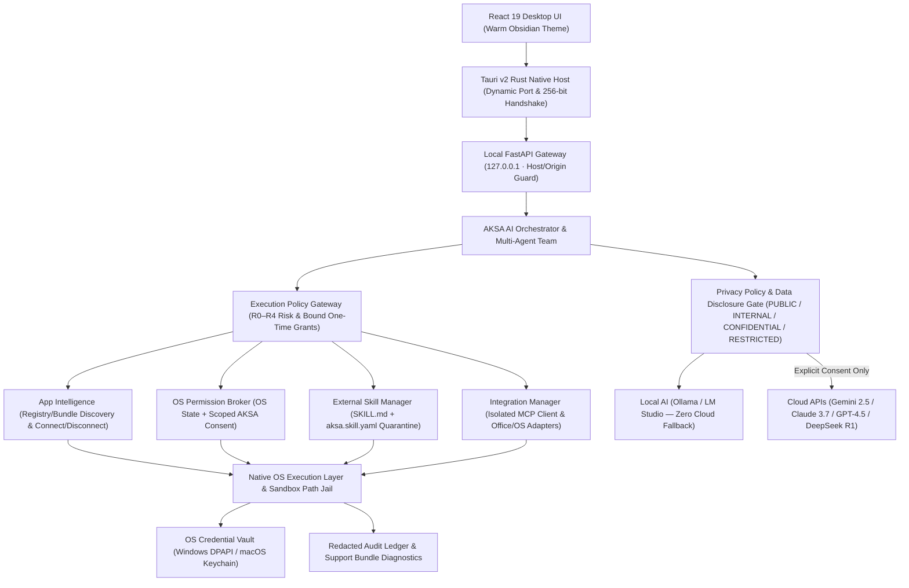

<div align="center">

<a href="#-aksa">
  
</a>

# AKSA
### Asisten Kerja &amp; Sistem Automasi — AI Desktop Operating Assistant
*(Hierarchical Multi-Agent Orchestrator, Authorized PC App Control, 16+ Agent Skills, OS Permission Broker &amp; Enterprise Security Baseline)*

<p align="center">
  <a href="./README.en.md"></a>
  
  
  
  
  
</p>

<p align="center">
  <b>Asisten kecerdasan desktop (AI Desktop Operating Assistant) yang beroperasi langsung di PC Anda dengan standar keamanan enterprise.</b><br>
  AKSA menggabungkan tim agen bertingkat (Supervisor &amp; Sub-Agen Spesialis), deteksi &amp; otorisasi aplikasi PC mandiri, broker izin sistem operasi 2-lapis, katalog 16+ keahlian portabel (<code>SKILL.md</code>), pencarian dokumen hibrida lokal (RAG), brankas kredensial OS (Windows DPAPI / macOS Keychain), dan kendali jarak jauh melalui Telegram.
</p>

[Fitur Utama](#-fitur-utama) • [Arsitektur Kecerdasan Desktop](#-arsitektur-kecerdasan-desktop-aksa) • [Keamanan & Privasi Enterprise](#-keamanan-enterprise-privasi-lokal--tata-kelola-data) • [Panduan Cepat](#-panduan-memulai-cepat-quickstart) • [Dokumentasi Lengkap](#-dokumentasi-teknis--tata-kelola)

</div>

---

## Mengapa AKSA Berbeda?

Mayoritas asisten AI hanya berjalan sebagai ruang obrolan di peramban web yang terpisah dari perangkat lunak, struktur folder, dan alur kerja nyata di komputer Anda. Sebaliknya, agen otomasi yang memberikan akses penuh tanpa batas berisiko membocorkan dokumen rahasia atau mengeksekusi perintah destruktif tanpa izin.

**AKSA (Asisten Kerja & Sistem Automasi)** dirancang dengan prinsip **Security-by-Default** dan **Explicit User Consent**:

1. **Ekosistem Terpadu (Model + Aplikasi PC + Skills -> Tim Agen):** Anda dapat memilih model AI terbaru per agen, menghubungkan aplikasi PC yang terinstall (*Connect / Disconnect* kapan saja bahkan saat aplikasi tertutup), memasang *Agent Skills* dalam 1 klik, lalu menetapkan izin akses aplikasi & keahlian tersebut secara spesifik ke masing-masing anggota **Tim Agen**.
2. **Automasi Dokumen & Aplikasi Perangkat Nyata:** Menghasilkan dan memodifikasi berkas kerja asli seperti spreadsheet **Excel (`.xlsx`)** lengkap dengan formula & grafik, dokumen **Word (`.docx`)** berstandar naskah dinas/kontrak, presentasi **PowerPoint (`.pptx`)**, laporan **PDF**, hingga duplikasi PDF-ke-Word dinamis.
3. **Kedaulatan Privasi tanpa Fallback Cloud Diam-Diam:** Mode `local_only` dan model lokal (**Ollama** / **LM Studio**) dijamin 100% tidak pernah membocorkan atau mengalihkan (*fallback*) data ke penyedia cloud dalam kondisi apa pun.
4. **Efisiensi Token hingga 80%:** Menggunakan *Sub-Agent Context Isolation* dan *Lazy Tool Loading* sehingga jendela konteks Manajer Eksekutif tetap ramping dan hemat biaya API.

---

## Fitur Utama

### 1. Kanvas Hierarki Tim Agen & Konfigurasi Hak Akses Granular
* **Visual Multi-Agent Builder (`@xyflow/react`):** Kelola struktur organisasi agen yang terdiri dari **Manajer Eksekutif (Supervisor)** dan **Sub-Agen Spesialis** (*Spesialis Administrasi & Office*, *Peneliti Dokumen & RAG*, *Operator PC & Automasi Sistem*) melalui tampilan Kanvas Visual maupun Daftar Organisasi.
* **3 Sub-Tab Hak Akses Alat (*Lazy Tool Loading*) per Agen:**
  * **Aplikasi PC Terhubung:** Centang aplikasi PC mana saja (yang telah diizinkan di menu *Aplikasi PC*) yang boleh diakses oleh agen tersebut.
  * **Keahlian Terpasang (*Skills*):** Tugaskan keahlian spesifik dari katalog yang telah dipasang ke agen terkait.
  * **Alat Inti Sistem:** Atur kapabilitas dasar (*Otomasi Dokumen*, *Basis Pengetahuan RAG*, *Python uv Runner*, *Computer Use*, *MCP*).
* **Dukungan Penuh Model AI Terbaru (Cloud & Lokal Gratis):**
  * **Google Gemini:** `gemini-2.5-pro`, `gemini-2.5-flash`, `gemini-2.5-flash-lite`, `gemini-2.0-flash`, `gemini-1.5-pro`
  * **Anthropic Claude:** `claude-3-7-sonnet-latest`, `claude-3-5-sonnet-latest`, `claude-3-5-haiku-latest`, `claude-3-opus-latest`
  * **OpenAI:** `gpt-4.5-preview`, `o3-mini`, `o1`, `gpt-4o`, `gpt-4o-mini`
  * **DeepSeek:** `deepseek-chat` (DeepSeek-V3 671B), `deepseek-reasoner` (DeepSeek-R1)
  * **Groq Cloud (LPU Kilat):** `llama-3.3-70b-versatile`, `deepseek-r1-distill-llama-70b`, `llama-3.1-8b-instant`, `qwen-2.5-32b`
  * **OpenRouter:** `anthropic/claude-3.7-sonnet`, `google/gemini-2.5-pro`, `deepseek/deepseek-r1`, `openrouter/auto`
  * **Ollama & LM Studio (100% Lokal & Gratis):** `qwen2.5:7b`, `qwen2.5-coder:7b`, `llama3.3:70b`, `llama3.2:3b`, `deepseek-r1:8b`, `phi4:14b`, `mistral:7b`

### 2. Intelijensi Aplikasi PC & Otorisasi Mandiri (`App Intelligence`)
* **Deteksi Aplikasi Terinstall yang Jujur:** Memindai registri Windows (`HKLM` / `HKCU`) dan direktori aplikasi macOS tanpa hak administrator, menyaring paket runtime/update sistem, dan memverifikasi keberadaan lokasi berkas (`launch_status: launchable | not_launchable`) tanpa menggunakan daftar aplikasi palsu.
* **Klasifikasi Kategori Integrasi Otomatis:** Mengelompokkan software ke dalam kategori *Otomasi Dokumen Office*, *Navigasi & Analisis Web*, *Penyunting Kode & Teks*, *Komunikasi & Produktivitas*, serta *Alat Sistem & Utilitas*.
* **Tombol Hubungkan & Putuskan Akses Mandiri:** Berikan atau cabut izin akses AKSA ke aplikasi tertentu (`Diizinkan / Terhubung` vs `Belum Diizinkan`) kapan saja secara langsung, **meskipun aplikasi tersebut sedang tidak dibuka/berjalan di latar belakang**.

### 3. Manajer Keahlian Eksternal (`SKILL.md` & 16+ Katalog Populer)
* **16 Katalog Keahlian Siap Pasang (1-Klik):** Tersedia secara default dalam status *Belum Terinstall* agar pengguna bebas memilih keahlian yang dibutuhkan:
  1. *Analisis Rekap Bulanan Excel* (`excel-monthly-report`)
  2. *Pemodelan Finansial & Valuasi Excel* (`excel-financial-modeler`)
  3. *Penyusun Kontrak & Perjanjian MoU* (`word-legal-contract`)
  4. *Tata Naskah Dinas & Surat Resmi RI* (`official-indonesian-correspondence`)
  5. *Ekstraktor Tabel Dokumen PDF* (`pdf-table-extractor`)
  6. *Analisis Data Eksploratif (EDA) & Visualisasi Python* (`python-data-analyst`)
  7. *Asisten Riset Regulasi & Web Terverifikasi* (`browser-research-assistant`)
  8. *Tinjauan Mutu Kode Git & Audit Standar* (`git-code-reviewer`)
  9. *Analisis & Optimasi Kueri SQL Relasional* (`sql-query-optimizer`)
  10. *Kalkulator PPh 21 (TER) & Simulasi Pajak Indonesia* (`indonesian-tax-calculator`)
  11. *Notula Rapat Eksekutif & Matriks Tindak Lanjut* (`meeting-minutes-generator`)
  12. *Arsitek Presentasi & Slide Pitching* (`powerpoint-pitch-deck`)
  13. *Telaah Jurnal Ilmiah & Sitasi APA/IEEE* (`academic-paper-summarizer`)
  14. *Rekonsiliasi Transaksi Bank & Audit Saldo CSV* (`csv-reconciliation-engine`)
  15. *Audit Konfigurasi Keamanan & Header HTTP* (`security-audit-scanner`)
  16. *Diagnostik Kesehatan OS & Utilisasi Sistem* (`system-admin-diagnostics`)
* **Karantina & Pemeriksaan Statis Ketat:** Menolak arsip dengan *path traversal* (`../`), *symbolic link*, duplikasi/tabrakan nama berkas (*case collision*), *zip bomb* (>25 MB atau rasio >50:1), file biner berbahaya (`.exe`, `.dll`, `.bat`), pencurian environment variable rahasia, maupun indikasi *prompt injection*. Setiap keahlian dipasang dalam kondisi **NONAKTIF secara default** dan seluruh izinnya otomatis dicabut saat di-uninstall.

### 4. Broker Izin Sistem Operasi 2-Lapis & Mesin Eksekusi 3-Tier
* **Pemisahan Status Izin OS vs Konsen AKSA:** Melacak `OSPermissionState` (`GRANTED`, `DENIED`, `NEEDS_USER_ACTION`, `UNSUPPORTED`) secara terpisah dari `AKSAConsentState` (`GRANTED_SCOPED`, `NOT_GRANTED`, `REVOKED`, `EXPIRED`) lengkap dengan buku besar audit (*Audit Ledger*).
* **3 Lapisan Automasi PC:**
  * **Tier 1 (Direct Office & Filesystem Engine):** Pembuatan dan modifikasi dokumen `.xlsx`, `.docx`, `.pptx`, dan `.pdf` di dalam sandbox dengan pencadangan otomatis ke `.aksa_backup/`.
  * **Tier 2 (OS Bridge, Isolated `uv` Python Runner & MCP Client):** Eksekusi skrip Python terisolasi dan klien JSON-RPC 2.0 Model Context Protocol (MCP) yang seluruh server eksternalnya nonaktif secara default dan environment subprocess-nya disterilkan dari kunci API.
  * **Tier 3 (Platform Computer Use Adapters):** Adapter terpisah `WindowsComputerUseAdapter` dan `MacOSComputerUseAdapter` dengan validasi enum aksi ketat, pemblokiran otomatis jendela sensitif (*password manager*, `1Password`, `Bitwarden`, `KeePass`, `Windows Security`, `Keychain Access`), verifikasi *precondition/postcondition*, *Failsafe Corner Abort*, dan tombol darurat `Ctrl+Shift+Q`.

### 5. Basis Pengetahuan Hibrida RAG Lokal & Pusat Kendali Telegram
* **Hybrid Search (LanceDB + SQLite FTS5 RRF):** Menggabungkan pencarian vektor semantik dan pencarian kata kunci eksak BM25 dengan pemantau folder otomatis berbasis hash SHA-256.
* **Telegram Remote Command Center:** Kendalikan agen dari smartphone menggunakan pesan teks, lampiran dokumen, atau *Voice Note* Bahasa Indonesia, diamankan dengan kode pairing 6-digit dan *whitelist* ID numerik pengguna.

---

## Arsitektur Kecerdasan Desktop AKSA



---

## Keamanan Enterprise, Privasi Lokal & Tata Kelola Data

AKSA memenuhi standar keamanan dalam [AKSA-ENTERPRISE-READINESS-MASTER-SPECIFICATION.md](./AKSA-ENTERPRISE-READINESS-MASTER-SPECIFICATION.md):

| Kontrol Keamanan | Implementasi Teknis |
|---|---|
| **OS Credential Vault** | Kunci API dienkripsi melalui **Windows DPAPI (`CryptProtectData`)** / **macOS Keychain** / **Sealed HMAC-SHA256 Vault**. Tabel SQLite `credentials_metadata` hanya menyimpan `credential_ref` dan pratinjau tersamar (`AIza••••••••9iYY`). |
| **Zero Local-to-Cloud Fallback** | Saat menggunakan model lokal (`Ollama` / `LM Studio`) atau mode `local_only`, sistem dijamin tidak pernah mengalihkan request ke penyedia cloud meskipun server lokal sedang mati. |
| **Data Disclosure Gate** | Tidak ada lampiran PDF otomatis dari folder kerja. Data berklasifikasi `RESTRICTED` diblokir dari cloud; lampiran dokumen wajib melalui persetujuan eksplisit pengguna. |
| **Bound One-Time Approvals** | Persetujuan berisiko tinggi (`R3`/`R4`) diikat secara kriptografis ke hash argumen `SHA-256`, `session_id`, `workspace_id`, `tool_version`, dan waktu kedaluwarsa, serta hanya dapat dikonsumsi satu kali (anti-replay). Semua field override publik (`execution_policy_override`, `skip_approval`, `is_admin`) ditolak secara aktif. |
| **Sandbox Path Jail & Revoke-All** | Resolusi kanonis `os.path.realpath`, pemblokiran path jaringan UNC (`\\server\share`) dan NTFS Alternate Data Streams (`:`), pelestarian izin *read-only*, serta pencabutan akses seluruh workspace satu klik (`POST /api/v1/workspaces/revoke-all`). |
| **Redacted Observability** | Seluruh log terstruktur dan *Support Diagnostic Bundle* (`GET /api/v1/system/diagnostics/support-bundle`) secara otomatis menyensor kunci API, token Bearer, kata sandi, dan isi dokumen. |

---

## Panduan Memulai Cepat (Quickstart)

### 1. Prasyarat Sistem
* **Node.js:** Versi 20.x atau 22.x LTS ([nodejs.org](https://nodejs.org/))
* **Python:** Versi 3.12+ beserta [uv](https://docs.astral.sh/uv/)
* **Rust (Opsional):** Diperlukan hanya jika ingin mengompilasi jendela native `.exe` / `.dmg` melalui Tauri (`winget install Rustlang.Rustup` atau [rustup.rs](https://rustup.rs/)).
* **Ollama (Opsional):** Untuk menjalankan model AI lokal gratis 100% offline ([ollama.com](https://ollama.com/)).

### 2. Klon Repositori & Instalasi
```bash
git clone https://github.com/yogijowo/aksa.git
cd aksa

# Pasang dependensi frontend
npm --prefix apps/desktop install

# Siapkan virtual environment Python di services/engine/.venv
uv venv services/engine/.venv
uv pip install -r services/engine/pyproject.toml --project services/engine
```

### 3. Menjalankan Aplikasi (Satu Perintah)
Peluncur lintas platform (`scripts/dev.js`) otomatis mendeteksi Python di dalam `.venv` lokal proyek:

```bash
# Mode Cepat (Web Browser UI di http://localhost:1420 + FastAPI Engine di port 43120 — Tanpa Butuh Rust)
npm run dev

# Mode Jendela Aplikasi Desktop Native Tauri v2 (Membutuhkan Rust / Cargo)
npm run dev:tauri
```

### 4. Menjalankan Suite Pengujian & Verifikasi Build
```bash
# Jalankan 33 skenario pengujian unit, integrasi, dan regresi keamanan P0/P1/P2
npm run test:backend

# Verifikasi kompilasi ketat TypeScript (tsc --noEmit) & bundle produksi Vite
npm run test:frontend
```

---

## Dokumentasi Teknis & Tata Kelola

### Dokumen Tata Kelola & Keamanan Utama
* [**`AKSA-ENTERPRISE-READINESS-MASTER-SPECIFICATION.md`**](./AKSA-ENTERPRISE-READINESS-MASTER-SPECIFICATION.md) — Spesifikasi induk kesiapan enterprise, baseline keamanan, dan *release gates*.
* [**`SECURITY.md`**](./SECURITY.md) — Model ancaman (*threat model*), batas kepercayaan, klasifikasi risiko `R0`–`R4`, dan prosedur pelaporan celah keamanan.
* [**`PRIVACY.md`**](./PRIVACY.md) — Kebijakan privasi *local-first*, `ProviderMode`, `DataClassification`, dan inventaris penyimpanan data lokal.
* [**`SUPPORT.md`**](./SUPPORT.md) — Panduan pemecahan masalah operasional (14 skenario kegagalan), kode error standar, dan cara mengekspor *Support Bundle* yang telah disensor.
* [**`CHANGELOG.md`**](./CHANGELOG.md) • [**`CONTRIBUTING.md`**](./CONTRIBUTING.md) • [**`CODE_OF_CONDUCT.md`**](./CODE_OF_CONDUCT.md) • [**`PROGRESS.md`**](./PROGRESS.md)

### Spesifikasi Arsitektur Domain (`docs/`)
* [**`AGENTS.md`**](./AGENTS.md) — Instruksi induk standar pengkodean, lokalisasi Bahasa Indonesia, dan struktur monorepo.
* [**`docs/01-ARCHITECTURE.md`**](./docs/01-ARCHITECTURE.md) — Arsitektur Tauri v2 + Python FastAPI Sidecar & IPC.
* [**`docs/02-MULTI-AGENT-AND-TOKEN-EFFICIENCY.md`**](./docs/02-MULTI-AGENT-AND-TOKEN-EFFICIENCY.md) — Orkestrasi hierarkis & efisiensi token.
* [**`docs/03-PC-AUTOMATION-AND-OFFICE-ENGINE.md`**](./docs/03-PC-AUTOMATION-AND-OFFICE-ENGINE.md) — Mesin automasi 3-Tier & Sandbox.
* [**`docs/04-RAG-AND-MEMORY-SYSTEM.md`**](./docs/04-RAG-AND-MEMORY-SYSTEM.md) — Mesin pencarian hibrida LanceDB + SQLite FTS5.
* [**`docs/05-TELEGRAM-GATEWAY.md`**](./docs/05-TELEGRAM-GATEWAY.md) — Spesifikasi gateway pusat kendali Telegram.
* [**`docs/06-UI-UX-DESIGN-SYSTEM.md`**](./docs/06-UI-UX-DESIGN-SYSTEM.md) — Sistem desain Warm Obsidian Claude Desktop & glosarium UI Indonesia.
* [**`docs/07-DATABASE-AND-API-SCHEMA.md`**](./docs/07-DATABASE-AND-API-SCHEMA.md) — Skema database SQLite, migrasi, dan kontrak REST/WebSocket.
* [**`docs/08-ROADMAP-AND-PHASES.md`**](./docs/08-ROADMAP-AND-PHASES.md) — Peta jalan pengembangan bertahap.

---

## Lisensi

Didistribusikan di bawah lisensi **[MIT License](./LICENSE)**.
