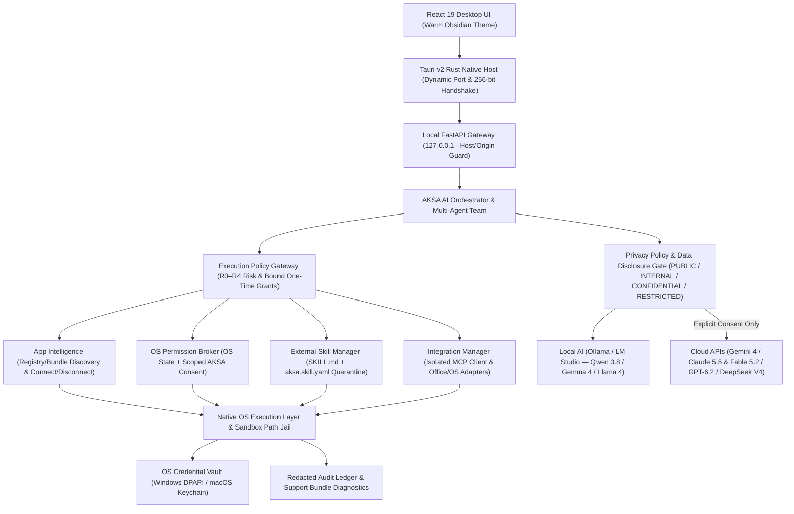

<div align="center">

<a href="#-aksa">
  
</a>

# AKSA
### Asisten Kerja &amp; Sistem Automasi — AI Desktop Operating Assistant
*(Hierarchical Multi-Agent Orchestrator, Adaptive Agent Learning, Dynamic Model Catalog, 20+ Agent Skills, OS Permission Broker &amp; Enterprise Security Baseline)*

<p align="center">
  <a href="./README.en.md"></a>
  
  
  
  
  
  
</p>

<p align="center">
  <b>Asisten kecerdasan desktop (AI Desktop Operating Assistant) yang beroperasi langsung di PC Anda dengan standar keamanan enterprise, pembelajaran per-agen adaptif, penemuan model dinamis, dan ekosistem keahlian portabel.</b><br>
  AKSA menggabungkan tim agen bertingkat (Supervisor &amp; Sub-Agen Spesialis), penyimpanan dan memori terisolasi per-agen di bawah direktori root pilihan pengguna, penemuan model dinamis dari 10 provider resmi, deteksi &amp; otorisasi aplikasi PC mandiri, broker izin sistem operasi 2-lapis, katalog 20+ keahlian terkurasi (<code>SKILL.md</code>) termasuk alur video &amp; administrasi Indonesia, pencarian dokumen hibrida lokal (RAG), brankas kredensial OS (Windows DPAPI / macOS Keychain), dan kendali jarak jauh melalui Telegram.
</p>

[Fitur Utama](#-fitur-utama) • [Arsitektur Kecerdasan Desktop](#-arsitektur-kecerdasan-desktop-aksa) • [Pembelajaran Per-Agen Adaptif](#-arsitektur-pembelajaran-per-agen-adaptif-adaptive-learning) • [Penemuan Model Dinamis](#-penemuan-model-multiprovider-dinamis-dynamic-discovery) • [Keamanan & Privasi Enterprise](#-keamanan-enterprise-privasi-lokal--tata-kelola-data) • [Panduan Cepat](#-panduan-memulai-cepat-quickstart) • [Dokumentasi Lengkap](#-dokumentasi-teknis--tata-kelola)

<br>


</div>

---

## Mengapa AKSA Berbeda?

Mayoritas asisten AI hanya berjalan sebagai ruang obrolan di peramban web yang terpisah dari perangkat lunak, struktur folder, dan alur kerja nyata di komputer Anda. Sebaliknya, agen otomasi yang memberikan akses penuh tanpa batas berisiko membocorkan dokumen rahasia atau mengeksekusi perintah destruktif tanpa izin.

**AKSA (Asisten Kerja & Sistem Automasi)** dirancang dengan prinsip **Security-by-Default**, **Explicit User Consent**, dan **Adaptive Agent Intelligence**:

1. **Pembelajaran Terisolasi Per-Agen (Adaptive Agent Learning):** Setiap agen memiliki direktori, profil, memori episodik, preferensi, dan keahlian hasil pembelajaran tersendiri di bawah `<AKSA_ROOT>/agents/<uuid>/`. Agen A tidak dapat membaca atau memodifikasi memori Agen B tanpa izin eksplisit. Pola kerja berulang dievaluasi di sandbox sebelum dipromosikan menjadi keahlian berversi (`1.0.0`) dengan perlindungan privasi penuh.
2. **Penemuan Model Dinamis Tanpa Hardcode:** Mengambil daftar model langsung dari API resmi 10 penyedia (OpenAI, Anthropic, Gemini, xAI, Mistral, DeepSeek, Groq, OpenRouter, Ollama, LM Studio), menormalisasi kapabilitas (reasoning, tool-calling, vision, context window), dan merekomendasikan model optimal berdasarkan peran tugas tanpa remapping diam-diam.
3. **Ekosistem Terpadu (Model + Aplikasi PC + Skills -> Tim Agen):** Anda dapat memilih model AI terbaru per agen, menghubungkan aplikasi PC yang terinstall (*Connect / Disconnect* kapan saja bahkan saat aplikasi tertutup), memasang *Agent Skills* (`SKILL.md`) dalam 1 klik, lalu menetapkan izin akses aplikasi & keahlian tersebut secara spesifik ke masing-masing anggota **Tim Agen**.
4. **Automasi Dokumen & Aplikasi Perangkat Nyata:** Menghasilkan dan memodifikasi berkas kerja asli seperti spreadsheet **Excel (`.xlsx`)** lengkap dengan formula & grafik, dokumen **Word (`.docx`)** berstandar naskah dinas/kontrak, presentasi **PowerPoint (`.pptx`)**, laporan **PDF**, alur video animasi **Remotion React** / **HyperFrames**, hingga duplikasi PDF-ke-Word dinamis.
5. **Kedaulatan Privasi tanpa Fallback Cloud Diam-Diam:** Mode `local_only` dan model lokal (**Ollama** / **LM Studio**) dijamin 100% tidak pernah membocorkan atau mengalihkan (*fallback*) data ke penyedia cloud dalam kondisi apa pun.
6. **Efisiensi Token hingga 80%:** Menggunakan *Sub-Agent Context Isolation*, *Lazy Tool Loading*, dan *Progressive Skill Disclosure* sehingga jendela konteks Manajer Eksekutif tetap ramping dan hemat biaya API.

---

## Fitur Utama

### 1. Arsitektur Pembelajaran Per-Agen Adaptif (`Adaptive Learning`)
* **Struktur Direktori Terisolasi Per-Agen:** Beroperasi di bawah direktori root AKSA pilihan pengguna (`<AKSA_ROOT>`):
  * `memory/episodic`: Ringkasan tugas dan hasil kerja minimal yang telah disensor dari kredensial/PII (bukan raw chat dump).
  * `memory/semantic`: Fakta stabil, konvensi proyek, dan aturan domain yang diverifikasi.
  * `memory/preferences`: Preferensi format output, tone bahasa, dan alat kerja.
  * `skills/candidates`: Prosedur berulang yang diajukan menjadi calon keahlian setelah memenuhi ambang minimal 3 tugas berhasil atau perintah pengguna eksplisit ("jadikan skill").
  * `skills/learned`: Keahlian yang telah lulus evaluasi keamanan sandbox dan dipromosikan ke versi immutable (`1.0.0`, `1.1.0`) dengan riwayat rollback.
* **Penyaring Privasi Pembelajaran (`LearningPrivacyFilter`):** Menghapus secara otomatis kunci API (`sk-...`, Bearer token, private key), NIK (16 digit), NPWP, nomor rekening, email, dan nomor telepon sebelum ringkasan disimpan ke memori atau dibagikan.
* **Isolasi Tanpa Bocor Antar-Agen (`AgentIsolationPolicy`):** Agen video tidak dapat mengakses memori atau keahlian internal milik agen keuangan/PBJ kecuali dipromosikan secara eksplisit ke pustaka bersama (`shared/skills/`).

### 2. Penemuan Model Multi-Provider Dinamis (`Dynamic Discovery`)
* **Integrasi Langsung API Resmi Provider:** Menemukan model secara otomatis dari endpoint resmi beserta katalog model terbaru:
  * **Google Gemini (`v1beta/models`):** `gemini-4-carbon` (Gemini 4 Carbon), `gemini-4-argon` (Gemini 4 Argon), `gemini-4-hydrogen` (Gemini 4 Hydrogen), `gemini-3.8-flash` (Gemini 3.8 Flash), `gemini-3.5-flash-lite`
  * **Anthropic Claude (`v1/models`):** `claude-fable-5-2` (Claude Fable 5.2), `claude-opus-5-5` (Claude Opus 5.5), `claude-sonnet-5-5` (Claude Sonnet 5.5), `claude-haiku-5-5` (Claude Haiku 5.5)
  * **OpenAI (`v1/models`):** `gpt-6.2-astra` (GPT-6.2 Astra), `gpt-6.2-sol` (GPT-6.2 Sol), `gpt-6.1-sol`, `gpt-6-luna` (GPT-6 Luna)
  * **DeepSeek:** `deepseek-v4-pro` (DeepSeek V4 Pro MoE), `deepseek-flash` (DeepSeek V4.1 Flash), `deepseek-chat`, `deepseek-reasoner` (DeepSeek R1)
  * **Groq Cloud (LPU):** `meta-llama/llama-4-maverick-17b-128e-instruct`, `meta-llama/llama-4-scout-17b-16e-instruct`, `qwen/qwen3-32b`, `deepseek-r1-distill-llama-70b`
  * **OpenRouter, xAI Grok & Mistral AI:** `anthropic/claude-opus-5-5`, `anthropic/claude-sonnet-5-5`, `google/gemini-4-carbon`, `openai/gpt-6.2-astra`, `deepseek/deepseek-v4-pro`, `openrouter/auto`
  * **Ollama & LM Studio (100% Lokal & Gratis):** `qwen3.8:8b`, `qwen3.8:14b`, `qwen3-coder:30b`, `gemma4:12b`, `deepseek-r1:8b`, `llama4:scout`
* **Normalisasi Kapabilitas:** Mengelompokkan model berdasarkan `text_input`, `image_input`, `audio_input`, `video_input`, `pdf_input`, `tool_calling`, `json_schema`, `reasoning`, dan `computer_use`.
* **Routing Berdasarkan Peran Tugas:** Memberikan rekomendasi model terbaik untuk *Coding*, *Reasoning*, *Vision/GUI*, *Riset*, dan percakapan umum.
* **Cache Resilient:** Penyimpanan cache model bertahan dari gangguan jaringan (katalog tidak dihapus jika provider sedang offline/gagal dihubungi) dan mencegah penggantian model diam-diam (*zero silent remapping*).

### 3. Kanvas Hierarki Tim Agen & Konfigurasi Hak Akses Granular
* **Visual Multi-Agent Builder (`@xyflow/react`):** Kelola struktur organisasi agen yang terdiri dari **Manajer Eksekutif (Supervisor)** dan **Sub-Agen Spesialis** melalui tampilan Kanvas Visual maupun Daftar Organisasi.
* **3 Sub-Tab Hak Akses Alat (*Lazy Tool Loading*) per Agen:**
  * **Aplikasi PC Terhubung:** Centang aplikasi PC mana saja (yang telah diizinkan di menu *Aplikasi PC*) yang boleh diakses oleh agen tersebut.
  * **Keahlian Terpasang (*Skills*):** Tugaskan keahlian spesifik dari katalog yang telah dipasang ke agen terkait (isolasi lokal per-agen atau pustaka bersama).
  * **Alat Inti Sistem:** Atur kapabilitas dasar (*Otomasi Dokumen*, *Basis Pengetahuan RAG*, *Python uv Runner*, *Computer Use*, *MCP*).

### 4. Intelijensi Aplikasi PC & Otorisasi Mandiri (`App Intelligence`)
* **Deteksi Aplikasi Terinstall yang Jujur:** Memindai registri Windows (`HKLM` / `HKCU`) dan direktori aplikasi macOS tanpa hak administrator, menyaring paket runtime/update sistem, dan memverifikasi lokasi berkas (`launch_status: launchable | not_launchable`).
* **Klasifikasi Kategori Integrasi Otomatis:** Mengelompokkan software ke dalam kategori *Otomasi Dokumen Office*, *Navigasi & Analisis Web*, *Penyunting Kode & Teks*, *Komunikasi & Produktivitas*, serta *Alat Sistem & Utilitas*.
* **Tombol Hubungkan & Putuskan Akses Mandiri:** Berikan atau cabut izin akses AKSA ke aplikasi tertentu (`Diizinkan / Terhubung` vs `Belum Diizinkan`) kapan saja secara langsung, **meskipun aplikasi tersebut sedang tidak dibuka/berjalan di latar belakang**.

### 5. Manajer Keahlian Eksternal (`SKILL.md` & 20+ Katalog Populer)
* **20+ Katalog Keahlian Siap Pasang (1-Klik) dengan *Progressive Disclosure*:**
  * **Video & Motion:** *Praktik Terbaik Video Remotion* (`remotion-best-practices`), *HyperFrames Motion Graphics* (`hyperframes-motion`), *Alur Kerja Generasi Video AI* (`ai-video-generation`).
  * **Desain & Frontend:** *Desain Antarmuka Frontend & UI Taste* (`frontend-design`), *Pedoman Desain Web* (`web-design-guidelines`).
  * **Naskah & Administrasi Indonesia:** *Tata Naskah Dinas & Surat Resmi RI* (`official-indonesian-correspondence`), *Penyuntingan Karya Ilmiah & Naskah ID* (`naskah-id`), *Keahlian Perpustakaan & Naskah DDTI* (`prisma-ddti-skills`), *Pemeriksaan Administrasi PBJ & ASN* (`pbj-asn-indonesia`), *Kalkulator PPh 21 & Pajak Indonesia* (`indonesian-tax-calculator`).
  * **Office & Dokumen:** *Analisis Rekap Bulanan Excel* (`excel-monthly-report`), *Pemodelan Finansial Excel* (`excel-financial-modeler`), *Penyusun Kontrak MoU* (`word-legal-contract`), *Ekstraktor Tabel PDF* (`pdf-table-extractor`), *Presentasi Pitch Deck* (`powerpoint-pitch-deck`).
  * **Rekayasa & Utilitas:** *Tinjauan Mutu Kode Git* (`git-code-reviewer`), *Analisis Data Eksploratif Python* (`python-data-analyst`), *Asisten Riset Web* (`browser-research-assistant`), *Optimasi Kueri SQL* (`sql-query-optimizer`), *Audit Keamanan HTTP* (`security-audit-scanner`), *Diagnostik OS* (`system-admin-diagnostics`).
* **Karantina & Pemeriksaan Statis Ketat:** Menolak arsip dengan *path traversal* (`../`), *symbolic link*, duplikasi/tabrakan nama berkas (*case collision*), *zip bomb* (>25 MB atau rasio >50:1), file biner berbahaya (`.exe`, `.dll`, `.bat`), dan *prompt injection*. Keahlian dipasang dalam kondisi **NONAKTIF secara default** dan seluruh izinnya otomatis dicabut saat di-uninstall.

### 6. Broker Izin Sistem Operasi 2-Lapis & Mesin Eksekusi 3-Tier
* **Pemisahan Status Izin OS Nyata vs Konsen AKSA:** Memvalidasi status native OS (TCC Screen Recording, macOS Accessibility, Windows UI Automation & Capture) terpisah dari konsen AKSA. Status `NEEDS_USER_ACTION` tidak pernah dipalsukan menjadi `GRANTED`.
* **3 Lapisan Automasi PC:**
  * **Tier 1 (Direct Office & Filesystem Engine):** Pembuatan dan modifikasi dokumen `.xlsx`, `.docx`, `.pptx`, dan `.pdf` di dalam sandbox dengan pencadangan otomatis ke `.aksa_backup/`.
  * **Tier 2 (OS Bridge, Isolated `uv` Python Runner & MCP Client):** Eksekusi skrip Python terisolasi dan klien JSON-RPC 2.0 Model Context Protocol (MCP) dengan sanitasi environment subprocess dari token/kunci API.
  * **Tier 3 (Platform Computer Use Adapters):** Adapter Windows & macOS dengan pemblokiran otomatis jendela sensitif (*password manager*, `1Password`, `Bitwarden`, `KeePass`, `Windows Security`, `Keychain Access`), verifikasi *precondition/postcondition*, *Failsafe Corner Abort*, dan tombol darurat `Ctrl+Shift+Q`.

### 7. Basis Pengetahuan Hibrida RAG Lokal & Pusat Kendali Telegram
* **Hybrid Search (LanceDB + SQLite FTS5 RRF):** Menggabungkan pencarian vektor semantik dan pencarian kata kunci eksak BM25 dengan pemantau folder otomatis berbasis hash SHA-256.
* **Telegram Remote Command Center:** Kendalikan agen dari smartphone menggunakan pesan teks, lampiran dokumen, atau *Voice Note* Bahasa Indonesia, diamankan dengan kode pairing 6-digit dan *whitelist* ID numerik pengguna.

---

## Arsitektur Kecerdasan Desktop AKSA



---

## Keamanan Enterprise, Privasi Lokal & Tata Kelola Data

AKSA menerapkan arsitektur keamanan berlapis yang terdokumentasi di [`SECURITY.md`](./SECURITY.md) dan [`PRIVACY.md`](./PRIVACY.md):

| Kontrol Keamanan | Implementasi Teknis |
|---|---|
| **Zero-Trust Sidecar Handshake** | Otentikasi token sidecar menggunakan verifikasi tantangan-tanggapan (*challenge-response nonce*). Token rahasia tidak pernah dikirim sebelum identitas engine diverifikasi. Mode produksi *fail-closed* tanpa fallback dev token. |
| **OS Credential Vault & DPAPI** | Kunci API dienkripsi melalui **Windows DPAPI (`CryptProtectData`)** / **macOS Keychain** / **Sealed HMAC-SHA256 Vault** dengan izin berkas `0o600`. File kunci fallback tanpa enkripsi ditolak di mode produksi. |
| **Host Principal & Workspace Sandbox** | Otorisasi ketat mengikat seluruh aksi ke identitas akun host OS (`user:<getpass.getuser()>`). Header `X-Principal-ID` palsu ditolak (403). Seluruh akses berkas dan pencarian RAG diverifikasi kanonis (`os.path.realpath`) terhadap daftar folder kerja yang diizinkan. |
| **Bound One-Time HITL Approvals** | Persetujuan berisiko tinggi (`R3`/`R4`) diikat secara kriptografis ke `action_id`, hash argumen `SHA-256`, `session_id`, `workspace_id`, `tool_version`, dan waktu kedaluwarsa, serta hanya dapat dikonsumsi satu kali (anti-replay). Seluruh parameter override publik ditolak secara aktif. |
| **Broker Izin OS Non-Spoofing** | Validasi status native OS (TCC Screen Recording, AVFoundation Camera/Mic, macOS Accessibility, Windows UI Automation & Capture) dilaporkan secara jujur (`NEEDS_USER_ACTION` / `UNKNOWN` / `GRANTED`). Izin tidak pernah dipalsukan hanya dari keberadaan binary `osascript` atau `GetDC(0)`. |
| **Strict MCP Subprocess Lifecycle** | Setiap parameter MCP divalidasi ketat terhadap skema JSON sebelum dieksekusi. Respons tanpa jabat tangan `initialize` diverifikasi ditolak secara *fail-closed*, dan subproses dijamin di-*reap* saat terminasi. |
| **Marketplace Skills & Sandboxed Runner** | Ekosistem keahlian dilengkapi toko kepercayaan penerbit (*Publisher Trust Store*) berbasis verifikasi tanda tangan digital Ed25519. Skrip keahlian dieksekusi dalam subprocess dengan hak terbatas (*least privilege*), lingkungan tersanitasi, dan ruang kerja terisolasi. |
| **Privacy Gate & Izin Data Konfidensial** | Data berklasifikasi `CONFIDENTIAL` selalu mewajibkan konsen pengguna eksplisit per-permintaan sebelum dikirim ke cloud. Dilengkapi sensor regex otomatis untuk PII (NIK, NPWP, telepon, email) dan kredensial rahasia. |
| **Zero Local-to-Cloud Fallback** | Saat menggunakan model lokal (`Ollama` / `LM Studio`) atau mode `local_only`, sistem dijamin tidak pernah mengalihkan request ke penyedia cloud dalam kondisi apa pun. |
| **Pasokan Rantai Perangkat Lunak (SBOM)** | Penghasilan otomatis CycloneDX Software Bill of Materials (SBOM) multi-ekosistem yang mencakup pustaka Python (`uv`/`pip`), frontend (`npm`), dan dependensi native Rust (`Cargo.lock`). |

---

## Panduan Memulai Cepat (Quickstart)

### 1. Prasyarat Sistem
* **Node.js:** Versi 20.x atau 22.x LTS ([nodejs.org](https://nodejs.org/))
* **Python:** Versi 3.12+ beserta [uv](https://docs.astral.sh/uv/)
* **Rust (Opsional):** Diperlukan hanya jika ingin mengompilasi jendela native `.exe` / `.dmg` melalui Tauri (`winget install Rustlang.Rustup` atau [rustup.rs](https://rustup.rs/)).
* **Ollama (Opsional):** Untuk menjalankan model AI lokal gratis 100% offline ([ollama.com](https://ollama.com/)).

### 2. Klon Repositori & Instalasi
```bash
git clone https://github.com/yogijowo/aksa.git
cd aksa

# Pasang dependensi frontend
npm --prefix apps/desktop install

# Siapkan virtual environment Python di services/engine/.venv
uv venv services/engine/.venv
uv pip install -r services/engine/pyproject.toml --project services/engine
```

### 3. Menjalankan Aplikasi (Satu Perintah)
Peluncur lintas platform (`scripts/dev.js`) otomatis mendeteksi Python di dalam `.venv` lokal proyek:

```bash
# Mode Cepat (Web Browser UI di http://localhost:1420 + FastAPI Engine di port 43120 — Tanpa Butuh Rust)
npm run dev

# Mode Jendela Aplikasi Desktop Native Tauri v2 (Membutuhkan Rust / Cargo)
npm run dev:tauri
```

### 4. Menjalankan Suite Pengujian & Verifikasi Build
```bash
# Jalankan rangkaian uji Python + Frontend + Rust (308 total skenario: 281 Pytest [277 passed & 4 skipped Windows/Linux-only di macOS] + 9 Vitest + 18 Cargo)
npm test && cargo test --manifest-path apps/desktop/src-tauri/Cargo.toml

# Verifikasi kompilasi ketat TypeScript (tsc --noEmit) & bundle produksi Vite
npm run test:frontend
```

> **Status Kejujuran Audit & Batasan Verifikasi Lintas-OS:**
> * Seluruh temuan **P1 (`P1-01` build & verifikasi binary sidecar PyInstaller nyata sebelum Cargo/Tauri)** dan **P2 (`RLIMIT_NPROC` headroom adaptif + telemetri `EAGAIN`)** dari [`docs/AKSA-INDEPENDENT-REAUDIT-CYCLE-12-2026-11-19.md`](./docs/AKSA-INDEPENDENT-REAUDIT-CYCLE-12-2026-11-19.md) (serta Siklus 7–11) telah diremediasi di kode sumber dan diuji via [`services/engine/tests/test_reaudit_cycle12_remediation.py`](./services/engine/tests/test_reaudit_cycle12_remediation.py).
> * **Verifikasi Lokal (macOS `darwin`):** Binary frozen `aksa-engine-aarch64-apple-darwin` terkompilasi penuh via PyInstaller (`129,210,976` bytes), lulus `--verify-only` & `smoke-test --require-executable` & `--verifier-worker`; `pytest` **277 passed, 4 skipped** (test runtime khusus Windows AppContainer & Linux `bwrap`), `cargo test` **18 passed**, `vitest` **9 passed**, `cargo check` bersih, `tsc --noEmit && vite build` bersih, dan `npm audit --omit=dev --audit-level=high` **0 vulnerabilities**.
> * **Syarat Menuju Public Beta:** Bukti run **GitHub Actions CI (`.github/workflows/ci.yml`)** & **Security (`.github/workflows/security.yml`)** hijau pada commit terbaru untuk ketiga runner (**`windows-latest`**, **`ubuntu-latest`**, **`macos-latest`**) termasuk build sidecar PyInstaller nyata + Cargo test + uji sandbox OS nyata, diikuti **Re-Audit Independen Siklus 13**.

---

## Dokumentasi Teknis & Tata Kelola

### Dokumen Tata Kelola & Keamanan Utama
* [**`docs/AKSA-INDEPENDENT-REAUDIT-CYCLE-12-2026-11-19.md`**](./docs/AKSA-INDEPENDENT-REAUDIT-CYCLE-12-2026-11-19.md) — **Laporan Re-Audit Independen Siklus 12 (Terkini)** (blocker sidecar CI sebelum Cargo/Tauri & headroom adaptif `RLIMIT_NPROC`).
* [**`docs/AKSA-INDEPENDENT-REAUDIT-CYCLE-11-2026-11-19.md`**](./docs/AKSA-INDEPENDENT-REAUDIT-CYCLE-11-2026-11-19.md) — Laporan Re-Audit Independen Siklus 11 (regresi OpenBLAS/`RLIMIT_NPROC=0` Linux, kegagalan SQLite clean-runner macOS, dan celah TOCTOU direktori perantara).
* [**`docs/AKSA-INDEPENDENT-REAUDIT-CYCLE-10-2026-11-19.md`**](./docs/AKSA-INDEPENDENT-REAUDIT-CYCLE-10-2026-11-19.md) — Laporan Re-Audit Independen Siklus 10 (temuan verifier worker OS sandbox, streaming output limits, dan status CI matrix).
* [**`docs/AKSA-INDEPENDENT-REAUDIT-CYCLE-9-2026-11-19.md`**](./docs/AKSA-INDEPENDENT-REAUDIT-CYCLE-9-2026-11-19.md) — Laporan Re-Audit Independen Siklus 9 beserta log perbaikan worker killable, batas `max_bytes` & payload API, formula unsupported fail-closed, dan guard ZIP bomb OOXML.
* [**`docs/AKSA-INDEPENDENT-REAUDIT-CYCLE-8-2026-11-19.md`**](./docs/AKSA-INDEPENDENT-REAUDIT-CYCLE-8-2026-11-19.md) — Laporan Re-Audit Independen Siklus 8 & log perbaikan isolasi context-local replay & verifier postcondition.
* [**`docs/AKSA-INDEPENDENT-REAUDIT-CYCLE-7-2026-11-19.md`**](./docs/AKSA-INDEPENDENT-REAUDIT-CYCLE-7-2026-11-19.md) — Laporan Re-Audit Independen Siklus 7 & log remediasi OS sandbox.
* [**`docs/AKSA-INDEPENDENT-REAUDIT-CYCLE-3-2026-11-18.md`**](./docs/AKSA-INDEPENDENT-REAUDIT-CYCLE-3-2026-11-18.md) — Arsip historis Re-Audit Siklus 3 (telah digantikan oleh audit lebih ketat Siklus 4–7).
* [**`docs/AKSA-INDEPENDENT-TECHNICAL-AUDIT-2026-11-18.md`**](./docs/AKSA-INDEPENDENT-TECHNICAL-AUDIT-2026-11-18.md) — Laporan Audit Teknis Independen Awal.
* [**`SECURITY.md`**](./SECURITY.md) — Model ancaman (*threat model*), batas kepercayaan, klasifikasi risiko `R0`–`R4`, dan prosedur pelaporan celah keamanan.
* [**`PRIVACY.md`**](./PRIVACY.md) — Kebijakan privasi *local-first*, `ProviderMode`, `DataClassification`, dan inventaris penyimpanan data lokal.
* [**`SUPPORT.md`**](./SUPPORT.md) — Panduan pemecahan masalah operasional (14 skenario kegagalan), kode error standar, dan cara mengekspor *Support Bundle* yang telah disensor.
* [**`CHANGELOG.md`**](./CHANGELOG.md) • [**`CONTRIBUTING.md`**](./CONTRIBUTING.md) • [**`CODE_OF_CONDUCT.md`**](./CODE_OF_CONDUCT.md) • [**`PROGRESS.md`**](./PROGRESS.md)

### Spesifikasi Arsitektur Domain (`docs/`)
* [**`AGENTS.md`**](./AGENTS.md) — Instruksi induk standar pengkodean, lokalisasi Bahasa Indonesia, dan struktur monorepo.
* [**`docs/01-ARCHITECTURE.md`**](./docs/01-ARCHITECTURE.md) — Arsitektur Tauri v2 + Python FastAPI Sidecar & IPC.
* [**`docs/02-MULTI-AGENT-AND-TOKEN-EFFICIENCY.md`**](./docs/02-MULTI-AGENT-AND-TOKEN-EFFICIENCY.md) — Orkestrasi hierarkis & efisiensi token.
* [**`docs/03-PC-AUTOMATION-AND-OFFICE-ENGINE.md`**](./docs/03-PC-AUTOMATION-AND-OFFICE-ENGINE.md) — Mesin automasi 3-Tier & Sandbox.
* [**`docs/04-RAG-AND-MEMORY-SYSTEM.md`**](./docs/04-RAG-AND-MEMORY-SYSTEM.md) — Mesin pencarian hibrida LanceDB + SQLite FTS5.
* [**`docs/05-TELEGRAM-GATEWAY.md`**](./docs/05-TELEGRAM-GATEWAY.md) — Spesifikasi gateway pusat kendali Telegram.
* [**`docs/06-UI-UX-DESIGN-SYSTEM.md`**](./docs/06-UI-UX-DESIGN-SYSTEM.md) — Sistem desain Warm Obsidian Claude Desktop & glosarium UI Indonesia.
* [**`docs/07-DATABASE-AND-API-SCHEMA.md`**](./docs/07-DATABASE-AND-API-SCHEMA.md) — Skema database SQLite, migrasi, dan kontrak REST/WebSocket.
* [**`docs/08-ROADMAP-AND-PHASES.md`**](./docs/08-ROADMAP-AND-PHASES.md) — Peta jalan pengembangan bertahap.

---

## Lisensi

Didistribusikan di bawah lisensi **[MIT License](./LICENSE)**.
