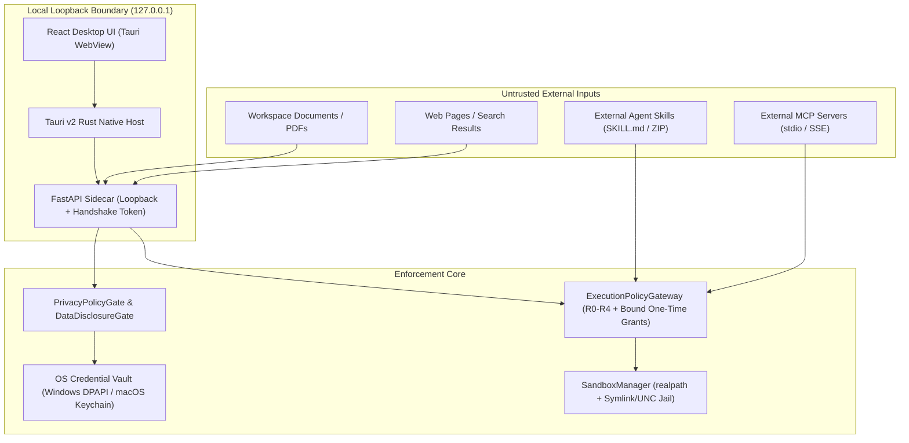

# Security Policy & Threat Model (`SECURITY.md`)

## 1. Security Philosophy

AKSA is engineered around **Deny-by-Default**, **Explicit User Consent**, and **Server-Side Enforcement**:
- No file, folder, application, screen, camera, microphone, network endpoint, or command execution is permitted without explicit authorization.
- UI controls are convenience indicators only; every security boundary is enforced in the Python Agent Engine (`ExecutionPolicyGateway`, `SandboxManager`, `PrivacyPolicyGate`) and Tauri Rust Native Host.
- Local-only mode never falls back to cloud providers under any condition.
- Secrets (API keys, bot tokens) are stored in the OS Credential Vault (Windows DPAPI / macOS Keychain / Sealed Vault), never in SQLite plaintext.

---

## 2. Trust Boundaries & Data-Flow Architecture

---

## 3. Threat Model & Mitigations (Section 4.1)

| # | Threat Scenario | Mitigation Implemented | Residual Risk & Owner |
|---|---|---|---|
| 1 | **Prompt Injection** from PDFs, documents, web pages, or skills | Untrusted content is isolated in sub-agent scratchpads; tool execution requires `ExecutionPolicyGateway` approval bound to canonical argument hashes. | High-complexity semantic manipulation still requires user review on R2-R4 approval dialogs. (Owner: Core Engine) |
| 2 | **Malicious Skill Archive** attempting path escape, secret theft, or code execution | Quarantine scanner blocks `../`, symlinks, case collisions, >25 MB zip bombs, binary executables, and `os.environ` secret harvesting; skills install as `DISABLED` by default. | Users must review skill instructions before enabling. (Owner: Skill Runtime) |
| 3 | **Compromised MCP Server** | External MCP servers are disabled by default; subprocess environment is scrubbed of all `*_API_KEY` / `*_TOKEN` variables; JSON-RPC responses are validated. | Stdio servers run as user-level processes when enabled. (Owner: MCP Runtime) |
| 4 | **Local API Attacked by Local Process / Browser Drive-by** | Sidecar binds strictly to `127.0.0.1`, validates `Host` and `Origin` allowlists (blocking DNS rebinding), enforces 10 MB body limit, and requires per-launch token in production mode. | Other processes running under the same OS user account have user-level privileges. (Owner: Native Host) |
| 5 | **WebSocket Cross-Session Hijacking** | `ConnectionManager` binds session ownership per WebSocket connection and rejects cross-session `subscribe` attempts from other clients. | None known for single-user local loopback. (Owner: API Gateway) |
| 6 | **Path Traversal, Symlink Escape, UNC & ADS** | `SandboxManager.validate_path` resolves `os.path.realpath`, blocks UNC (`\\server\share`) and NTFS Alternate Data Streams (`:`), and verifies target is inside authorized workspace root. | None when symlink target is outside workspace root. (Owner: Sandbox) |
| 7 | **Silent Cloud Fallback / Auto-Attachment Exfiltration** | `PrivacyPolicyGate` blocks all cloud calls in `local_only` mode, disables cross-provider fallback, and requires explicit `allow_external_disclosure` before attaching files. | User-approved cloud requests are subject to third-party provider terms. (Owner: LLM Router) |
| 8 | **Plaintext Credential Theft from SQLite** | `CredentialVault` seals secrets using Windows DPAPI (`CryptProtectData`) / macOS Keychain; SQLite `credentials_metadata` stores only `credential_ref` and masked previews. | Malware running as the same logged-in Windows user can call `CryptUnprotectData`. (Owner: Security) |
| 9 | **Screen Capture / Password Manager Scraping** | `ComputerUseAdapter` inspects foreground window titles and blocks actions targeting `1Password`, `Bitwarden`, `KeePass`, `Windows Security`, `Credential Manager`, and `Keychain Access`. | Custom password dialogs with generic window titles may not match keyword filters. (Owner: Computer Use) |

---

## 4. Action Risk Classification (R0 – R4)

| Level | Classification | Examples | Policy Enforcement |
|---|---|---|---|
| **R0** | Read-Only Low | Engine health, provider status, non-sensitive metadata | Permitted within authenticated session |
| **R1** | Read Sensitive | Reading workspace documents, inspecting spreadsheets | Requires active workspace `allow_read` scope |
| **R2** | Reversible Write | Creating/editing workspace files with `.aksa_backup/` snapshot | Requires workspace `allow_write` scope + automatic backup |
| **R3** | External Side Effect | Cloud document attachment, external API/MCP mutation | Requires explicit consent / `DataDisclosureGate` |
| **R4** | Destructive / Privileged | Custom Python script execution, Tier 3 GUI mouse/keyboard control, file deletion | Requires one-time cryptographic `ApprovalGrant` bound to canonical arguments hash, session, workspace, tool version, and expiry |

---

## 5. Reporting a Vulnerability

If you discover a security vulnerability in AKSA:
1. **Do NOT open a public GitHub issue** containing exploit payloads or unpatched P0/P1 details.
2. Generate a redacted diagnostic bundle via `GET /api/v1/system/diagnostics/support-bundle` (verify no personal data is included).
3. Submit a private security advisory via GitHub Security Advisories on `https://github.com/yogijowo/aksa/security/advisories`.
