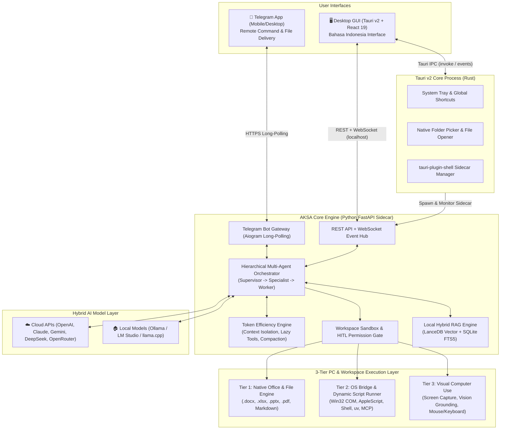

# 01 — System Architecture Specification

## 1. Architectural Overview

**AKSA** uses a **Hybrid Tauri v2 (Rust) + Local Python Sidecar Architecture**. This pattern combines the ultra-low memory footprint, native speed, and small binary size of **Tauri v2 + React 19** with the unmatched AI orchestration, data processing, and PC/Office automation ecosystem of **Python**.



---

## 2. Why This Architecture?

| Requirement | Architectural Solution | Benefit |
| :--- | :--- | :--- |
| **Ultra-Light RAM & Small Installer** | **Tauri v2 (Rust) + React + Tailwind v4 + `shadcn/ui`** | Uses ~70% less RAM than Electron when running in the background for Telegram, with a tiny native UI binary (~10 MB). |
| **Deep MS Office & File Manipulation** | **Python Sidecar (`openpyxl`, `python-docx`, `python-pptx`, `pywin32`)** | Python has the most mature libraries for generating complex spreadsheets with formulas, Word reports, and controlling live Office apps. |
| **Self-Extending Agent Capabilities** | **Embedded `uv` Python Runtime** | When an agent encounters a novel task, it can write a Python script and run `uv run --with <pkg> script.py` in an isolated cache without polluting the user's system. |
| **Background Operation for Telegram** | **Tauri System Tray (`TrayIconBuilder`) + Async Python Loop** | Closing the main window minimizes AKSA to the System Tray (Windows) or Menu Bar (macOS) with minimal RAM impact so the user can message their PC via Telegram 24/7. |
| **Zero-Setup Local Database** | **SQLite + LanceDB (File-based)** | Stored directly inside the user's OS AppData folder; requires zero external database servers or Docker containers. |

---

## 3. Process Lifecycle & Inter-Process Communication (IPC)

### 3.1 Startup Sequence
1. **Tauri Rust Core Starts:** Reads local configuration, selects a free localhost port (e.g., `127.0.0.1:43120`), and generates a per-session `X-AKSA-Auth-Token`.
2. **Python Sidecar Spawns:** Tauri spawns the bundled Python FastAPI sidecar via `tauri_plugin_shell::ShellExt` (or runs `uv run uvicorn` in dev mode), passing `--port 43120` and `--auth-token <token>`.
3. **Database & Services Init:** The Python engine initializes SQLite tables, opens LanceDB, starts the `watchdog` folder monitor for active workspaces, and starts the Telegram Bot polling loop (if configured).
4. **UI Ready:** The React frontend queries `invoke("get_engine_connection_info")` from Tauri Rust, receives `{ port, authToken }`, and connects to the Python engine once `/api/v1/health` responds with `200 OK`.

### 3.2 Communication Channels
1. **Tauri Native Commands & Plugins (`@tauri-apps/api/core` & official plugins):**
   - Used strictly for native desktop shell actions:
     - `@tauri-apps/plugin-dialog` (`open({ directory: true })`): Opens native Windows/macOS folder picker.
     - `@tauri-apps/plugin-opener` (`openPath(path)` / `revealItemInDir(path)`): Opens a generated file (e.g., `Laporan.xlsx`) in the default desktop app (Excel) or reveals it in Explorer/Finder.
     - `@tauri-apps/plugin-notification`: OS-level toast notification.
     - `invoke("get_engine_connection_info")` / `invoke("restart_sidecar")`: Manages Python sidecar lifecycle.
2. **REST API (`http://127.0.0.1:<port>/api/v1/*`):**
   - Used for CRUD operations: managing agents, hierarchies, model configurations, workspace folders, RAG documents, and Telegram settings.
3. **WebSocket Stream (`ws://127.0.0.1:<port>/ws/stream`):**
   - Multiplexed bi-directional real-time event bus:
     - Streams token-by-token agent responses.
     - Broadcasts live hierarchical state transitions (e.g., `Manager Agent` delegating task to `Excel Specialist Agent`).
     - Pushes **Human-in-the-Loop (HITL) Approval Requests** to the UI when an agent requests permission for a sensitive action.
     - Pushes real-time token consumption and cost metrics.

---

## 4. Application Data Directory Structure

AKSA stores all persistent internal state in the standard OS application data folder (`%APPDATA%\com.aksa.desktop` on Windows, `~/Library/Application Support/com.aksa.desktop` on macOS):

```text
<AppData>/com.aksa.desktop/
├── config.json                  # App-level bootstrap settings (theme, tray, sidecar port)
├── data/
│   ├── aksa.db                  # SQLite database (agents, chats, permissions, token logs, FTS5)
│   └── lancedb/                 # Embedded LanceDB vector tables for RAG & semantic memory
├── runtime/
│   ├── uv/                      # Portable uv binary & isolated virtual environments for agent scripts
│   └── skills/                  # Custom reusable Python tools/skills created by the agents
└── logs/
    ├── desktop.log              # Tauri Rust process logs
    └── engine.log               # Rotating Python sidecar logs
```

> **Note:** User documents and generated files are **never** hidden inside `<AppData>`. They are read from and written directly to the **Workspace Folder** explicitly chosen by the user (e.g., `D:\Kerjaan\Keuangan`).

---

## 5. Cross-Platform Packaging Strategy (Windows & macOS)

1. **Python Engine Sidecar Bundling:**
   - Packaged using **PyInstaller** with target-triple naming required by Tauri (`aksa-engine-x86_64-pc-windows-msvc.exe` on Windows, `aksa-engine-aarch64-apple-darwin` / `aksa-engine-x86_64-apple-darwin` on macOS) placed inside `apps/desktop/src-tauri/binaries/` and declared under `bundle.externalBin` in `tauri.conf.json`.
2. **Tauri Bundler (`tauri.conf.json`):**
   - **Windows Target:** NSIS Installer (`.exe`) and `.msi` via `cargo tauri build`, using Windows Edge WebView2.
   - **macOS Target:** `.dmg` disk image & `.app` bundle, including macOS `Info.plist` entitlements for Screen Recording & Accessibility (required for Tier 3 Visual Computer Use and AppleScript automation).

