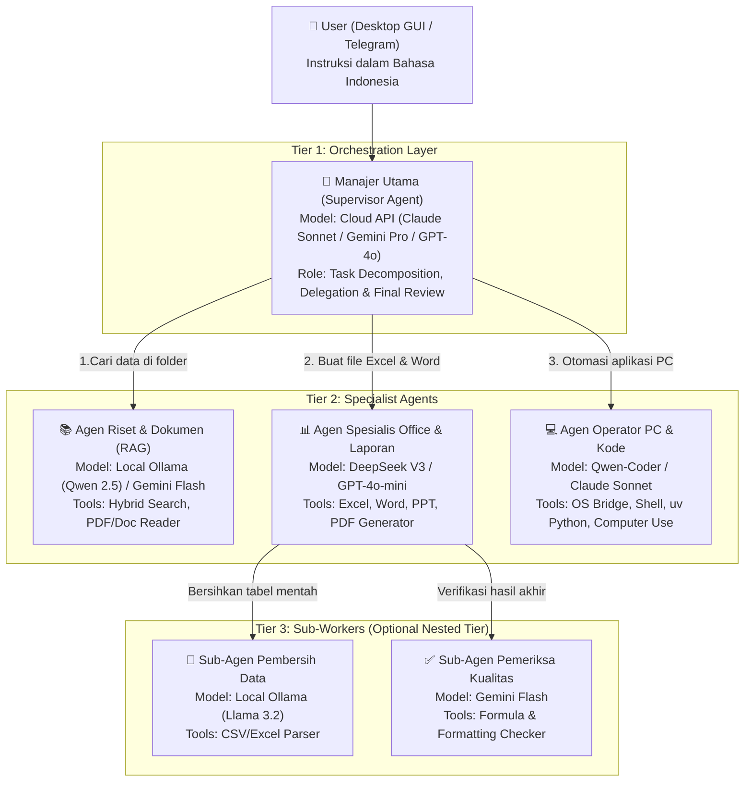

# 02 — Hierarchical Multi-Agent System & Token Efficiency Specification

## 1. Hierarchical Multi-Agent Architecture

AKSA enables users to build and run **multi-tiered agent teams** where a high-level manager coordinates specialized sub-agents, mimicking a real-world human organization.



---

## 2. Agent Data Model & Hierarchy Configuration

Every agent node in AKSA has an independent configuration so users can mix and match models, prompts, and tools visually:

```python
class AgentNodeConfig(BaseModel):
    id: str                              # Unique UUID
    name: str                            # e.g., "Manajer Eksekutif", "Spesialis Excel"
    role_title: str                      # Bahasa Indonesia role subtitle
    description: str                     # Used by parent Supervisor to know when to delegate to this agent
    parent_id: str | None                # None for root Supervisor; Parent Agent ID for sub-agents
    tier_level: int                      # 0 = Root Supervisor, 1 = Specialist, 2 = Sub-Worker
    
    # Per-Agent Model Configuration
    provider: Literal[
        "openai", "anthropic", "gemini", "deepseek", 
        "openrouter", "groq", "ollama", "lmstudio", "custom_openai"
    ]
    model_id: str                        # e.g., "claude-3-7-sonnet", "gemini-2.5-pro", "ollama/qwen2.5:7b"
    temperature: float = 0.2
    max_tokens: int = 4096
    
    # Prompt & Capabilities
    system_prompt_id_or_custom: str      # Bahasa Indonesia system instructions
    enabled_tool_categories: list[str]   # e.g., ["office_excel", "office_word", "rag_search"]
    can_delegate: bool = True            # True if this agent has child sub-agents
    max_iterations: int = 15             # Loop guard to prevent infinite agent loops
```

---

## 3. Unified Multi-Model Router (Cloud API + Local AI)

AKSA provides a single unified LLM interface (`services/engine/app/core/llm_router.py`) supporting both commercial APIs and 100% free local inference:

### 3.1 Cloud API Providers (via LiteLLM)
- **Supported Providers:** OpenAI, Anthropic, Google Gemini, DeepSeek, Groq, OpenRouter, and any OpenAI-compatible base URL.
- **API Key Security:** Stored encrypted in local configuration / OS Credential Vault (`keyring`).
- **Automatic Fallback:** Users can configure a fallback model (e.g., if an API hits a rate limit, automatically fall back to another API or a local Ollama model).

### 3.2 Local Model Providers (Zero API Cost & 100% Offline Privacy)
- **Ollama Native Integration (`http://localhost:11434`):**
  - Auto-detects if Ollama is installed and running on the PC.
  - Lists installed local models (`ollama list`) directly in the GUI dropdown.
  - Allows pulling recommended models (e.g., `qwen2.5:7b`, `qwen2.5-coder:7b`, `gemma3:4b`, `llama3.2:3b`) with a progress bar inside the AKSA settings page.
- **LM Studio / Local OpenAI Server (`http://localhost:1234/v1`):**
  - Auto-discovers models loaded in LM Studio or `llama-server`.

---

## 4. Token Efficiency Engine (5 Core Techniques)

A major weakness of traditional multi-agent frameworks (like standard CrewAI or AutoGen) is **exponential token bloat**, where every agent passes the entire conversation history and all 50+ tool schemas back and forth. AKSA solves this with **5 strict token-saving mechanisms**:

### 4.1 Technique 1: Sub-Agent Context Isolation (Task Scoping & Summary Handback)
When a **Supervisor Agent** delegates a sub-task to a **Sub-Agent**:
1. The Sub-Agent starts with a **fresh, isolated scratchpad** containing *only*:
   - Its specific role prompt.
   - The targeted task brief and relevant file paths passed by the Supervisor.
2. Suppose the Sub-Agent reads a 100-page PDF (50,000 tokens) or runs 10 steps of Excel data cleaning using a **free Local Ollama model** or low-cost **Gemini Flash / DeepSeek** model.
3. Once complete, the Sub-Agent returns **only a structured, compact Handback Summary (max 300–500 tokens)** + the list of created file paths to the Supervisor Agent.
4. **Result:** The expensive Supervisor Agent consumes **<500 tokens** instead of 50,000+ tokens!

### 4.2 Technique 2: Dynamic & Lazy Tool Loading (Category Filtering)
Sending 60+ JSON tool schemas on every LLM call consumes 4,000–8,000 input tokens *per turn*.
- In AKSA, tools are grouped into lightweight **Skill Categories** (`filesystem`, `office_word`, `office_excel`, `office_ppt`, `pdf_tools`, `rag_search`, `os_automation`, `computer_use`, `web_browser`).
- Each sub-agent only receives the JSON schemas for its assigned categories (typically 3–6 tools per agent).
- If a single agent is used without sub-agents, AKSA uses a lightweight **Tool Router** that injects full tool schemas only when relevant to the user's request.

### 4.3 Technique 3: Token-Compact File Inspection (`Peek & Outline` Pattern)
Agents are prohibited from calling a naive `read_entire_file()` on large documents or spreadsheets. Instead, AKSA's file tools enforce a 2-step inspection pattern:
1. **`inspect_document_structure(path)`:**
   - For **Excel (`.xlsx`):** Returns sheet names, row/column counts, column headers, and top 5 sample rows (~150 tokens).
   - For **Word/PDF:** Returns the Table of Contents / heading outline and page count (~200 tokens).
2. **`read_document_section(path, sheet_or_page, query)`:**
   - Reads only the relevant slice or uses RAG chunk retrieval.

### 4.4 Technique 4: Rolling Context Compaction & Memory Pruning
- **Tool Output Truncation:** Raw terminal outputs or intermediate data tables in an agent's history older than 3 turns are automatically replaced with a compact placeholder: `[Hasil eksekusi tool sebelumnya telah diringkas: Berhasil memproses 1.240 baris di Penjualan.xlsx]`.
- **Conversation Summarization:** When a chat session exceeds a configurable threshold (e.g., 12,000 tokens), older turns are asynchronously summarized into a `SessionSummary` block while keeping the last 6 messages verbatim.

### 4.5 Technique 5: Provider Prompt Caching
- Static system prompts, workspace context, and tool definitions are strictly ordered at the **prefix** of the prompt payload.
- For Anthropic (`cache_control`), OpenAI, DeepSeek, and Gemini, AKSA automatically enables prefix caching, cutting input token costs by **50% to 90%** on multi-step tool loops.

---

## 5. Orchestration Execution Loop (Step-by-Step)

1. **Intent & Plan Generation:**
   - User submits a request in Bahasa Indonesia (via Desktop Chat or Telegram).
   - Root Supervisor analyzes the request against the active Workspace Folder contents and generates a visible **Execution Plan (`Rencana Kerja`)** with steps.
2. **Delegation (`delegate_to_agent` Tool):**
   - Root Supervisor invokes `delegate_to_agent(target_agent_id, task_instruction, input_files, expected_output)`.
   - Can run sequentially (Step A $\rightarrow$ Step B) or in parallel (`asyncio.gather`) when sub-tasks are independent.
3. **Sub-Agent Tool Loop:**
   - Sub-agent executes tools inside the Workspace Sandbox, streaming real-time progress events (`agent_step_start`, `tool_call`, `artifact_created`, `agent_step_complete`) to the GUI and Telegram status message.
4. **Verification & Final Response:**
   - Supervisor verifies all generated artifacts exist and match the user's request, then presents a clean Bahasa Indonesia summary with clickable file cards.

