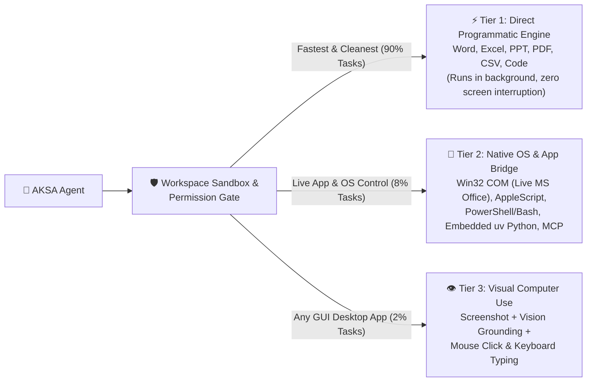

# 03 — PC Automation, Office Engine & Workspace Sandbox Specification

## 1. Core Philosophy: Working on the PC Like a Human (and Better)

To fulfill the goal of an agent that **"works directly inside selected PC folders and can create or operate anything installed on the PC (such as Microsoft Office or other applications) like a human"**, AKSA implements a **3-Tier PC Execution Engine** guarded by a strict **Workspace Sandbox**.



---

## 2. Workspace Sandbox & Permission Gate (`sandbox.py`)

Before any tool interacts with the PC, it passes through the `SandboxManager`.

### 2.1 Folder-Scoped Access Control
- **Authorized Workspace Folders (`allowed_paths`):**
  - The user selects one or more folders via the GUI (e.g., `D:\Kerjaan\Laporan_Bulanan`).
  - Each workspace folder has configurable permissions:
    - `read`: Read files, index into RAG, inspect spreadsheets/documents.
    - `write`: Create new files, edit existing files (with automatic backup copy `.aksa_backup/` before overwriting).
    - `execute`: Run scripts or shell commands with the working directory locked to this folder.
- **Strict Path Jail:**
  - Every file path argument is resolved via `Path(target).resolve()` and checked with `resolved_path.is_relative_to(allowed_workspace_path)`.
  - Any attempt to access paths outside the authorized workspace (e.g., `C:\Windows` or `~/.ssh`) is automatically blocked unless explicitly elevated by the user.

### 2.2 Human-in-the-Loop (HITL) Approval Levels
Every tool action is classified into one of three risk tiers:

| Risk Level | Examples | Behavior |
| :--- | :--- | :--- |
| **🟢 Low (Auto-Allow)** | Reading files in workspace, searching RAG, creating a new `.docx`/`.xlsx`/`.pptx` file in workspace. | Executes immediately without interrupting the user. |
| **🟡 Medium (Configurable / Auto-Backup)** | Overwriting an existing file in workspace, installing a Python package via `uv`, opening an app via COM/AppleScript. | Automatically creates a restore point in `.aksa_backup/` before modifying; optionally asks confirmation based on user preference. |
| **🔴 High (Mandatory HITL Approval)** | Deleting files, accessing paths outside the selected folder, running arbitrary shell commands, or activating Tier 3 Mouse/Keyboard control. | Pauses execution and pops up an **Approval Card** in the Desktop GUI **AND** sends an inline `[✅ Izinkan]` / `[❌ Tolak]` button to Telegram. |

---

## 3. Tier 1: Direct Programmatic File & Office Engine

For 90% of office and productivity tasks, manipulating files directly via specialized libraries is **100x faster, more accurate, and doesn't hijack the user's mouse or keyboard**.

### 3.1 Microsoft Excel Engine (`tools/office/excel_tools.py`)
Powered by `openpyxl`, `xlsxwriter`, and `pandas`:
- **`excel_inspect(file_path)`:** Lists sheets, dimensions, headers, data types, and sample rows.
- **`excel_create_workbook(file_path, sheets_spec)`:** Creates a professionally styled `.xlsx` workbook with:
  - Auto-fitted column widths, styled header rows (custom colors, bold fonts, borders), currency/date formatting (`Rp #,##0`).
  - **Dynamic Excel Formulas:** Writes real formulas (`=SUM(...)`, `=VLOOKUP(...)`, `=XLOOKUP(...)`, `=IF(...)`, `=AVERAGE(...)`) rather than static numbers so the spreadsheet remains interactive.
  - **Native Excel Charts:** Generates Bar, Line, and Pie charts embedded directly inside the worksheet.
- **`excel_modify_cells(file_path, sheet, edits)`:** Updates cells, appends rows, or adds new calculated columns while preserving existing formatting and macros.

### 3.2 Microsoft Word Engine (`tools/office/word_tools.py`)
Powered by `python-docx`:
- **`word_inspect(file_path)`:** Extracts document outline, headings, paragraphs, and tables.
- **`word_create_document(file_path, title, sections, style_preset)`:** Generates formatted `.docx` documents (Surat Resmi, Laporan Kerja, Proposal, SOP, Notulen Rapat) with:
  - Custom headers/footers, page numbering, cover pages, styled tables, bulleted/numbered lists, and embedded images/charts.
- **`word_fill_template(template_path, output_path, replacements)`:** Replaces placeholders (e.g., `{{nama_klien}}`, `{{tanggal}}`, `{{tabel_rincian}}`) inside an existing company Word template while keeping logos and kop surat intact!

### 3.3 Microsoft PowerPoint Engine (`tools/office/ppt_tools.py`)
Powered by `python-pptx`:
- **`ppt_create_presentation(file_path, title, slides_spec, theme)`:** Generates `.pptx` slide decks with title slides, bullet points, two-column comparisons, data tables, and chart slides.

### 3.4 PDF & Universal Document Engine (`tools/office/pdf_tools.py`)
Powered by `pymupdf` (`fitz`), `reportlab`, and `markitdown`:
- **`pdf_extract_markdown(file_path, pages)`:** Converts PDF pages (including tables) into clean Markdown.
- **`pdf_merge_or_split(input_paths, output_path, mode)`:** Combines or splits PDF documents.
- **`pdf_generate_report(file_path, markdown_content, css_theme)`:** Renders clean, printable PDF reports and invoices.

---

## 4. Tier 2: Native OS Bridge, Live App Control & Self-Extending Scripts

When the user wants AKSA to interact with **installed desktop applications** or perform custom tasks beyond standard tools:

### 4.1 Live Microsoft Office & Desktop App Control (`tools/os_bridge/`)
- **Windows (`pywin32` COM Automation & PowerShell):**
  - Can attach to an **already open instance** of Microsoft Excel, Word, or Outlook on the user's screen (`win32com.client.GetActiveObject("Excel.Application")`).
  - Can read the user's currently selected cells in Excel, insert formulas live in front of the user's eyes, or export a Word document to PDF using Microsoft Word's native renderer.
- **macOS (`osascript` / AppleScript & JXA):**
  - Controls Microsoft Office for Mac, Finder, Pages, Numbers, Keynote, Notes, Calendar, and Mail via AppleEvents.

### 4.2 Self-Extending Python Script Runner via `uv` (`tools/os_bridge/uv_runner.py`)
To ensure the agent can **create anything that can be done on a PC** (e.g., image editing, audio processing, barcode generation, web scraping, CAD/DXF generation, data visualization):
- The agent has a tool `run_custom_python_task(script_code, required_packages, working_dir)`.
- AKSA executes the script inside the workspace folder using the embedded **`uv`** runtime:
  ```bash
  uv run --isolated --with pillow --with matplotlib task_script.py
  ```
- This gives AKSA unlimited capabilities without requiring pre-built tools for every niche file format.

### 4.3 Model Context Protocol (MCP) Client (`tools/mcp/`)
- AKSA acts as a full **MCP Host/Client**, allowing users to toggle on any standard MCP server (Playwright Browser Automation, SQLite/PostgreSQL, Git, Google Drive, Notion, Figma) with one click.

---

## 5. Tier 3: Visual "Computer Use" Engine (Human-Like GUI Interaction)

For legacy or third-party desktop apps that have no API, CLI, or COM interface (e.g., local accounting software like Accurate/Zahir, desktop ERP, tax software e-Faktur, or graphic design tools):

### 5.1 How Visual Computer Use Works (`tools/computer_use/`)
1. **Capture & Inspect (`capture_screen_and_a11y`):**
   - Takes a high-speed screenshot via `mss` with a coordinate grid overlay.
   - Simultaneously queries the **OS Accessibility Tree** (Windows `uiautomation` / macOS `AXUIElement`) to get exact bounding boxes `(x, y, width, height)` of visible buttons, text inputs, and menus.
2. **Vision + Grounding Decision:**
   - The agent identifies the target UI element and outputs a structured action:
     - `click(x, y, button="left", double=False)`
     - `type_text(text, press_enter=True)`
     - `press_hotkey(["ctrl", "s"])`
     - `scroll(direction="down", amount=3)`
3. **Human-Like Execution & Safety:**
   - Smooth cursor movement (`pyautogui` / `pynput`) so the user can see what the agent is clicking.
   - **Floating Mini-HUD & Kill Switch:** Whenever Tier 3 Computer Use is active, a small floating pill appears on screen: *"🤖 AKSA sedang mengoperasikan layar — Tekan `ESC` atau `Ctrl+Shift+Q` untuk menghentikan seketika."*
   - Moving the physical mouse rapidly to any screen corner (`pyautogui.FAILSAFE = True`) immediately aborts GUI automation.

