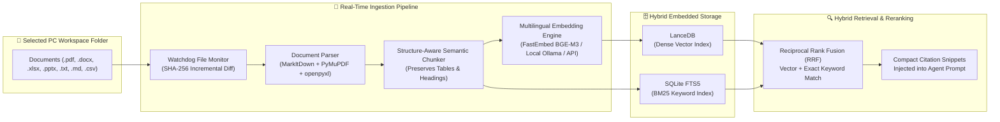

# 04 — Local RAG & Multi-Tier Memory System Specification

## 1. Overview: Zero-Config, Local-First Hybrid RAG

AKSA includes a built-in, zero-setup **Retrieval-Augmented Generation (RAG)** and **Agent Memory** engine designed specifically for Indonesian and multilingual office documents. Users do **not** need to install PostgreSQL, Qdrant, or Docker—everything runs locally as embedded files inside `<AppData>/aksa/data/`.

---

## 2. Why Hybrid Search (Vector + BM25) is Essential for Indonesian Users

Pure vector search often fails on exact Indonesian administrative data such as:
- Nomor Surat / Invoice (`INV/2026/XI/0042`, `SK-DIR/089/2026`)
- NIK, NPWP, kode barang, atau nama karyawan spesifik
- Nominal angka dan tanggal spesifik

By combining **LanceDB (Dense Vector Semantic Search)** with **SQLite FTS5 (BM25 Exact Keyword Search)** via **Reciprocal Rank Fusion (RRF)**, AKSA retrieves both conceptually relevant paragraphs and exact code/number matches with near-100% recall.

---

## 3. Real-Time Folder Watching & Incremental Indexing (`rag/watcher.py`)

1. **Automatic Workspace Synchronization:**
   - When a user enables **"Aktifkan Basis Pengetahuan (RAG)"** on a selected workspace folder, AKSA's `watchdog` service monitors file creations, modifications, and deletions in real time.
2. **Incremental Hash Check (Zero Redundant Indexing):**
   - For every supported file (`.pdf`, `.docx`, `.xlsx`, `.pptx`, `.csv`, `.txt`, `.md`), AKSA computes a fast `SHA-256` hash + `mtime`.
   - If the hash has not changed since the last index, the file is skipped.
   - If a file is modified, only that file's old chunks are deleted and re-indexed.
3. **Structure-Aware Chunking (`rag/ingest.py`):**
   - **Word & PDF:** Splits by headings (`#`, `##`, `###`) and paragraphs (target chunk size: `512 tokens`, overlap: `64 tokens`), keeping page numbers and section titles attached as metadata.
   - **Excel & CSV:** Converts tables into Markdown table blocks grouped by sheet name + row ranges (e.g., `Rows 1-50`) while always prepending the column header row to every chunk so the LLM never loses column context!

---

## 4. Embedding Model Options (Offline Local vs Cloud)

Users can select their preferred embedding engine in **Pengaturan $\rightarrow$ Basis Pengetahuan**:

| Mode | Model Name | Dimensions | Pros |
| :--- | :--- | :--- | :--- |
| **Default (Local CPU/ONNX)** | `BAAI/bge-m3` or `intfloat/multilingual-e5-small` via `fastembed` | 384 / 1024 | Runs 100% offline on CPU without GPU, zero API cost, excellent Bahasa Indonesia understanding. |
| **Local Ollama** | `nomic-embed-text` or `bge-m3` via Ollama | 768 / 1024 | Uses local GPU acceleration if Ollama is installed. |
| **Cloud API** | `text-embedding-3-small` (OpenAI) / `gemini-embedding-001` | 1536 / 768 | Fastest for low-spec laptops when internet is available. |

---

## 5. Multi-Tier Agent Memory System

Inspired by **Hermes Agent**, AKSA agents don't forget user preferences across sessions. Memory is divided into three clean tiers:

1. **Tier 1: Working Memory (Active Session Context)**
   - Lives in RAM and SQLite `messages` for the current task. Automatically compacted when exceeding token limits.
2. **Tier 2: Workspace Project Memory (`.aksa/MEMORY.md` inside Workspace Folder)**
   - Each workspace folder can have an auto-maintained project summary (e.g., company formatting standards, preferred currency format `Rp`, standard kop surat template filename).
3. **Tier 3: Long-Term User Episodic Memory (SQLite + LanceDB `user_memories` table)**
   - Stores persistent facts learned about the user across all workspaces (e.g., *"Nama user adalah Budi, menjabat sebagai Manajer Operasional PT Maju Jaya, lebih suka laporan ringkas dengan tabel"*).
   - Agents can call `remember_fact(fact, category)` and `recall_memories(query)` automatically.

