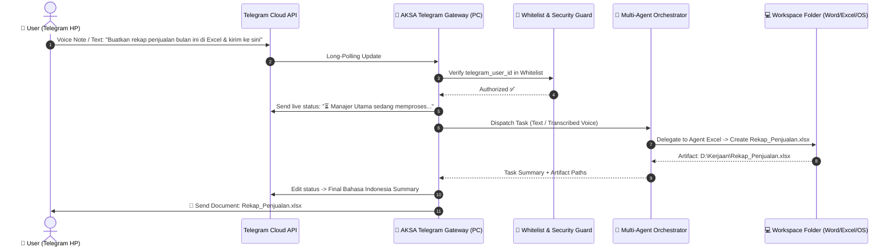

# 05 — Telegram Remote Command Center Specification

## 1. Overview: Control Your PC Agents from Anywhere

AKSA integrates a built-in **Telegram Gateway** (`services/engine/app/telegram/`) that turns the user's Telegram app on their phone into a secure remote control for the AKSA agents running on their PC.

- **Zero Server / Zero Port-Forwarding Required:** Uses outbound HTTPS **Long-Polling (`aiogram` v3)**. As long as the PC is on and connected to the internet, the bot works behind any home/office NAT or firewall.
- **Full Parity with Desktop GUI:** Anything the user can ask in the Desktop GUI (creating Excel/Word files, searching RAG documents, running multi-agent workflows, capturing desktop screenshots) can be triggered from Telegram.



---

## 2. Security & Authentication Architecture (`telegram/auth.py`)

Because AKSA has access to local PC folders and applications, **strict authentication is mandatory**:

1. **Strict Numeric Telegram User ID Whitelist:**
   - Every incoming message, voice note, or callback button click checks `message.from_user.id` against the encrypted `allowed_telegram_user_ids` list in SQLite.
   - Messages from unknown Telegram users are **silently ignored and logged** in the Desktop Security Log (never processed by the LLM).
2. **Easy 1-Click Pairing Flow (For Non-Technical Indonesian Users):**
   - Users don't even need to manually look up their Telegram User ID if they don't want to:
     1. User pastes their `@BotFather` token in AKSA Desktop GUI and clicks **"Mulai Hubungkan"**.
     2. AKSA displays a temporary 6-digit pairing code on the PC screen (e.g., `/pair 849201`).
     3. User sends `/pair 849201` from their Telegram account to the bot.
     4. AKSA automatically captures their numeric `user_id`, locks the whitelist to that account, and disables pairing mode!

---

## 3. Core Telegram Capabilities & UX

### 3.1 Live Streaming Progress Updates
Instead of leaving the user waiting in silence for 30 seconds while sub-agents work:
- AKSA immediately replies with a status message and edits it dynamically (throttled every 2.5 seconds to respect Telegram API limits):
  > 🔄 **AKSA Sedang Bekerja...**
  > - ✅ **Manajer Utama:** Menyusun rencana tugas
  > - ✅ **Agen Riset (RAG):** Membaca `Data_Mentah_Nov.csv`
  > - ⏳ **Spesialis Excel:** Sedang membuat grafik di `Laporan_Final.xlsx`...

### 3.2 Two-Way File & Media Exchange
- **PC $\rightarrow$ Telegram (Auto-Send Artifacts):**
  - Whenever an agent creates or modifies a file (`.docx`, `.xlsx`, `.pptx`, `.pdf`, `.png`, `.zip`) during a Telegram-initiated task, the bot automatically uploads and sends the file directly to the user's Telegram chat!
- **Telegram $\rightarrow$ PC (Save to Active Workspace):**
  - When the user sends a document or photo from their phone to the Telegram bot with a caption (e.g., *"Simpan file PDF ini ke folder kerja dan buatkan ringkasannya"*), AKSA downloads the file into the active PC workspace folder (`D:\Kerjaan\Inbox_Telegram\`), indexes it into RAG, and executes the instruction.

### 3.3 Indonesian Voice Note Support
- Users can hold the microphone button in Telegram and speak naturally in Bahasa Indonesia.
- AKSA downloads the `.ogg` voice note, converts it to text using either:
  - **Local Whisper (`faster-whisper` tiny/small)** for 100% offline privacy, or
  - **Groq Whisper / OpenAI Audio API** for instant transcription.
- Replies with the recognized transcript (`🎙️ Pesan Suara: "..."`) and immediately executes the command.

### 3.4 Remote Human-in-the-Loop (HITL) Approval Buttons
When an agent needs permission for a High-Risk action (e.g., deleting old files or running an external app), AKSA sends an interactive message to Telegram with inline buttons:
```text
⚠️ Permintaan Izin Akses (AKSA Security)
Agen "Operator PC" meminta izin untuk menjalankan aksi berikut:
• Aksi: Menghapus 3 file duplikat di D:\Kerjaan\Temp
• Tingkat Risiko: Tinggi

[ ✅ Izinkan Sekali ]   [ ❌ Tolak Aksi ]
```

---

## 4. Built-in Telegram Slash Commands (Bahasa Indonesia)

| Command | Description |
| :--- | :--- |
| `/start` | Menampilkan status koneksi PC, folder kerja aktif, dan tim agent yang aktif. |
| `/folder` | Menampilkan daftar folder kerja yang diizinkan dan mengganti folder aktif via tombol inline. |
| `/tim` | Memilih tim/hirarki agent mana yang ingin digunakan untuk chat saat ini. |
| `/layar` | Mengambil screenshot layar PC saat ini dan mengirimkannya ke chat Telegram. |
| `/status` | Mengecek penggunaan CPU/RAM PC, status Ollama lokal, dan pemakaian token hari ini. |
| `/berhenti` | Menghentikan paksa (*emergency stop*) semua proses agent yang sedang berjalan di PC. |

