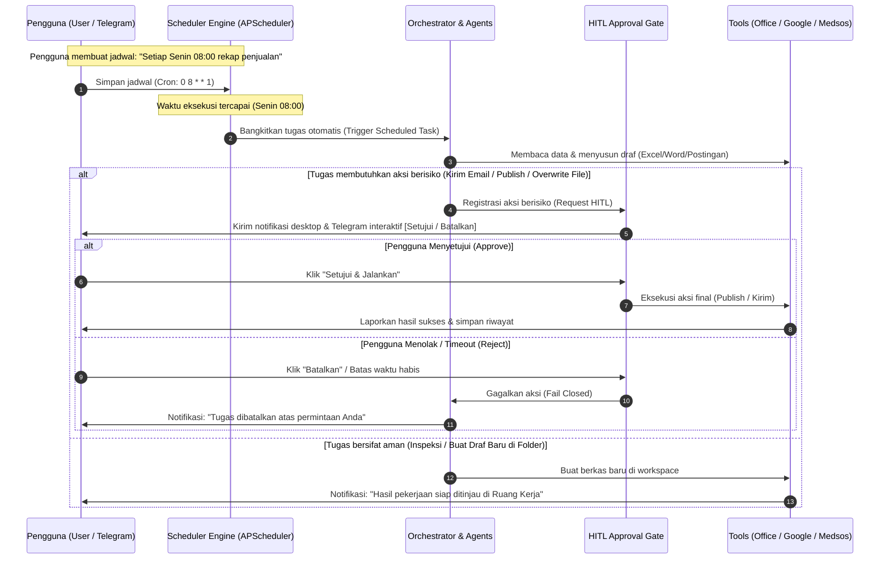

# PRD — AKSA Virtual Office, Autonomous Scheduler & Ecosystem Connectors

**Document Version:** 1.0.0  
**Target Application Version:** AKSA v0.1.0+ (Phased Rollout)  
**Status:** Approved Architectural Specification  
**Author:** AKSA Architecture Team & AI Agent System  
**Last Updated:** 20 November 2026  

---

## 1. Executive Summary & Objectives

AKSA telah membuktikan kapabilitasnya sebagai asisten kerja otonom lokal berbasis *hierarchical multi-agent* dengan kemampuan inspeksi ruang kerja mendalam, pembuatan dokumen Office berstandar korporat (Word, Excel, PowerPoint, PDF), dan integrasi Telegram.

Untuk mentransformasikan AKSA dari sekadar "alat bantu percakapan kerja" menjadi **"Digital Headquarters & Autonomous Co-Worker"**, diperlukan tiga pilar ekspansi strategis:

```text
┌─────────────────────────────────────────────────────────────────────────────┐
│                       AKSA DIGITAL HEADQUARTERS                             │
├─────────────────────────┬─────────────────────────┬─────────────────────────┤
│    PILAR 1: VISUAL      │    PILAR 2: TEMPORAL    │   PILAR 3: EKOSISTEM    │
│  Virtual Office Canvas  │  Autonomous Scheduler   │ Connectors: Google &    │
│   (Simulasi Kantor)     │     & HITL Recurring    │      Social Media       │
├─────────────────────────┼─────────────────────────┼─────────────────────────┤
│ Representasi visual 2D  │ Eksekusi tugas berkala  │ Integrasi Google Drive, │
│ kantor; agen terlihat   │ otomatis (Cron/natural) │ Docs, Sheets, Calendar, │
│ bekerja, istirahat,     │ dengan proteksi Human-  │ Gmail + posting/reply   │
│ berdiskusi, & alerting. │ in-the-Loop lintas alat.│ LinkedIn, X, Meta.      │
└─────────────────────────┴─────────────────────────┴─────────────────────────┘
```

### Sasaran Utama (Key Objectives)
1. **Humanizing AI Experience (Pilar 1):** Memberikan transparansi visual interaktif yang menyenangkan (*delightful & intuitive*) mengenai siapa agen yang sedang bekerja, tugas apa yang sedang diproses, dan kapan agen membutuhkan bantuan manusia.
2. **True Autonomy with Safety (Pilar 2):** Memungkinkan pengguna mendelegasikan tugas rutin ("setiap hari Senin jam 8 pagi buatkan rekapitulasi data penjualan") tanpa perlu membuka antarmuka obrolan manual, dengan jaminan **Human-in-the-Loop (HITL)** pada aksi berisiko tinggi.
3. **Omni-Channel Operations (Pilar 3):** Menghubungkan AKSA dengan komputasi awan harian pengguna (Google Workspace) dan corong publikasi digital (Media Sosial) tanpa mengorbankan sandboxing lokal dan privasi data.

---

## 2. Pilar 1: Virtual Office Canvas (Simulasi Visual Kantor AKSA)

### 2.1 Konsep & Nilai Pengguna (User Value)
Saat ini menu **Tim AI** menggunakan diagram node React Flow (`@xyflow/react`). Meskipun fungsional untuk keperluan teknis, diagram ini kurang memberikan nuansa emosional dan intuisi langsung mengenai status tim kerja secara riil.

Tampilan **Virtual Office** menyajikan denah kantor modern bergaya isometrik / 2.5D minimalis (senada dengan palet *Obsidian Slate Dark* dan *Warm Paper Light*), di mana setiap agen digambarkan sebagai karakter visual yang memiliki meja kerja, perangkat kerja, dan aktivitas dinamis.

### 2.2 Status & Animasi Agen (Agent States)
Setiap agen di ruang kantor memiliki status yang disinkronkan secara *real-time* via WebSocket engine:

| Status Agen | Representasi Visual Kantor | Pemicu (Trigger) |
| :--- | :--- | :--- |
| **Idle / Siaga** | Duduk santai, membaca dokumen, menikmati kopi/minuman, animasi napas halus (*subtle breathing*). | Tidak ada tugas aktif yang didelegasikan ke agen tersebut. |
| **Working / Mengetik** | Duduk tegak di depan monitor, lampu meja menyala, efek ketukan keyboard, balon pikiran (*thought bubble*) menampilkan cuplikan tugas yang sedang berjalan (cth: *"Menganalisis kk.xlsx..."*). | Orchestrator sedang mengeksekusi *sub-agent tool loop* atau LLM generation. |
| **Collaborating / Rapat** | Karakter berpindah atau berkumpul di Meja Diskusi / Ruang Rapat bersama Supervisor saat terjadi delegasi bertingkat. | Supervisor mengeksekusi `delegate_to_agent` ke lebih dari satu agen secara paralel. |
| **Waiting HITL / Meminta Izin** | Karakter berdiri, melambaikan tangan, atau muncul ikon lonceng/peringatan kuning di atas kepala. | Sandboxed tool memicu `request_user_approval` (misal menulis di luar workspace atau mengirim postingan). |
| **Error / Terkendala** | Karakter terdiam dengan ikon seru merah kecil; meja memiliki tanda peringatan halus. | API model kehabisan kuota atau tool runtime exception. |

### 2.3 Arsitektur Teknis Antarmuka
- **Renderer:** Vektor SVG interaktif + HTML5 Canvas yang dianimasikan menggunakan `framer-motion` dan Tailwind CSS v4. Menjaga performa tetap 60fps tanpa memberatkan memori GPU Tauri v2.
- **Toggle View:** Pengguna dapat berpindah kapan saja melalui segmented control di header:
  `[ Kantor Virtual ]  |  [ Diagram Hirarki ]  |  [ Daftar Tim ]`
- **Interaksi Meja:**
  - Klik pada meja agen: Membuka *Agent Slide-Over Inspector* (mengedit persona, mengganti model LLM, melihat keahlian, dan log aktivitas terakhir).
  - Drag & Drop: Pengguna dapat memindahkan posisi meja agen antar ruangan (misal: Ruang Analis Data, Meja Resepsionis, Ruang Manajemen).
  - Audio Ambience Opsional: Suara ketikan halus (*lo-fi mechanical keyboard*) dan *chime* saat pekerjaan selesai (dapat dinonaktifkan di Pengaturan).

---

## 3. Pilar 2: Autonomous Scheduler & Recurring Tasks Engine

### 3.1 Konsep & Nilai Pengguna
Pengguna kantor sering memiliki tugas repetitif yang harus dieksekusi secara berkala (harian, mingguan, bulanan). Fitur ini memberikan kemampuan otomasi mandiri pada AKSA untuk mengeksekusi tugas tanpa intervensi manual di jam yang telah ditentukan, sambil mempertahankan kontrol penuh melalui **Gerbang Konfirmasi (HITL)**.

### 3.2 Diagram Alur Penjadwalan & Konfirmasi (HITL)



### 3.3 Skema Basis Data SQLite (`scheduled_jobs`)

```sql
CREATE TABLE IF NOT EXISTS scheduled_jobs (
    id TEXT PRIMARY KEY,
    name TEXT NOT NULL,
    description TEXT,
    cron_expr TEXT,                -- Format standar: "0 8 * * 1"
    interval_seconds INTEGER,      -- Alternatif interval (cth: setiap 3600 detik)
    natural_language_desc TEXT,    -- Cth: "Setiap hari Senin jam 08:00"
    target_agent_id TEXT NOT NULL, -- Agen penanggung jawab utama
    workspace_id TEXT NOT NULL,    -- Workspace folder yang ditargetkan
    prompt_template TEXT NOT NULL, -- Perintah kerja untuk agen
    risk_level TEXT NOT NULL,      -- "safe" (auto-run) | "high" (wajib HITL)
    status TEXT NOT NULL,          -- "active" | "paused" | "completed"
    last_run_at TEXT,
    next_run_at TEXT NOT NULL,
    created_at TEXT NOT NULL,
    updated_at TEXT NOT NULL,
    FOREIGN KEY (target_agent_id) REFERENCES agents(id),
    FOREIGN KEY (workspace_id) REFERENCES workspaces(id)
);

CREATE TABLE IF NOT EXISTS scheduled_job_logs (
    id TEXT PRIMARY KEY,
    job_id TEXT NOT NULL,
    triggered_at TEXT NOT NULL,
    completed_at TEXT,
    status TEXT NOT NULL,          -- "running" | "waiting_approval" | "success" | "rejected" | "failed"
    summary TEXT,
    artifacts_generated TEXT,      -- JSON array file paths
    hitl_approved_by TEXT,         -- "desktop_ui" | "telegram" | null
    error_message TEXT,
    FOREIGN KEY (job_id) REFERENCES scheduled_jobs(id)
);
```

### 3.4 Antarmuka Pengguna Scheduler
- **Lokasi Menu:** Ditambahkan sebagai sub-fitur di `Ruang Kerja` dan menu navigasi samping: **Jadwal & Rutinitas**.
- **Pembuat Jadwal Berbasis Bahasa Alami:** Input sederhana: *"Ketik perintah rutin (misal: 'Setiap Jumat jam 16:30 buatkan ringkasan progres mingguan format PPT')"*. AI otomatis mengonversi kalimat menjadi ekspresi Cron standar dan menentukan agen yang tepat.
- **Tabel Monitoring:** Menampilkan status jadwal, waktu eksekusi berikutnya, tombol jeda (*pause*), dan riwayat eksekusi.

---

## 4. Pilar 3: Konektor Ekosistem (Google Workspace & Media Sosial)

### 4.1 Arsitektur Keamanan Kredensial & Autentikasi
Kredensial pihak ketiga (OAuth tokens, API keys) diperlakukan dengan standar isolasi tingkat tinggi:
- **Penyimpanan:** Kredensial tidak disimpan dalam teks biasa (*plain text*), melainkan disimpan terenkripsi menggunakan modul OS Keyring bawaan (Windows Credential Manager / macOS Keychain) melalui abstraction layer `services/engine/app/config.py`.
- **OAuth Desktop Loopback:** Alur autentikasi Google menggunakan OAuth 2.0 PKCE standar aplikasi desktop via *local loopback redirect* (`http://127.0.0.1:<random-port>/oauth/callback`).

---

### 4.2 Sub-Pilar 3A: Konektor Google Workspace

```text
┌─────────────────────────────────────────────────────────────────────────────┐
│                       GOOGLE WORKSPACE CONNECTOR                            │
├────────────────────┬────────────────────┬──────────────────┬────────────────┤
│    GOOGLE DRIVE    │   GOOGLE SHEETS    │ GOOGLE CALENDAR  │     GMAIL      │
├────────────────────┼────────────────────┼──────────────────┼────────────────┤
│ • Cari berkas      │ • Baca range sel   │ • Baca agenda    │ • Cari email   │
│ • Unduh ke lokal   │ • Tulis data baru  │ • Buat jadwal    │ • Buat draf    │
│ • Ekspor DOCX/PDF  │ • Sinkronisasi FTS │ • Cek tabrakan   │ • Kirim email  │
│   ke Drive         │   tabel Excel lokal│   jadwal         │   (Wajib HITL) │
└────────────────────┴────────────────────┴──────────────────┴────────────────┘
```

#### Spesifikasi Tool Google Workspace:
1. `google_drive_search(query: str, mime_type: str | None)`: Mencari berkas di Drive pengguna.
2. `google_drive_download(file_id: str, local_destination_path: str)`: Mengunduh berkas ke *workspace sandbox* lokal.
3. `google_drive_upload(local_file_path: str, drive_folder_id: str | None)`: Mengunggah berkas hasil kerja (Office/PDF) ke Drive.
4. `google_sheets_read_range(spreadsheet_id: str, range: str)`: Mengambil data tabel dari Google Sheets untuk dianalisis lokal.
5. `google_sheets_append_rows(spreadsheet_id: str, sheet_name: str, rows: list[list[Any]])`: Menambahkan data rekap ke Sheet aktif.
6. `google_calendar_list_events(start_date: str, end_date: str)`: Membaca agenda kegiatan pengguna.
7. `google_calendar_create_event(title: str, start_time: str, end_time: str, attendees: list[str])`: Menjadwalkan rapat / pengingat.
8. `gmail_draft_or_send(to: list[str], subject: str, body_html: str, attachments: list[str], auto_send: bool = False)`: Membuat draf email atau mengirim email secara aman dengan **HITL Approval Modal**.

---

### 4.3 Sub-Pilar 3B: Konektor Media Sosial & Komunitas

#### Target Platform:
- **LinkedIn:** Publikasi postingan profesional korporat / personal branding, membaca impresi.
- **X (Twitter):** Publikasi cuitan (*single tweet* / *thread*), membaca mention, balasan interaktif.
- **Meta (Instagram & Facebook Pages):** Publikasi konten carousel / feed, membaca komentar postingan.

#### Agen Khusus: "Spesialis Komunikasi & Media Sosial"
AKSA menyediakan template agen baru pada tim default:
- **Nama Persona:** *Spesialis Komunikasi & Media Sosial* (Rani).
- **Peran:** Menganalisis dokumen ruang kerja (laporan, berita kegiatan, peluncuran produk) dan merumuskannya menjadi materi publikasi media sosial yang menarik, sopan, dan relevan.

#### Kebijakan Keamanan Mutlak (Zero Unapproved Posting Rule):
> [!CAUTION]
> **Kebijakan Publikasi Publik (Zero Unapproved Post):**
> Agen AKSA **DILARANG KERAS** memublikasikan postingan, cuitan, atau balasan komentar langsung ke akun publik pengguna tanpa kartu persetujuan visual (**Social Media HITL Approval Card**). Pengguna harus melihat *live preview* postingan (teks, tautan, lampiran gambar) dan menekan tombol **"Setujui & Publikasikan"**.

#### Spesifikasi Tool Media Sosial:
1. `social_draft_post(platform: str, content: str, media_paths: list[str], scheduled_time: str | None)`: Membuat kartu draf publikasi untuk ditinjau pengguna.
2. `social_publish_approved(draft_id: str, approval_token: str)`: Mengeksekusi penerbitan konten ke platform target setelah disetujui pengguna.
3. `social_fetch_interactions(platform: str, filter_type: str = "mentions_and_comments")`: Membaca interaksi atau respons terbaru dari audiens.
4. `social_draft_reply(interaction_id: str, proposed_reply: str)`: Menyusun rekomendasi draf balasan komentar yang ramah dan profesional.

---

## 5. Kebutuhan Non-Fungsional (Non-Functional Requirements)

1. **Efisiensi Token & Biaya:**
   - Data riwayat komentar sosial media atau isi Google Drive tidak boleh di-*dump* mentah ke dalam prompt LLM.
   - Peringkasan berbasis chunking dan lazy loading wajib digunakan sebelum data diserahkan ke agen supervisor.
2. **Kemandirian Lokal (Offline First Resilience):**
   - Jika koneksi internet ke Google atau Medsos terputus, sistem scheduler tetap berjalan untuk tugas-tugas lokal PC dan Office.
   - Tugas eksternal yang gagal terhubung otomatis masuk ke status *retry queue* dengan *exponential backoff*.
3. **Kompatibilitas Lintas Sistem Operasi (macOS & Windows):**
   - Sistem notifikasi desktop menggunakan pustaka native Tauri v2 (`@tauri-apps/plugin-notification`).
   - Penjadwalan lokal menggunakan scheduler Python asinkron (`APScheduler`) yang berjalan di dalam sidecar engine, independen dari OS Task Scheduler / Cron daemon.
4. **Desain & Glosarium Bahasa Indonesia:**
   - Seluruh label visual, kartu status kantor virtual, kartu persetujuan media sosial, dan dialog penjadwalan wajib menggunakan Bahasa Indonesia yang baku dan elegan sesuai [`docs/06-UI-UX-DESIGN-SYSTEM.md`](./06-UI-UX-DESIGN-SYSTEM.md).

---

## 6. Rencana Implementasi Bertahap (Phased Roadmap)

```text
Phase 38: Autonomous Scheduler Engine & Multi-Channel HITL Gate
├── 38.1 Backend APScheduler engine + SQLite tables (scheduled_jobs, scheduled_job_logs)
├── 38.2 REST & WebSocket endpoints (/api/v1/schedules/*)
├── 38.3 Natural language cron parser & recurrence rule manager
├── 38.4 Desktop Notification & Telegram HITL interactive approval integration
└── 38.5 Frontend UI: Menu "Jadwal & Rutinitas" + formulir pembuatan tugas berkala

Phase 39: Google Workspace Ecosystem Connector
├── 39.1 OAuth 2.0 PKCE loopback authentication flow + OS Keyring credential storage
├── 39.2 Google Drive & Docs tools (search, download, upload export)
├── 39.3 Google Sheets bidirectional sync tool (range read & row append)
├── 39.4 Google Calendar agenda reader & event scheduler tool
└── 39.5 Gmail draft & guarded email sender tool with HITL approval modal

Phase 40: Social Media Connector & Community Management
├── 40.1 Multi-platform credential manager (LinkedIn, X API, Meta Graph)
├── 40.2 Social Media Specialist agent seed template (Bahasa Indonesia persona)
├── 40.3 Interactive Social Media Post Preview Card component in desktop UI
├── 40.4 Post drafting, scheduled publishing, and comment monitoring tools
└── 40.5 Telegram remote approval integration for mobile post publishing

Phase 41: AKSA Virtual Office Experience (Visual Agent Canvas)
├── 41.1 2.5D Isometric office canvas architecture (Vector SVG + Canvas + Framer Motion)
├── 41.2 Character sprite generator & state animator (Idle, Typing, Meeting, Alerting)
├── 41.3 Real-time WebSocket bridge connecting agent orchestrator steps to office avatars
├── 41.4 Interactive desk inspector & customizable office room layout
└── 41.5 Seamless view toggle between Virtual Office, Flow Hierarchy, and List View
```

---

## 7. Kriteria Penerimaan (Acceptance Criteria)

- [ ] **AC-1 (Virtual Office):** Pengguna dapat melihat denah kantor dengan karakter agen yang bergerak dinamis sesuai status pekerjaan nyata (mengetik saat bekerja, rileks saat idle, melambaikan tangan saat butuh izin HITL).
- [ ] **AC-2 (Scheduler):** Pengguna dapat membuat jadwal berkala menggunakan bahasa alami; tugas berhasil dieksekusi otomatis pada jam yang ditentukan tanpa memerlukan obrolan manual.
- [ ] **AC-3 (Scheduler HITL):** Tugas terjadwal yang berkategori risiko tinggi (misal: kirim email / publikasi medsos) berhenti dan menunggu persetujuan eksplisit melalui notifikasi desktop atau Telegram sebelum mengeksekusi aksi final.
- [ ] **AC-4 (Google Workspace):** Pengguna dapat login via Google OAuth, mengekspor laporan Word/Excel lokal langsung ke Google Drive/Docs/Sheets, dan menjadwalkan agenda di Google Calendar.
- [ ] **AC-5 (Social Media):** Agen Spesialis Medsos dapat menyusun draf postingan LinkedIn / X dari dokumen kerja lokal, menampilkan pratinjau kartu media sosial di desktop, dan memublikasikan postingan hanya setelah tombol persetujuan ditekan.
- [ ] **AC-6 (No Emojis & Clean UI):** Seluruh visual antarmuka baru menggunakan ikon vektor dinamis `lucide-react`, palet tema resmi, dan bebas dari emoji Unicode statis.

